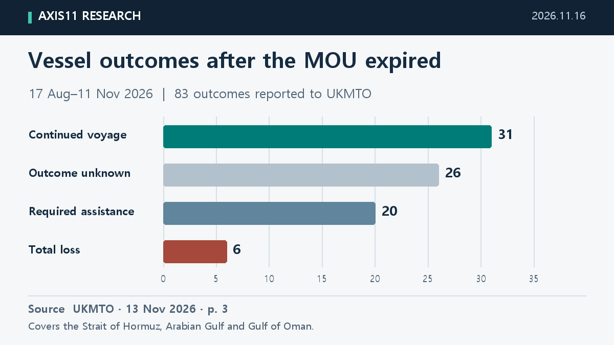
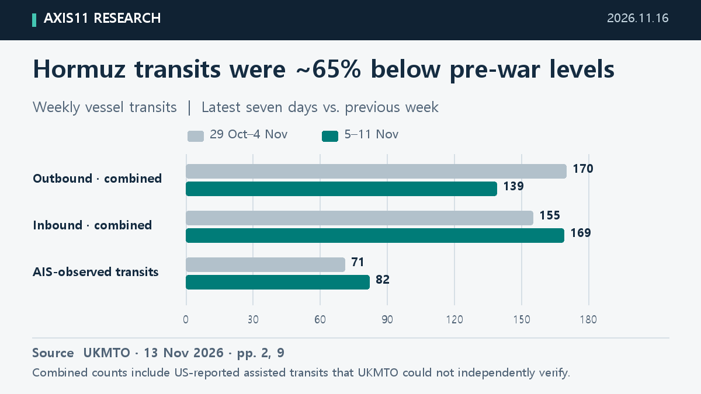
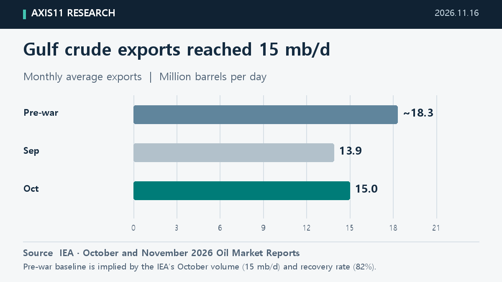

*What the shipping records confirm, and what the oil flows tell us*

Iran has repeatedly claimed that ships struck mines in or near the Strait of Hormuz. The claims in the public record date back at least to 31 August, after the 17 August US–Iran memorandum of understanding. For the oil market, the concern is tangible: serious damage to a loaded tanker could disrupt shipments and spill crude.

Gulf crude exports nevertheless recovered. The International Energy Agency (IEA) puts October exports at **15 million barrels a day**, or **82% of the pre-war level**. Two questions follow: how much of the reported damage can be verified, and how have exporters kept oil moving with far fewer vessels transiting the strait? [Kpler on the 60 days since the MOU](https://www.kpler.com/blog/60-days-of-a-broken-us-iran-mou-the-market-stopped-waiting-for-hormuz) · [IEA November report](https://www.iea.org/reports/oil-market-report-november-2026) · [UKMTO, 13 November](https://www.ukmto.org/-/media/ukmto/products/20261113-ukmto_vra_overview_u.pdf)

## What the incident reports confirm

Iran’s Islamic Revolutionary Guard Corps has repeatedly described ships striking mines after using routes it had not authorised. Public reports document vessel damage in the region. Matching an incident to a specific Iranian claim requires two further pieces of evidence: **which vessel was hit and what caused the damage**. In the cases below, that evidence is often missing.

| Date announced | Iran's account | Independent reporting and official responses |
|---|---|---|
| 31 August | A VLCC struck two mines and caught fire | US Central Command denied Iran's claim. [gCaptain](https://gcaptain.com/iran-claims-more-tankers-hit-mines-in-hormuz-but-evidence-remains-elusive/) |
| 30 October | Four tankers struck mines and caught fire | Omani authorities said they evacuated 25 crew from a separately stricken tanker, but whether that ship is among the four Iran announced is not confirmed. [AP](https://apnews.com/article/7f7f34ceb62f294a450e48ace0bd56e0) |
| 4 November | Four tankers struck mines and were destroyed | UKMTO recorded one tanker hit by an unidentified projectile the day before. The identities and damage of Iran's four are not confirmed. [Reuters](https://new.streetinsider.com/Reuters/Iran%27s%2BIRGC%2Bsays%2Bfour%2Btankers%2Bablaze%2Bafter%2Bhitting%2Bmines%2Bnear%2BStrait%2Bof%2BHormuz/27284158.html) · [UKMTO](https://www.ukmto.org/-/media/ukmto/products/20261106-ukmto_vra_overview_u.pdf) |
| 13–14 November | An explosion on an LPG carrier and fires on three tankers, each announced as a mine strike | The cited reports do not confirm the identity of the damaged vessels. [AP, 13 Nov](https://apnews.com/article/5d73a23b5b8647d2515c35b267b36c08) · [AP, 14 Nov](https://apnews.com/article/ade76bebaf22135168aac6eb3016bc19) |

United Kingdom Maritime Trade Operations (UKMTO) recorded 83 attacks on vessels in the Strait of Hormuz and nearby waters from 17 August to 11 November. **Six were recorded as total losses.** Of the rest, 31 continued their voyage, 20 required assistance such as towing or rescue, and 26 had an unknown outcome. The confirmed total losses account for about 7% of the cases; unresolved outcomes could raise that share. The tally covers attacks generally and does not identify the six losses as mine strikes. [UKMTO](https://www.ukmto.org/-/media/ukmto/products/20261113-ukmto_vra_overview_u.pdf#page=3)

*Outcomes of the 83 incidents recorded by UKMTO from 17 August to 11 November. Six were total losses.*

Of the eight incidents UKMTO reported for 5–11 November, **none was confirmed as a mine strike and none was recorded as a sinking.** The weekly summary lists four vessels hit by unidentified projectiles, one explosion near the waterline and three others. By outcome, three continued their voyage, three required assistance and two were unresolved. [UKMTO, pp. 3 and 7](https://www.ukmto.org/-/media/ukmto/products/20261113-ukmto_vra_overview_u.pdf#page=7) · [Individual warning 202-26](https://www.ukmto.org/-/media/ukmto/products/20261111-ukmto_warning_202_26_update-001.pdf)

The Joint Maritime Information Centre (JMIC) said on 15 November that it had confirmed no attacks or transit disruptions inside the strait in the previous 72 hours. That update covers a short window and a specific area. It does not resolve earlier claims or incidents in nearby waters. The public material reviewed did not establish both a vessel’s identity and its sinking for any of the specific Iranian claims in the table. [JMIC update, 15 November](https://www.ukmto.org/-/media/ukmto/products/update-114_jmic_advisory_15-nov.pdf?rev=be65cfbd755a41c4816feba6cef4401c)

## Transits are 65% below pre-war levels, while crude exports recover

In the week to 11 November, **139** vessels transited out of Hormuz and **169** transited in. The combined 308 is below the previous week's 325 (170 outbound, 155 inbound) and about **65% below the pre-war level**. Over the same period, transits observed through the Automatic Identification System (AIS) rose from 71 to 82. The combined counts include assisted transits reported by the United States, which UKMTO says it cannot independently verify. [UKMTO, pp. 2 and 9](https://www.ukmto.org/-/media/ukmto/products/20261113-ukmto_vra_overview_u.pdf#page=2)

*Weekly outbound and inbound transits through Hormuz against AIS-observed transits. The combined count fell while AIS-observed transits rose.*

Transit counts include different vessel types and movements in both directions. Export volumes show how much crude actually left the region. The IEA estimates Gulf crude exports rose from **13.9 million barrels a day in September to 15.0 million in October**. October’s recovery rate of 82% implies a pre-war level of about **18.3 million barrels a day**. A comparable November monthly figure is not yet available. [IEA October report](https://www.iea.org/reports/oil-market-report-october-2026) · [IEA November report](https://www.iea.org/reports/oil-market-report-november-2026)

The recovery in Gulf exports changed the global balance as well. According to the IEA, **world oil supply exceeded demand in October for the first time since the Iran war began.** With Gulf exports recovering faster than demand, world supply rose by 2.3 million barrels a day on the month to 105.4 million, and observed inventories rose by 52 million barrels over the month. The IEA expects supply to exceed demand for the fourth quarter as a whole. [IEA November report](https://www.iea.org/reports/oil-market-report-november-2026)

*Gulf crude exports. October's 15.0 million barrels a day is 82% of the pre-war level.*

Kpler’s separate estimate helps explain the gap between transits and exports. From 1 to 28 September, it tracked at least **16.5 million barrels a day** leaving the Middle East Gulf region excluding Iran. Of that, **9.9 million barrels a day (60%)** passed through Hormuz; the Gulf of Oman coast accounted for 23% and the Red Sea for 17%. Some crude that crossed the strait was later transferred to other tankers. These figures cover a different period and geographic scope from the IEA series. They show why regional exports can recover faster than traffic through the strait. [Kpler on September volumes and routes](https://www.kpler.com/blog/explainer-how-mideast-gulf-crude-exports-returned-to-pre-war-levels)

## Falling freight rates gave Asian refiners more options

In October, the cost of chartering a very large crude carrier (VLCC) from the US Gulf to China reached **$80 million** at one point. The higher cost of US barrels pushed Asian refiners to look at Middle Eastern alternatives such as the UAE’s Murban crude. ADNOC and Saudi Aramco also sold crude to Asia on a delivered basis, taking on the freight cost themselves. [Reuters, 9 October](https://au.investing.com/news/commodities-news/soaring-freight-rates-threaten-asias-appetite-for-us-crude-4681014) · [Reuters, 20 October](https://www.marketscreener.com/news/asian-refiners-use-smaller-tankers-buy-delivered-crude-as-freight-rates-soar-ce785cdbd181f521)

By 13 November, the Baltic Exchange put the US Gulf–China VLCC rate at about **$33.8 million per voyage**, down more than $19.6 million in a week. October’s high freight costs had encouraged some refiners to look back to the Middle East. November’s decline made US barrels more competitive again as Gulf supply was recovering, giving refiners more choices. [Baltic Exchange, 13 November](https://www.balticexchange.com/en/data-services/WeeklyRoundup/tanker/news/2026/tanker-report-week-46.html) · [Charles R. Weber, 6 November](https://crweber.com/wp-content/uploads/2026/11/CRW-Weekly-Market-Report-44-26.pdf)

## Conclusion

Ships have been hit and some have been lost. JMIC still rates the threat in Hormuz as **severe**. The public record leaves many of Iran’s specific mine claims unresolved; the lack of confirmation does not establish that they are false.

**Gulf crude exports are recovering even though shipping through Hormuz is far from normal.** October exports reached 82% of the pre-war level, while early November transits were still about a third of their pre-war level. Substantial volumes continue to cross the strait, and terminals outside it account for part of the recovery. The export figures show how much oil is moving; the incident reports show why that recovery should not be taken as evidence that the threat has passed. [UKMTO, pp. 2 and 3](https://www.ukmto.org/-/media/ukmto/products/20261113-ukmto_vra_overview_u.pdf#page=2) · [IEA November report](https://www.iea.org/reports/oil-market-report-november-2026)

*As of: UKMTO transits and incidents to 11 November, published 13 November · IEA Gulf crude exports, October outturn · Kpler strait volumes, 1–28 September · freight rates published 13 November.*
