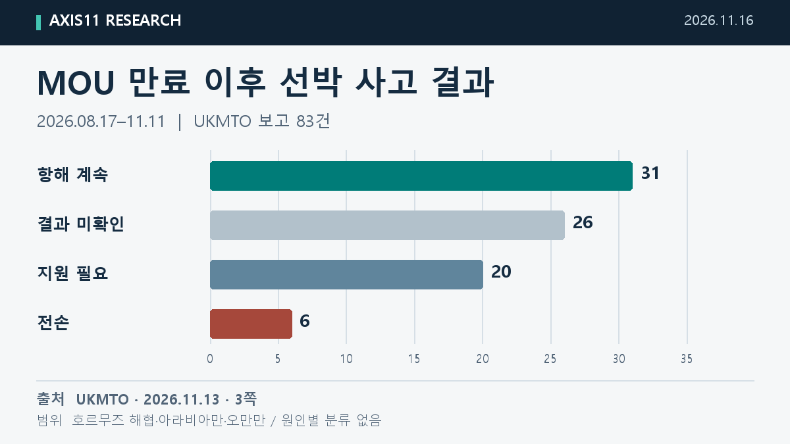
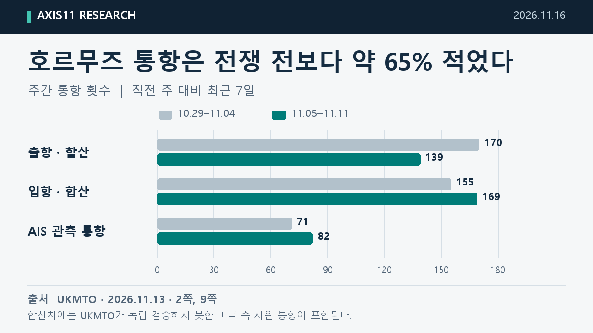
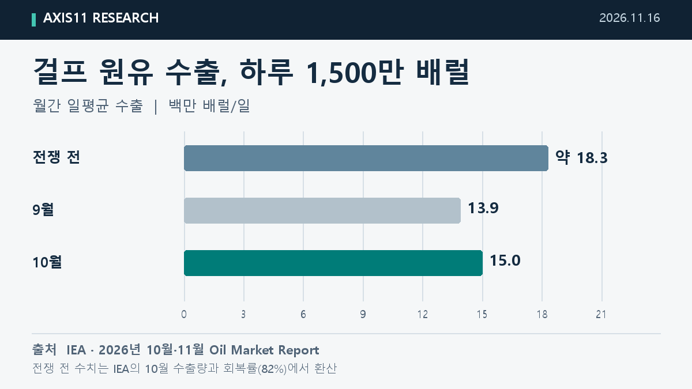

*이란의 기뢰 주장과 공개 자료, 그리고 회복 중인 걸프 원유 수송*

이란은 8월 17일 미국·이란 양해각서(MOU)의 60일 시한이 끝난 뒤, 호르무즈 해협을 지나는 선박이 기뢰와 충돌했다는 주장을 수차례 내놨다. 이런 발표를 접할 때마다 나는 원유를 실은 유조선 여러 척이 크게 파손될 경우 바다로 흘러들 기름부터 걱정하게 된다.

그런데 같은 기간 걸프 원유 수출은 회복됐다. 국제에너지기구(IEA)에 따르면 10월 수출량은 **하루 1,500만 배럴**, 전쟁 전의 **82%**였다. 이란이 발표한 피해는 어디까지 확인됐고, 공격이 이어지는 동안 원유는 어떻게 계속 흘러나갈 수 있었을까? [Kpler의 MOU 경과 분석](https://www.kpler.com/blog/60-days-of-a-broken-us-iran-mou-the-market-stopped-waiting-for-hormuz) · [IEA 11월 보고서](https://www.iea.org/reports/oil-market-report-november-2026) · [UKMTO 11월 13일 보고서](https://www.ukmto.org/-/media/ukmto/products/20261113-ukmto_vra_overview_u.pdf)

## 유조선 피격은 확인됐다. 기뢰 충돌은 어디까지 확인됐나

이란 혁명수비대(IRGC)의 발표에는 같은 설명이 반복된다. 이란이 허가하지 않은 항로를 이용하던 선박이 기뢰와 충돌했다는 것이다. 선사 입장에서는 항로를 바꾸라는 압박으로 읽힐 수 있다. 하지만 공개 자료를 대조해 보면, 인근에서 유조선이 피격됐다는 보고는 있어도 **그 배가 이란이 지목한 선박인지, 폭발 원인이 기뢰였는지**까지 확인되는 경우는 드물다.

| 발표일 | 이란 측 발표 | 공개 자료에서 확인된 내용 |
|---|---|---|
| 8월 31일 | 초대형 유조선이 기뢰 두 발과 충돌해 화재 | 미 중부사령부는 이란의 주장을 부인 [gCaptain](https://gcaptain.com/iran-claims-more-tankers-hit-mines-in-hormuz-but-evidence-remains-elusive/) |
| 10월 30일 | 유조선 4척이 기뢰와 충돌해 화재 | 오만 당국은 별도 피격 유조선에서 선원 25명을 대피시켰다고 밝혔지만, 이 배가 이란이 발표한 4척에 포함되는지는 확인되지 않음. [AP](https://apnews.com/article/7f7f34ceb62f294a450e48ace0bd56e0) |
| 11월 4일 | 유조선 4척이 기뢰와 충돌해 파괴 | UKMTO는 전날 유조선 한 척이 미확인 발사체에 맞았다고 기록. 반면 이란이 발표한 4척의 신원과 피해는 확인되지 않음. [Reuters](https://new.streetinsider.com/Reuters/Iran%27s%2BIRGC%2Bsays%2Bfour%2Btankers%2Bablaze%2Bafter%2Bhitting%2Bmines%2Bnear%2BStrait%2Bof%2BHormuz/27284158.html) · [UKMTO](https://www.ukmto.org/-/media/ukmto/products/20261106-ukmto_vra_overview_u.pdf) |
| 11월 13~14일 | LPG 운반선 한 척의 폭발과 유조선 3척의 화재를 각각 기뢰 충돌로 발표 | 인용 보도에서 피해 선박의 신원은 확인되지 않음. [AP 13일](https://apnews.com/article/5d73a23b5b8647d2515c35b267b36c08) · [AP 14일](https://apnews.com/article/ade76bebaf22135168aac6eb3016bc19) |

영국 해상무역기구(UKMTO)가 8월 17일부터 11월 11일까지 호르무즈 해협과 주변 해역에서 선박 공격 이후의 결과를 집계했다. **83건 중 전손은 6건**이었다. 31건은 항해를 계속했고, 20건은 예인·구조 등 지원이 필요했다. 나머지 26건은 결과가 확인되지 않았다. 전손이 확인된 비중은 약 7%지만, 결과가 밝혀지지 않은 사례가 많아 추가 전손이 확인되면 이 비중은 올라갈 수 있다. [UKMTO](https://www.ukmto.org/-/media/ukmto/products/20261113-ukmto_vra_overview_u.pdf#page=3)

*MOU 만료 이후 UKMTO에 보고된 사고 결과 83건. 전손은 6건이다.*

UKMTO가 11월 5~11일에 보고한 8건 중 **기뢰 충돌로 확인된 사례도, 침몰로 기록된 사례도 없었다.** 주간 요약에는 미확인 발사체 피격 4건, 수선 부근 폭발 1건, 기타 3건이 실렸다. 항해 결과를 보면 3건은 항해를 계속했고, 3건은 지원이 필요했으며, 2건은 결과가 미확인 상태였다. [UKMTO 3·7쪽](https://www.ukmto.org/-/media/ukmto/products/20261113-ukmto_vra_overview_u.pdf#page=7) · [개별 경보 202-26](https://www.ukmto.org/-/media/ukmto/products/20261111-ukmto_warning_202_26_update-001.pdf)

선박 한 척의 행방을 확인하려면 선명과 적재 상태, 이후 항적이 필요하다. 11월 15일 합동해상정보센터(JMIC) 보고에는 직전 72시간 동안 해협 안에서 확인된 공격이나 통항 차질이 없었다. 검토한 당국·선사·보험사의 공개 자료에서도 선박 신원과 침몰을 함께 확인할 근거는 찾지 못했다. [JMIC 11월 15일 업데이트](https://www.ukmto.org/-/media/ukmto/products/update-114_jmic_advisory_15-nov.pdf?rev=be65cfbd755a41c4816feba6cef4401c)

## 해협 통항은 전쟁 전보다 65% 적지만, 원유 수출은 회복 중

11월 11일까지 일주일간 호르무즈를 빠져나간 통항은 **139건**, 들어온 통항은 **169건**이었다. 합계는 308건으로 직전 주 325건(출항 170건·입항 155건)보다 줄었고, **전쟁 전보다 약 65% 적었다.** 같은 기간 선박자동식별장치(AIS)로 관측된 통항은 71건에서 82건으로 늘었다. 합산 통항에는 미국 측이 발표한 지원 통항도 포함되며, UKMTO는 그 지원 통항을 독립적으로 검증할 수 없다고 밝혔다. [UKMTO 2·9쪽](https://www.ukmto.org/-/media/ukmto/products/20261113-ukmto_vra_overview_u.pdf#page=2)

*호르무즈 주간 출항·입항과 AIS 관측 통항. 합산 통항은 줄었지만 AIS 관측 통항은 늘었다.*

통항 횟수에는 여러 선종과 입·출항이 섞인다. 실제 수출 규모는 배럴 단위로 봐야 한다. IEA가 발표한 걸프 원유 수출은 **9월 하루 1,390만 배럴에서 10월 1,500만 배럴**로 늘었다. IEA가 제시한 10월 회복률 82%를 기준으로 환산하면 전쟁 전 수출은 **하루 약 1,830만 배럴**이었다. 같은 기준의 11월 월간 실적은 아직 확인되지 않았다. [IEA 10월 보고서](https://www.iea.org/reports/oil-market-report-october-2026) · [IEA 11월 보고서](https://www.iea.org/reports/oil-market-report-november-2026)

걸프 수출의 회복은 세계 수급에도 영향을 줬다. IEA에 따르면 10월 **세계 석유 공급이 이란 전쟁 발발 이후 처음으로 수요를 넘어섰다.** 걸프 수출이 수요보다 빠르게 회복되면서 세계 석유 공급은 전월보다 하루 230만 배럴 늘어난 1억 540만 배럴에 이르렀고, 관측 재고는 한 달 동안 5,200만 배럴 증가했다. IEA는 4분기 전체로도 공급이 수요를 웃돌 것으로 전망했다. [IEA 11월 보고서](https://www.iea.org/reports/oil-market-report-november-2026)

*걸프 원유 수출. 10월 하루 1,500만 배럴로 전쟁 전의 82% 수준까지 회복됐다.*

원유는 어디로 빠져나갔을까. Kpler에 따르면 9월 1~28일 이란을 제외한 중동 걸프권에서 하루 최소 1,650만 배럴이 반출됐다. 그중 **하루 990만 배럴(60%)은 실제로 호르무즈를 통과했다.** 나머지는 오만만 연안(23%)과 홍해(17%)로 나갔다. 사우디는 홍해의 얀부, UAE는 오만만의 푸자이라를 활용했다. 해협을 건넌 원유의 일부는 해협 밖에서 다른 유조선으로 옮겨 실었다. 이런 수송 방식 덕분에 해협 통항이 크게 줄어든 상황에서도 걸프의 원유 수출은 회복될 수 있었다. Kpler의 9월 집계는 이란을 제외하고 여러 반출 경로를 합산한 수치다. [Kpler의 9월 물동량·경로 분석](https://www.kpler.com/blog/explainer-how-mideast-gulf-crude-exports-returned-to-pre-war-levels)

## 미국발 운임 하락으로 아시아의 구매 선택지가 넓어졌다

10월 미국 걸프에서 중국으로 향하는 초대형 원유운반선(VLCC)의 용선료는 한때 **8,000만 달러**까지 올랐다. 미국산을 들여오는 비용이 뛰자 아시아 정유사들은 UAE산 머반 등 중동산 원유를 물색했다. 같은 달 UAE의 ADNOC와 사우디 아람코는 운송을 부담하는 조건으로 아시아에 원유를 판매했다. 중동 공급이 살아나면서 정유사들이 확보할 수 있는 물량이 늘어난 것이다. [Reuters 10월 9일](https://au.investing.com/news/commodities-news/soaring-freight-rates-threaten-asias-appetite-for-us-crude-4681014) · [Reuters 10월 20일](https://www.marketscreener.com/news/asian-refiners-use-smaller-tankers-buy-delivered-crude-as-freight-rates-soar-ce785cdbd181f521)

11월에는 미국 걸프→중국 VLCC 운임이 큰 폭으로 내렸다. Baltic Exchange의 11월 13일 보고값은 **항차당 약 3,380만 달러**였다. 일주일 사이 1,960만 달러 넘게 떨어졌다. 중동산 물량이 돌아오는 가운데 미국산을 들여오는 운송비 부담도 낮아졌다. 아시아 정유사로서는 두 공급원을 비교해 고를 여지가 커졌고, 원유를 확보하는 데도 이전보다 여유가 생겼다. [Baltic Exchange 11월 13일](https://www.balticexchange.com/en/data-services/WeeklyRoundup/tanker/news/2026/tanker-report-week-46.html) · [Charles R. Weber 11월 6일](https://crweber.com/wp-content/uploads/2026/11/CRW-Weekly-Market-Report-44-26.pdf)

## 결론

이란의 기뢰 충돌 주장을 일괄적으로 거짓이라 단정할 수는 없다. 실제 피격과 전손이 기록됐고, JMIC는 호르무즈의 위협 수준을 여전히 **심각(Severe)**으로 평가한다. 그 위험 속에서도 상당량의 원유가 해협을 통과하고, 해협 밖 수출항도 물량을 분담하고 있다. **걸프 원유 수송의 정상화는 진행 중이다.** 10월 원유 수출은 전쟁 전 수준에 가까워졌지만, 11월 초 해협 통항은 여전히 전쟁 전의 약 3분의 1 수준이었다. [UKMTO 2·3쪽](https://www.ukmto.org/-/media/ukmto/products/20261113-ukmto_vra_overview_u.pdf#page=2) · [IEA 11월 보고서](https://www.iea.org/reports/oil-market-report-november-2026)

*자료 기준일 · UKMTO 통항·사고 11월 11일 마감, 13일 발행 · IEA 걸프 원유 수출 10월 실적 · Kpler 해협 원유 물량 9월 1~28일 · 최신 운임 11월 13일 발행.*
