*Inflation protection, real yields and the price of monetary uncertainty*

Gold rallies are often described as a response to inflation. But gold can fall while consumer prices rise rapidly, and surge when inflation is subdued. The recent rally and correction raise a familiar question: what, exactly, is the investor buying protection against?

The inflation argument is intuitive. Rising prices erode money’s purchasing power, while gold’s supply is difficult to expand. That helps explain why investors might want to own it. It says much less about when the price will rise or what return a buyer can expect.

Real yields provide another channel. Gold pays no interest, so an interest-bearing asset offering a return above inflation raises its opportunity cost. Yet two claims are often confused: that gold benefits from negative real yields, and that it benefits when real yields fall.

This note compares gold futures prices with US inflation, distinguishes **the level of real yields from changes in them**, and revisits the 1970s experience behind gold’s inflation-hedge reputation. It then considers how these relationships help interpret the recent rally and correction. The central distinction is between a reason to own gold and the return available at the price paid; the analysis does not estimate fair value or isolate one cause of the correction.

## 1. A rally and a correction on different scales

Gold closed 2022 at $1,826.0. By 29 January 2026 it had reached $5,354.8, a gain of 193.3% in about three years. It then fell to $4,074.9 on 6 November 2026, 23.9% below that peak.

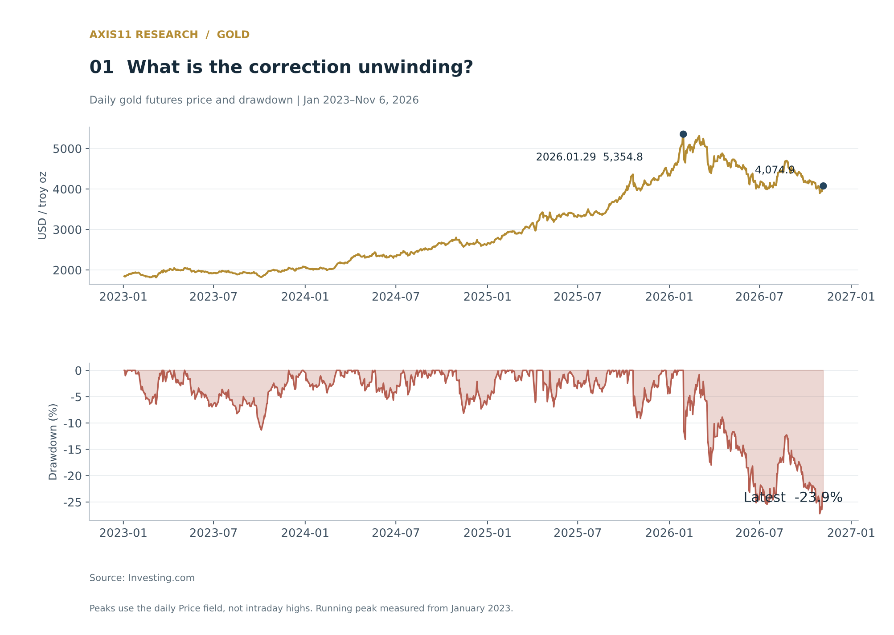

Despite the 23.9% drawdown, gold remained 123.2% above its end-2022 price. Both comparisons matter. The decline measures the reversal from the peak; the longer gain shows how much repricing preceded it.

A steady inflation hedge might be expected to track the erosion of purchasing power relatively closely. Gold’s price movements have been much larger in both directions.

## 2. Gold has outpaced inflation, but has not tracked it closely

Between end-January 1975 and end-September 2026, gold rose about 23.5 times, against a 6.47-fold increase in US consumer prices. Its inflation-adjusted price increased about 3.64 times. An investor measured across those endpoints more than preserved purchasing power.

The path was far less reassuring. The chart indexes gold and CPI to a common starting point, then shows gold divided by CPI below. A stable purchasing-power hedge would produce a much flatter lower line.

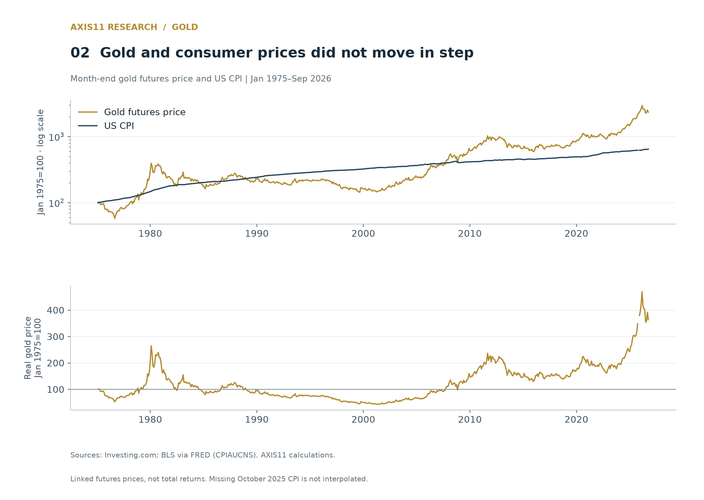

Gold’s real price declined for most of the two decades after early 1980. It then rose much faster than inflation in the 2000s and again recently. These swings point to substantial changes in demand and valuation beyond current consumer-price increases.

Monthly gold changes have a correlation of **0.08** with seasonally adjusted monthly US CPI inflation; since 2000, it is about **0.02**. Using year-over-year changes raises the correlation to **0.33**, but adjacent observations share most of their twelve-month measurement windows. They are not independent investment experiences.

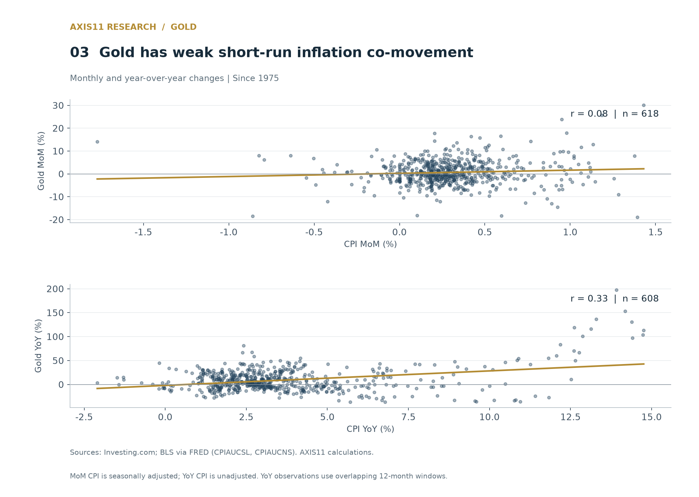

Low correlation does not establish that inflation is irrelevant. Expected inflation may be priced before a release, and current CPI differs from long-term expectations. It does undermine the simpler claim that **gold reliably offsets the loss of purchasing power month by month**.

Annual outcomes vary too. Gold far outpaced inflation in 1979, then fell sharply despite high inflation in 1981. In 2020, CPI rose 1.4% while gold gained 24.4%. In 2021, CPI rose 7.0% while gold fell 3.5%; gold again lagged inflation in 2022. Its real losses in those last two years were 9.9% and 6.2%.

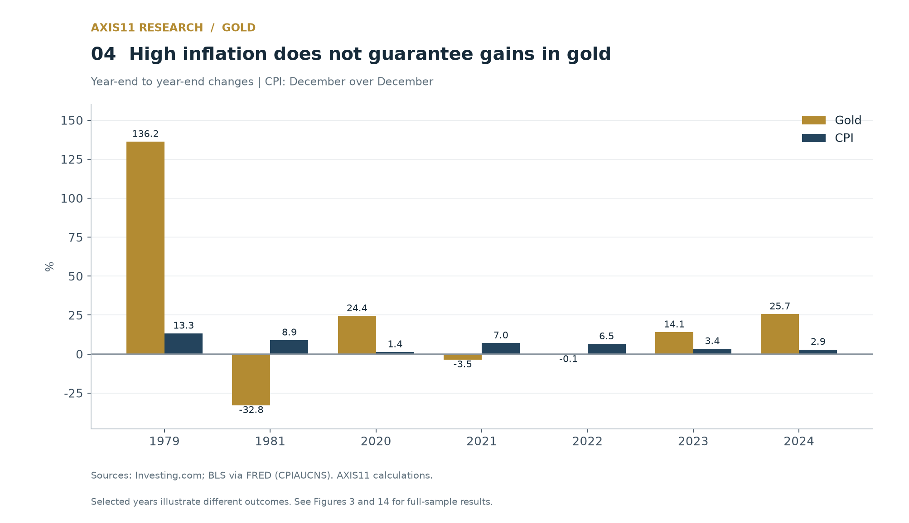

Inflation alone did not determine the investment result. To understand why it became the default explanation for gold, it helps to revisit the period that established the association.

## 3. The 1970s combined inflation with a new monetary regime

The 1970s were also a transition away from Bretton Woods. The London Gold Pool collapsed in 1968, leading to separate official and private-market gold prices. In August 1971, the United States suspended dollar convertibility into gold for foreign monetary authorities. Major currencies moved to floating exchange rates in 1973. Gold’s market price was adjusting as the monetary system itself changed.[^1][^2]

The Great Inflation was unfolding alongside that transition. Inflationary pressures had built from the mid-1960s, then interacted with energy shocks, policy changes and shifting expectations. Closing the gold window cannot, by itself, explain the entire rally.[^3]

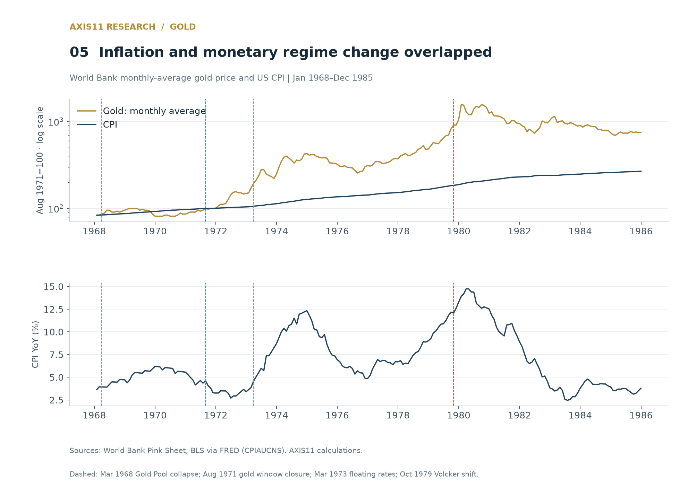

The World Bank series puts the monthly average gold price at $43 in August 1971 and $675 in January 1980. That is a gain of 1,469.8%, compared with CPI inflation of 90.7%. Gold’s real price rose 723.2%, far beyond what was needed simply to maintain purchasing power.

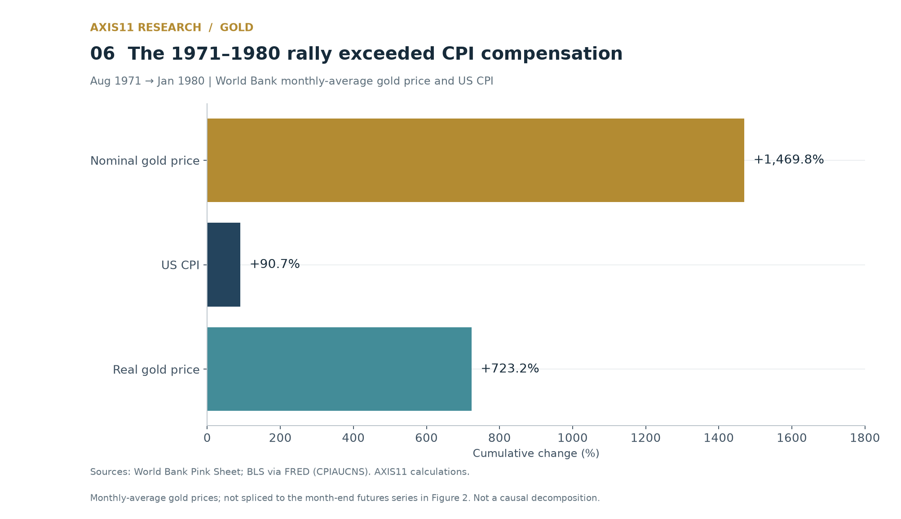

Inflation could still explain part of the move. Fears of much higher future inflation can push gold ahead of current prices, while declining confidence in monetary policy can increase demand. But **compensation for realised inflation, concern about future inflation and adjustment to a new monetary regime are distinct forces**. The chart cannot separate their contributions.

Gold had already risen about 328% between August 1971 and end-1974, then gained roughly another 267% by January 1980. A one-off repricing when convertibility ended cannot explain the later surge. Monetary change and the inflation experience need to be considered together.

## 4. From a historical episode to an investment rule

The 1970s gave gold’s reputation a powerful foundation: high inflation, monetary disruption and exceptional gains occurred together. Gold’s long monetary history, limited supply response and availability in physical form reinforced the case.

The problem is extending that episode into a universal rule. “Gold rose in the 1970s,” “gold rises with inflation” and “gold preserves purchasing power at any entry price” are increasingly strong claims. Evidence for the first does not establish the others. This is an analytical distinction, rather than a finding from tracing how the belief spread through investment commentary.

Academic findings also depend on the horizon and specification. Ghosh and co-authors examine inflation hedging through a long-run equilibrium relationship and its short-run deviations. Erb and Harvey emphasise the instability of that hedge over investors’ practical horizons, distinguishing very-long-run purchasing power from investment performance.[^4][^5]

Barsky and co-authors at the Chicago Fed find a historical role for inflation expectations, but greater importance for real yields and economic pessimism since 2001. Results also vary depending on whether they examine annual price levels, quarterly news or daily changes.[^6]

A low monthly CPI correlation does not refute every long-run result. Equally, a long-run relationship does not guarantee protection in a particular year. The relevant questions are **which inflation exposure, over what horizon and at what entry price**.

## 5. Negative real yields and falling real yields are different conditions

A negative correlation between gold changes and real-yield changes describes how they move together. It does not establish that gold rises whenever the real-yield level is negative.

A fall in the real yield from +2% to +1% lowers the opportunity cost of holding gold, even though the yield remains positive. A rise from −1% to −0.5% raises that cost despite the yield remaining negative. The zero line alone misses this distinction.

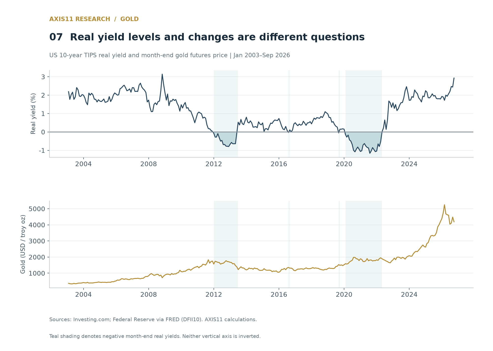

The analysis classifies each month using the **previous month-end** US 10-year TIPS real yield. That keeps the starting condition separate from the yield move during the month. Each group is then split between months in which real yields fell and those in which they rose or were unchanged.

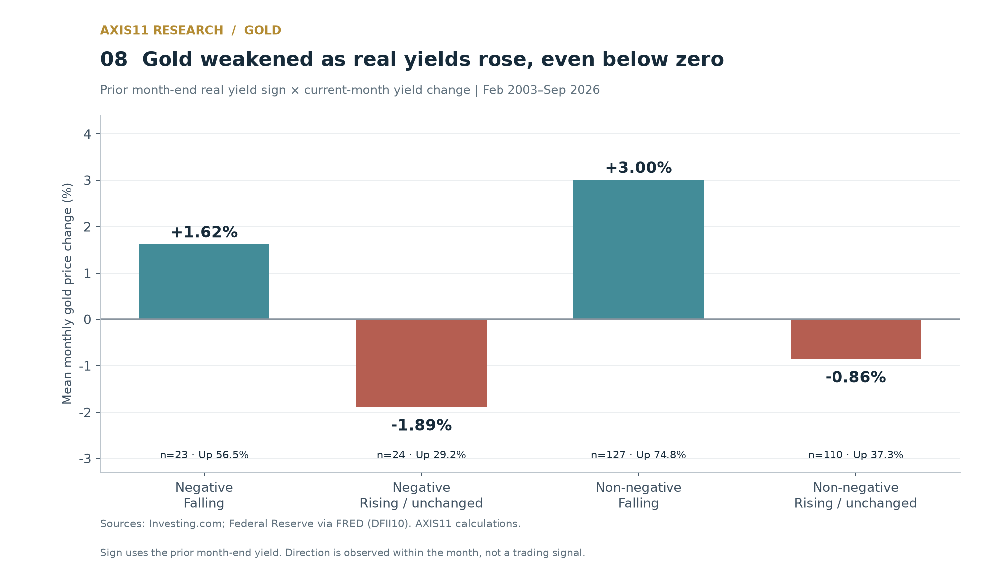

| Real yield at prior month-end | Change during the month | Months | Mean monthly gold change | Share of up months |
|---|---|---:|---:|---:|
| Negative | Falling | 23 | +1.62% | 56.5% |
| Negative | Rising or unchanged | 24 | -1.89% | 29.2% |
| Zero or above | Falling | 127 | +3.00% | 74.8% |
| Zero or above | Rising or unchanged | 110 | -0.86% | 37.3% |

Gold fell on average when real yields rose from a negative starting level, and rose on average when yields fell from a non-negative level. **The direction of the yield change separates the outcomes more clearly than the sign of the starting yield.**

Grouped only by starting yield, the 47 negative-yield months averaged a −0.18% gold change, compared with +1.21% across 237 non-negative-yield months. This does not make positive real yields favourable for gold. The groups cover different eras, and much of the recent rally sits in the latter.

Classification also matters. Using the current month-end yield gives average gold changes of +0.35% in the negative group and +1.13% in the rest. The negative group’s average changes sign. Its 47 months also cluster into a few episodes rather than 47 independent tests. Together, these qualifications weaken the case for using zero real yields as an automatic trading threshold.

## 6. Real-yield changes retain a relationship with gold

From February 2003 to September 2026, monthly changes in gold and real yields have a correlation of about −0.45. The relationship is visible, but the wide scatter shows that falling yields do not produce gains in every month.

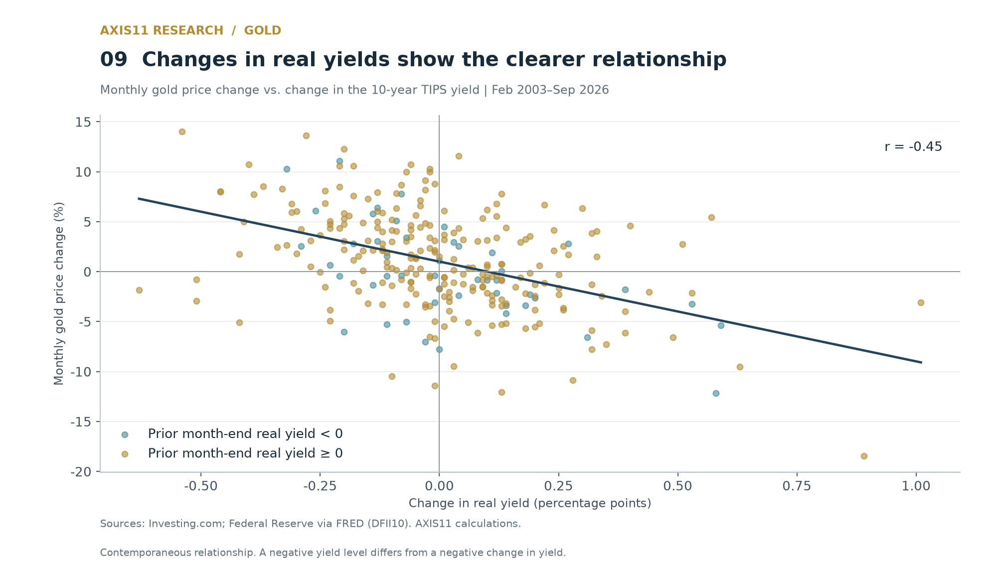

To assess the relationship alongside the dollar and inflation compensation, the analysis uses the **US 10-year breakeven inflation rate (BEI)**: the difference between nominal Treasury and TIPS real yields of the same maturity.[^9]

**10-year BEI = 10-year nominal Treasury yield − 10-year TIPS real yield**

BEI approximates the average inflation rate over the next ten years at which nominal and inflation-linked bonds would provide equivalent returns. It also contains inflation-risk and relative-liquidity premia. It is therefore an imperfect proxy for expected inflation, rather than a forecast of realised CPI.

Using the common sample available since 2006, monthly log changes in gold are regressed on real-yield changes, BEI changes and log changes in the dollar index.

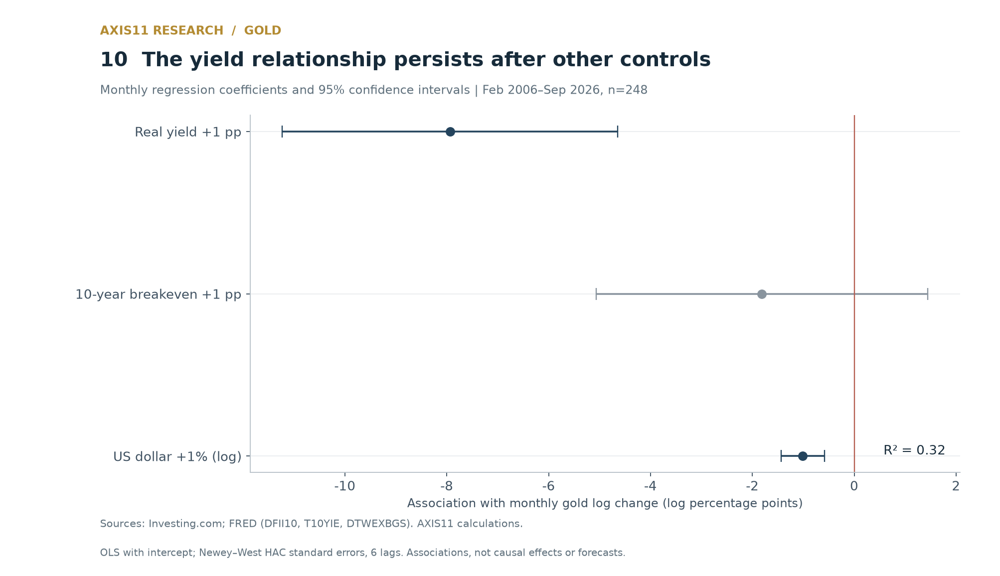

The real-yield coefficient is −7.94. Holding contemporaneous changes in the other variables constant, a 0.25 percentage point rise in real yields is associated with an approximately 1.98 percentage point reduction in gold’s monthly log change. A 1% rise in the dollar is associated with a reduction of about 1.01 percentage points. Neither coefficient’s 95% confidence interval includes zero.

The BEI-change coefficient is not statistically clear in this specification. A positive simple correlation need not survive controls for the other variables. That finding is specific to this sample and model; it does not establish that inflation expectations never matter.

Adding an indicator for a negative prior month-end real yield produces a coefficient of −1.05, with a 95% interval of roughly −2.40 to +0.30. The interval includes zero, providing **little evidence of an additional gold gain associated with the negative-yield state itself**.

These are contemporaneous associations. Yield changes are unknown in advance, and common policy or growth shocks can move both variables. The regression explains about 32% of gold’s variation, leaving substantial movements outside the model.

## 7. The recent rally exceeded what the earlier relationships would imply

Five-year rolling correlations show how gold’s relationships with real yields, the dollar and inflation change over time. A full-sample average conceals those shifts.

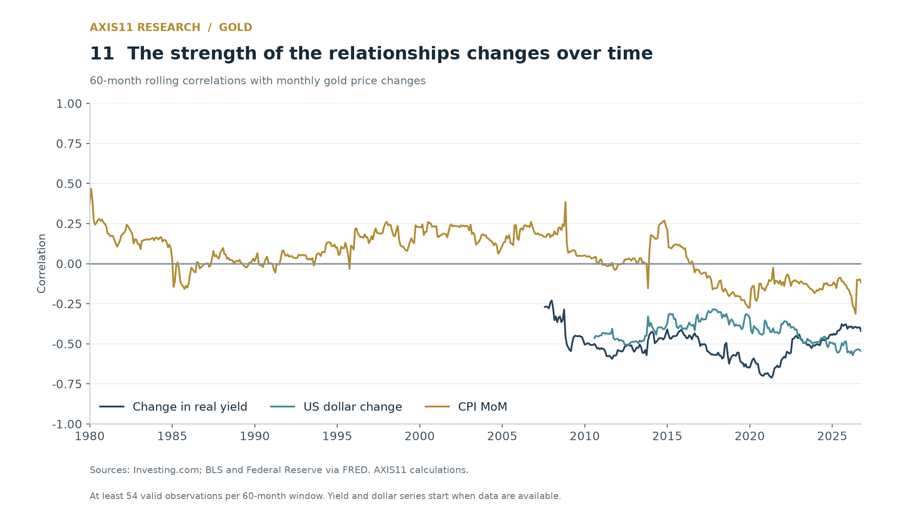

The recent rally is particularly difficult to explain through lower real yields. Between end-2022 and end-September 2026, the 10-year real yield rose from 1.58% to 2.93%, while gold rose from $1,826.0 to $4,186.7. BEI moved only from 2.30% to 2.36%. Endpoints omit the intervening path, but neither falling real yields nor a large rise in inflation compensation describes the period as a whole.

As a diagnostic, the model is re-estimated using data only through end-2021, then applied to the realised yield, BEI and dollar changes from 2022 onwards. Because those inputs were known only afterwards, the resulting path is an ex-post comparison, rather than an investable forecast.

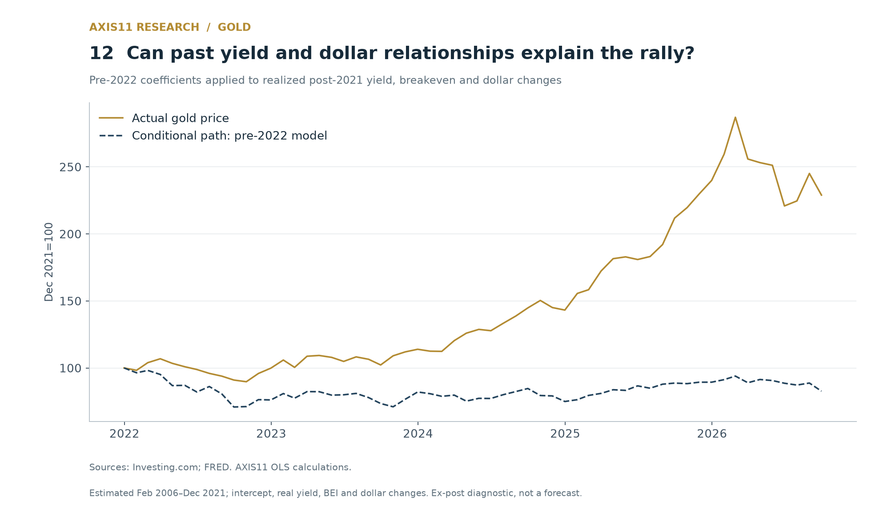

By September 2026, gold was about 129.0% above end-2021. The conditional path generated by the earlier coefficients and intercept was about 17.3% lower. The gap shows that those historical relationships cannot account for the rally. It combines omitted influences, changing relationships and model error; it cannot be assigned directly to central-bank purchases or a geopolitical premium.

Demand research offers further avenues to examine. The World Gold Council highlights stronger investment demand, including ETFs, in 2025. Federal Reserve researcher Colin Weiss also argues that private investment demand since late 2024 needs to be considered alongside central-bank buying.[^7][^8]

Geopolitical uncertainty can increase demand for protection against financial disruption. For reserve managers, it also raises a more specific issue: **whether an asset will remain accessible**. Credit quality and deep markets offer limited protection if sanctions prevent the holder from using the reserves.

Following Russia’s full-scale invasion of Ukraine in 2022, US prohibitions on transactions with its central bank and allied measures restricted access to external reserves. This highlighted the sanctions exposure attached to foreign-held assets and international financial networks. The measures extended beyond the dollar, so moving into another Western reserve currency would not necessarily remove that exposure.[^10][^11]

Domestically held physical gold is not a promise by another issuer to pay. That can appeal to reserve managers concerned about sanctions. Arslanalp, Eichengreen and Simpson-Bell find a relationship between financial sanctions by major reserve-currency issuers and higher gold shares in central-bank reserves. Multilateral sanctions can narrow the available currency alternatives, increasing gold’s relative appeal. Their study covers historical sanctions episodes; it does not isolate the effect of the 2022 war on the recent rally.[^11]

ECB analysis published in 2025 also finds a substantial increase in central-bank gold demand after the invasion, with reserve-share increases more pronounced among countries geopolitically close to China and Russia. This is consistent with sanctions-related diversification supporting demand, though it does not establish a common motive for every buyer.[^12]

Gold retains legal and practical constraints. Metal stored abroad is exposed to that jurisdiction, while domestic holdings still require counterparties and settlement arrangements for international sale or pledging. The argument is for diversification away from particular issuers and foreign networks, rather than complete immunity from sanctions or wholesale replacement of the dollar.[^11]

Reserve shares also reflect valuation. A rising gold price increases gold’s share even with no additional tonnage. Weiss separates this effect from new purchases. A higher reported share is therefore insufficient evidence that central banks are selling dollars to buy more gold.[^8]

ETF flows, central-bank purchases and geopolitical risk are not included in this note’s regressions. They are candidates for further analysis, not measured explanations for its residual. **Growing demand for protection and the price already paid for that protection remain separate questions.**

## 8. Reading the correction

On 29 January 2026, the day of the price peak, the 10-year real yield was 1.89%. By 5 November, the latest observation available, it had risen to 2.60%. The broad dollar index rose about 3.6%, from 117.44 on the day of the peak to 121.67 on 30 October. The 10-year BEI fell from 2.35% on the day of the peak to 2.23% on 6 November. The latest observation date differs by series.

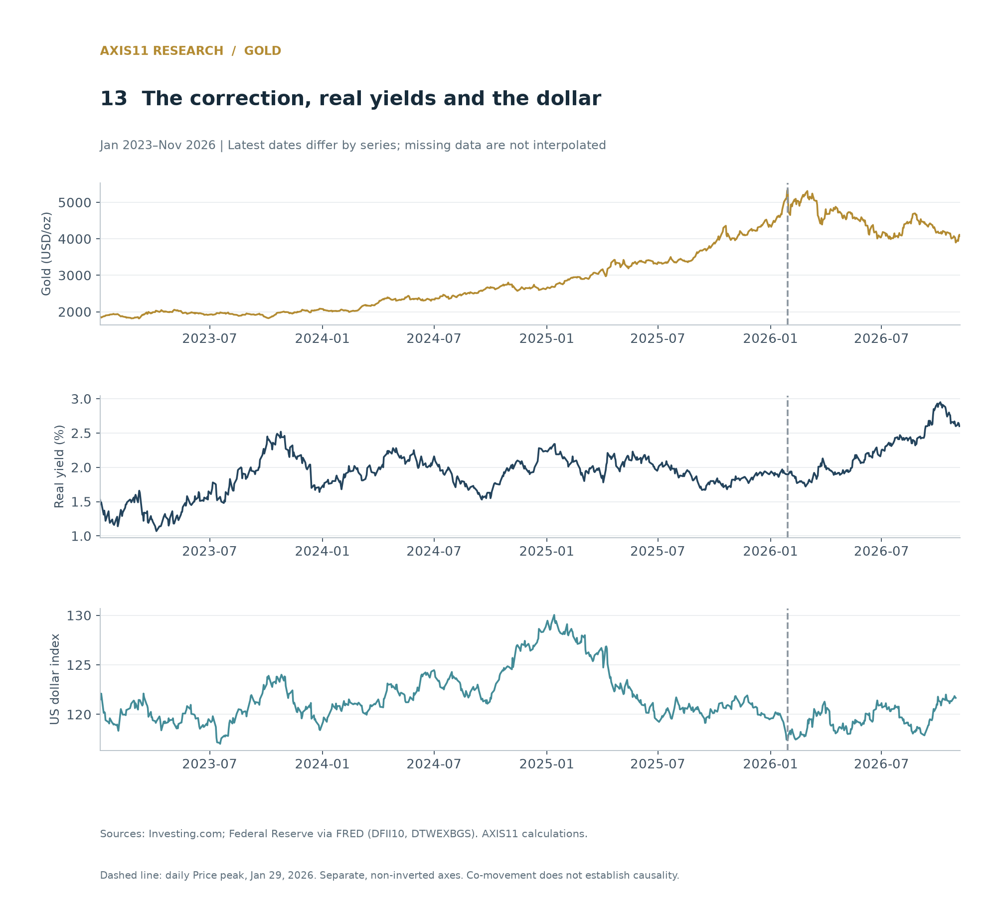

Higher real yields and a stronger dollar are consistent with pressure on gold, while BEI is lower than at the peak. These changes do not establish that yields explain the entire decline. If the rally reflected additional demand and expectations, a reversal in some of them could also matter.

Reserve diversification and monetary uncertainty may provide lasting reasons to hold gold. But if buyers have already paid for that demand, its persistence does not guarantee further gains. Conversely, a large drawdown does not prove that the original motive has disappeared.

This analysis cannot identify the end of the correction or forecast central-bank and ETF demand. It does show why **an explanation for a rally cannot guarantee the returns that follow it**.

## 9. Purchasing-power protection depends on the entry date

Across the full sample since 1975, gold outpaced US inflation. Across individual investment windows, the record is mixed. The chart measures the share of rolling 1-, 5-, 10- and 20-year holding periods in which gold’s price increase exceeded cumulative CPI inflation.

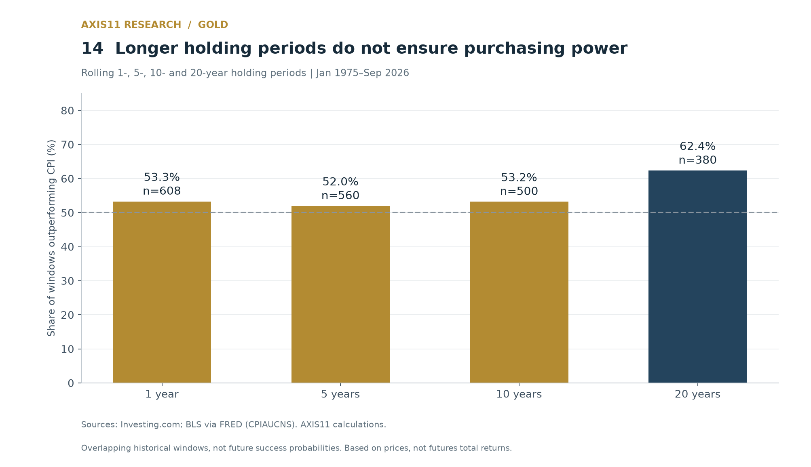

Gold beat inflation in 53.3% of one-year windows, 52.0% of five-year windows, 53.2% of ten-year windows and 62.4% of twenty-year windows. Longer holdings did not ensure protection: from end-January 1980 to end-January 2000, the real gold price fell about 81.3%. These are proportions of overlapping historical windows, not future success probabilities or realised futures total returns.

The evidence supports a conditional investment case. Changes in real yields retain a negative relationship with gold, but a negative yield level alone offers no reliable rule. Current inflation has little short-run correlation with gold, while the purchasing-power outcome depends heavily on the entry date.

The 1970s combined high inflation, monetary regime change and uncertainty about the future. Applying that experience today requires identifying which conditions are recurring. The recent rally also points beyond simple inflation and real-yield explanations towards demand for the asset itself—without establishing how much that demand contributed.

**A reason to hold gold is not a guarantee of an adequate return at the current price.** What it hedges depends on the risk being addressed, the holding period and how much investors have already paid for protection.

## Data and method

The cut-off date is 9 November 2026. The main analysis including inflation runs from January 1975 to September 2026; recent daily prices run through 6 November. The month-end gold price is the Price field on the last trading day of the month. The US CPI is a monthly-average index, so the purchasing-power calculations are an approximation combining a month-end price with that month's price level.

Gold data come from Investing.com, daily from 3 January 1975 to 6 November 2026. The contract roll rules and whether the whole history is back-adjusted could not be verified, so the series is labelled a linked gold futures price rather than a strict front-month series. The results are a property of that linked price, not an investment total return including collateral interest, transaction costs and realised roll.

The 1968–1985 historical comparison uses the World Bank Pink Sheet monthly-average gold price separately. August 1971 is a monthly average spanning both sides of the suspension of convertibility, so it is not a cut-off that measures the regime change on its own. The official fixed price of $35 has not been spliced directly to private market prices.

US CPI is FRED's CPIAUCNS (not seasonally adjusted); the monthly co-movement with inflation uses CPIAUCSL (seasonally adjusted). The real yield is DFII10, the proxy for expected inflation is T10YIE, and the dollar is DTWEXBGS. T10YIE can include inflation risk and liquidity premia. The dollar index is not the ICE DXY. Daily economic series use the last valid value in the month, which can differ slightly from gold's last trading day.

The October 2025 CPI observation in the data obtained is missing. It has not been interpolated and is excluded from any calculation that needs it or the corresponding base month. The valid sample for the full monthly inflation correlation is 618 months, and 608 months year-over-year. The real yield cross-classification covers 284 months from February 2003 to September 2026; the regression including the dollar covers 248 months from February 2006 to September 2026. The dependent variable is 100×Δln(gold); the regressors are the change in the real yield (pp), the change in the BEI (pp) and 100×Δln(dollar index), with an intercept. Confidence intervals use Newey–West (HAC) standard errors with a maximum lag of 6 months.

The real change over a holding period is `(end gold / start gold) ÷ (end CPI / start CPI) − 1`. Monthly averages are arithmetic and are not annualised. Holding-period windows and rolling correlations overlap. These are descriptive statistics and contemporaneous regressions on the latest data vintage, so they are not forecasts based on the information available at the time and not causal effects.

The conditional path since 2022 applies the regression estimated on February 2006–December 2021 to the realised regressors thereafter, summing the log changes. It includes the intercept, carries the influence of the realised variables and of model error, and has no adjustment for the mean when converting log values back into prices. It is not a fair price, a forecast, or an estimate of structural contributions by factor. All figures are rounded.

Data: [Investing.com gold futures historical data](https://www.investing.com/commodities/gold-historical-data), [rollover policy](https://www.investing-support.com/hc/en-us/articles/115003803345-When-are-futures-contracts-rolled-over-on-the-website), [World Bank Commodity Markets](https://www.worldbank.org/en/research/commodity-markets), FRED [CPIAUCNS](https://fred.stlouisfed.org/series/CPIAUCNS), [CPIAUCSL](https://fred.stlouisfed.org/series/CPIAUCSL), [DFII10](https://fred.stlouisfed.org/series/DFII10), [T10YIE](https://fred.stlouisfed.org/series/T10YIE), [DTWEXBGS](https://fred.stlouisfed.org/series/DTWEXBGS).

---

## Sources

[^1]: IMF, [Money Matters — System in Crisis](https://www.imf.org/external/np/exr/center/mm/eng/mm_sc_04.htm). Background to the 1968 collapse of the Gold Pool.
[^2]: U.S. Department of State, Office of the Historian, [Nixon and the End of the Bretton Woods System](https://history.state.gov/milestones/1969-1976/nixon-shock). The suspension of convertibility and the 1973 move to floating rates.
[^3]: Michael Bryan, Federal Reserve History, [The Great Inflation](https://www.federalreservehistory.org/essays/great-inflation). The history of the Great Inflation and the policy response.
[^4]: Dipak Ghosh, Eric J. Levin, Peter MacMillan, Robert E. Wright, [Gold as an inflation hedge?](https://strathprints.strath.ac.uk/6926/), 2004. A long-run equilibrium relationship and the short-run disturbances around it.
[^5]: Claude B. Erb, Campbell R. Harvey, [The Golden Dilemma](https://www.nber.org/papers/w18706), NBER Working Paper 18706, 2013. The limits of the hedging role over an investor's horizon.
[^6]: Robert Barsky, Craig Epstein, Adrian Lafont-Mueller, Younggeun Yoo, [What Drives Gold Prices?](https://www.chicagofed.org/publications/chicago-fed-letter/2021/464), Chicago Fed Letter 464, 2021. The roles of expected inflation, real yields and pessimism about the economy.
[^7]: World Gold Council, [Gold Demand Trends: Q4 and Full Year 2025](https://www.gold.org/goldhub/research/gold-demand-trends/gold-demand-trends-full-year-2025), 2026. Investment and central bank demand. Used with the industry-body source in mind.
[^8]: Colin Weiss, [Why Gold Didn't Actually Overtake Treasury Securities as the World's "Favorite" Reserve Asset](https://www.federalreserve.gov/econres/notes/feds-notes/why-gold-didnt-actually-overtake-treasury-securities-as-the-worlds-favorite-reserve-asset-20260903.html), FEDS Notes, 3 September 2026. Separating the valuation effect from an increase in holdings. The author's analysis, not an official Federal Reserve position.
[^9]: Federal Reserve Bank of St. Louis, [10-Year Breakeven Inflation Rate — T10YIE](https://fred.stlouisfed.org/series/T10YIE). The definition as the difference between the 10-year nominal and TIPS yields.
[^10]: U.S. Department of the Treasury, [Treasury Prohibits Transactions with Central Bank of Russia and Imposes Sanctions on Key Sources of Russia's Wealth](https://home.treasury.gov/news/press-releases/jy0612), 28 February 2022. The prohibition on transactions with the Central Bank of Russia.
[^11]: Serkan Arslanalp, Barry Eichengreen, Chima Simpson-Bell, [Gold as International Reserves: A Barbarous Relic No More?](https://www.imf.org/en/publications/wp/issues/2023/01/27/gold-as-international-reserves-a-barbarous-relic-no-more-528089), IMF Working Paper 2023/014, 2023. Financial sanctions and gold holdings, and the limits that storage and settlement impose. The authors' analysis, not an official IMF position.
[^12]: Anja Brüggen, Maurizio Michael Habib, Roger Gomis, Alessandro Vallin, [Gold demand: the role of the official sector and geopolitics](https://www.ecb.europa.eu/press/other-publications/ire/focus/html/ecb.irebox202506_01~f93400a4aa.en.html), ECB, The International Role of the Euro, June 2025. Central bank demand after the invasion and geopolitical diversification.
