*인플레이션의 기억, 실질금리의 변화, 그리고 급등 이후의 가격*

우리는 흔히 금 가격이 상승할 때 이를 물가에 대한 헤지로 해석하는 기사나 분석 자료를 접한다. 실제로 그랬을까? 최근 금 가격이 큰 상승기를 거친 뒤 조정을 받은 것은 어떤 의미일까? 이 노트는 이 두 가지 궁금증에서 시작했다.

물가가 오르면 화폐의 구매력이 낮아진다. 공급을 쉽게 늘릴 수 없는 금이 그 손실을 보완해 줄 것이라는 설명은 자연스럽다. 그러나 그 설명만으로는 금이 언제 오르고, 언제 하락하는지 이해하기 어렵다. 물가가 빠르게 오르는데 금은 하락할 수 있고, 물가가 안정된 동안 금 가격이 큰 폭으로 상승할 수도 있기 때문이다.

실질금리를 함께 보면 설명이 조금 더 구체적이 된다. 금은 이자를 지급하지 않는다. 물가를 제외하고도 이자를 받을 수 있는 자산이 있다면 금을 보유하는 기회비용은 커진다. 반대로 실질금리가 낮아지면 그 비용은 줄어든다. 그렇다면 금은 실질금리가 마이너스인 기간에 오르는 것일까? 아니면 금리가 내려가는 동안 오르는 것일까?

이 노트는 미국 물가와 금 선물 가격을 비교하고, 실질금리의 **수준과 변화**를 구분한다. 그리고 1970년대의 경험이 어떻게 금에 대한 설명으로 남았는지 살펴본다. 최근 조정의 원인을 하나로 단정하거나 적정 가격을 계산하려는 것은 아니다. 관심은 **금의 상승을 설명하는 논리와, 그 가격에서 기대할 수 있는 성과가 얼마나 일치하는가**에 있다.

## 1 크게 오른 가격이 조정을 받았다는 것

금 가격은 2022년 말 1,826.0달러였다. 2026년 1월 29일에는 5,354.8달러까지 올라 약 3년 동안 193.3% 상승했었다. 이후 2026년 11월 6일 4,074.9달러까지 내려와, 해당 고점 대비 하락률은 23.9%다.

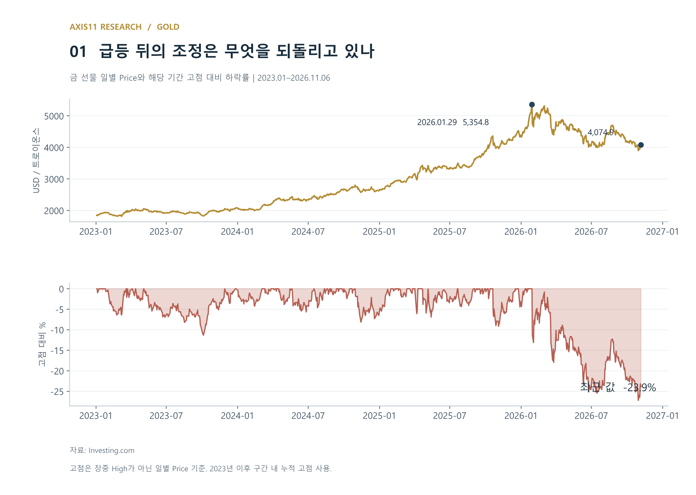

큰 상승과 큰 조정은 동시에 존재할 수 있다. 최근 가격은 고점에서 상당히 내려왔지만 여전히 2022년 말보다 123.2% 높다. 이 가격을 이해하려면 최근 하락만큼이나 그전에 어떤 기대가 쌓였는지를 보아야 한다.

금이 물가를 보상해 주는 자산이라면, 금 가격과 소비자물가는 장기적으로 비슷한 속도로 움직일 것이라는 생각을 할 수 있다. 그러나 실제 가격에는 물가 변화보다 훨씬 큰 상승과 하락이 나타난다.

## 2 물가를 따라가는 자산인가

1975년 1월 말부터 2026년 9월 말까지 금 가격은 약 23.5배, 미국 소비자물가는 약 6.47배가 됐다. 물가를 조정한 금 가격도 약 3.64배로 높아졌다. 이 두 시점만 놓고 보면 금은 구매력을 보존하는 데 성공했다.

그러나 그 과정은 물가와 일정한 간격을 유지하는 모습과 거리가 멀다. 아래 도표의 위쪽은 금과 CPI를 같은 출발점에 놓은 것이고, 아래쪽은 금 가격을 CPI로 나눈 것이다. 금이 물가를 일정하게 보상한다면 아래쪽 선은 훨씬 안정적이어야 한다.

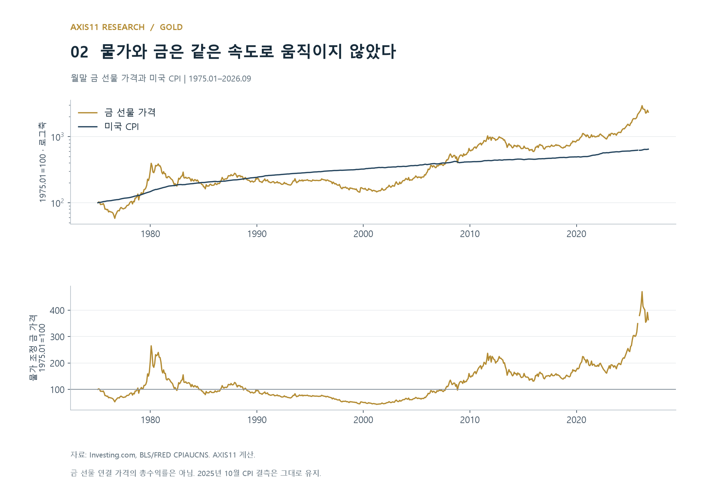

1980년 초 이후 실질 금 가격은 오랫동안 하락했다. 반대로 2000년대와 최근에는 물가 상승 속도를 크게 웃도는 재평가가 나타났다. 금에 대한 수요와 지불하려는 가격이 물가 외의 조건에 따라 달라졌다는 뜻이다.

단기 관계도 확인해 보자. 금의 월간 가격 변화율과 미국 CPI의 계절조정 전월비 상승률 사이 상관계수는 **0.08**이었다. 2000년 이후로 기간을 좁히면 약 **0.02**다. 전년동월비끼리 비교하면 상관계수는 **0.33**으로 높아지지만, 12개월씩 겹치는 관측치여서 이를 독립적인 투자 경험으로 해석할 수는 없다.

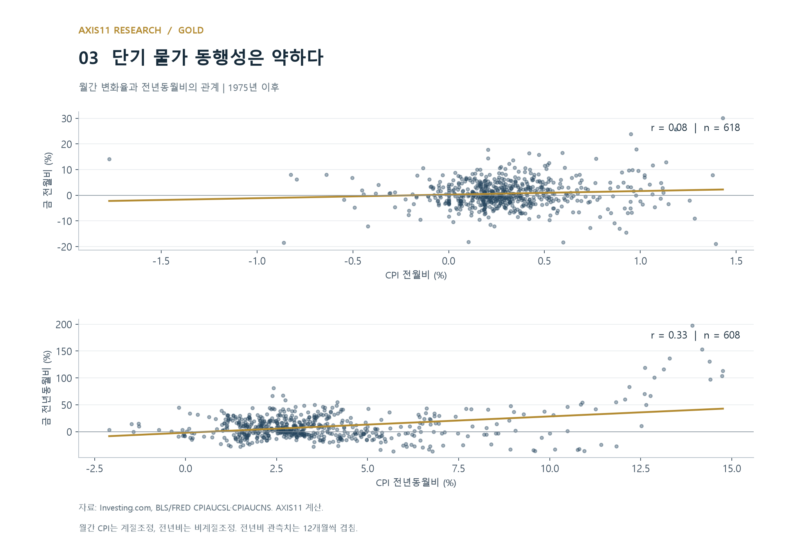

이 결과는 금과 물가 사이에 어떠한 관계도 없다는 증거가 아니다. 이미 예상된 물가는 발표되기 전에 가격에 반영될 수 있고, 현재 CPI와 장기 기대인플레이션도 다르다. 다만 **물가가 오르는 시기에 금을 보유하면 그달의 구매력 손실이 안정적으로 보전된다**는 설명은 이 자료에서 확인되지 않는다.

연도별 사례에서도 차이가 드러난다. 1979년 금은 물가 상승을 크게 웃돌았지만, 1981년에는 높은 인플레이션에도 가격이 급락했다. 2020년에는 CPI가 1.4% 오르는 동안 금이 24.4% 상승했다. 반면 2021년 CPI는 7.0% 상승했지만 금은 3.5% 하락했고, 2022년에도 물가를 따라가지 못했다. 물가 조정 금 가격의 변화율은 각각 -9.9%, -6.2%였다.

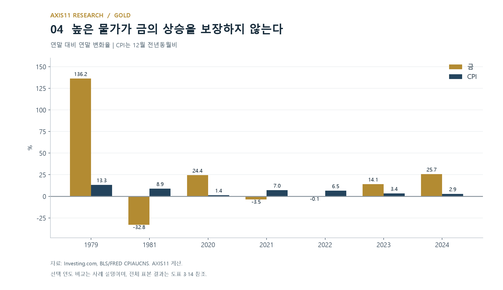

인플레이션이라는 단어는 같아도 투자 결과는 달랐다. 그렇다면 금이 물가 헤지라는 설명은 어디에서 힘을 얻었을까?

## 3 1970년대에는 물가와 통화체제가 함께 바뀌었다

이 질문에 답하려면 1970년대를 돌이켜봐야 한다. 브레턴우즈 체제에서 달러는 공식적으로 금과 연결돼 있었다. 그러나 공식 가격과 민간 시장 가격을 같은 것으로 볼 수 있었던 기간은 길지 않았다. 1968년 런던 금 풀이 붕괴하면서 두 가격을 분리하는 체계가 형성됐고, 1971년 8월에는 미국이 외국 통화당국에 대한 달러의 금 태환을 중단했다. 1973년에는 주요 통화의 변동환율 전환이 진행됐다. 금의 시장가격이 통화제도 변화와 함께 재평가되는 환경이었다.[^1][^2]

동시에 미국은 대인플레이션을 겪고 있었다. 물가 상승은 1971년에 갑자기 시작된 현상이 아니었다. 1960년대 중반부터 누적된 인플레이션 압력, 에너지 충격, 정책 대응과 기대의 변화가 겹쳤다. 금 가격의 상승을 금 태환 중단 하나로 설명하기 어려운 이유다.[^3]

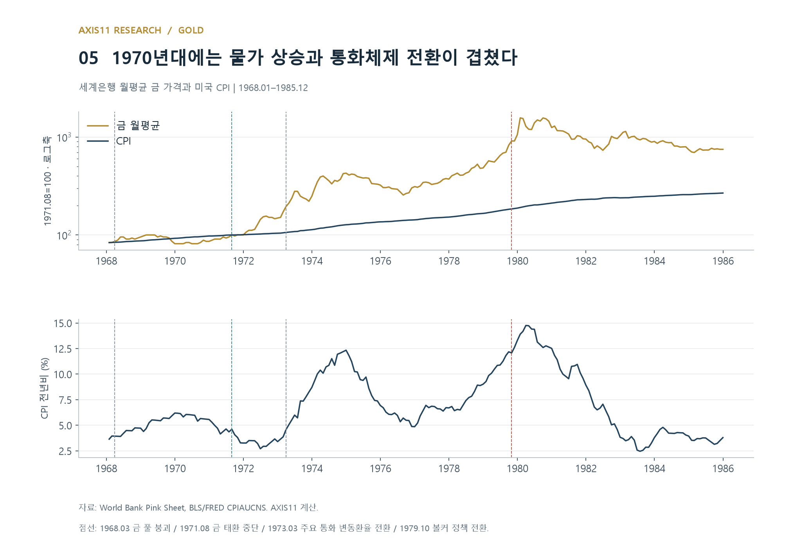

세계은행 자료에서 1971년 8월 금 월평균 가격은 43달러, 1980년 1월에는 675달러였다. 금 가격이 1,469.8% 상승하는 동안 CPI 상승률은 90.7%였다. 물가를 조정한 금 가격도 723.2% 상승했다. 단순히 같은 구매력을 유지하기 위한 가격 조정으로는 설명되지 않는 규모다.

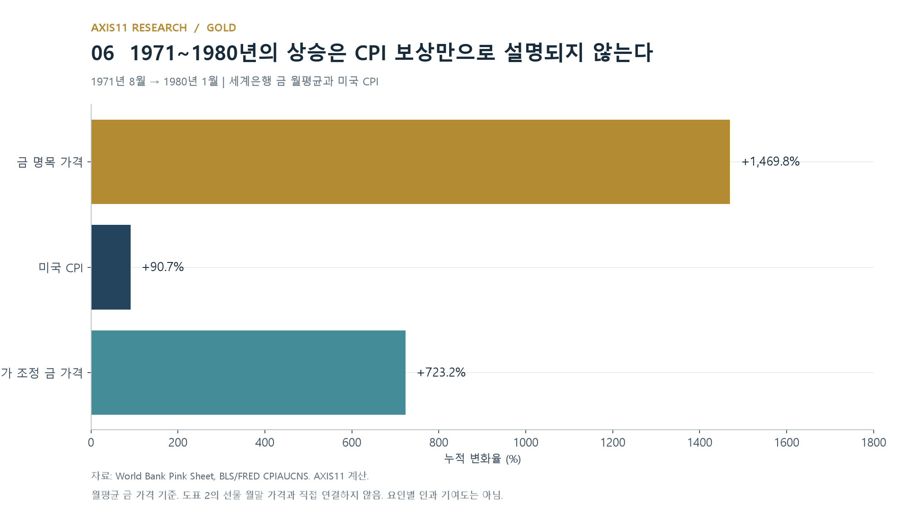

여기서 '물가의 영향이 없었다'고 결론 내릴 수는 없다. 미래 물가가 훨씬 높아질 것으로 예상하면, 현재 물가보다 금 가격이 먼저 크게 오를 수 있다. 통화정책에 대한 신뢰 약화와 금 보유 수요의 증가도 같은 시기에 일어날 수 있다. 다만 **현재 물가의 보상, 미래 물가에 대한 우려, 통화체제 전환에 따른 재평가를 하나로 묶으면 설명이 지나치게 단순해진다.** 이 도표만으로 세 요인의 기여도를 나눌 수는 없다.

1971년 8월부터 1974년 말까지 금 가격은 이미 약 328% 올랐다. 이후 1980년 1월까지도 약 267% 더 상승했다. 태환 중단 직후의 일회성 조정만으로 1970년대 후반의 상승 전체를 설명하는 것도 충분하지 않다. 제도 변화와 인플레이션 경험을 함께 읽어야 한다.

## 4 강한 역사적 경험이 일반적인 투자 논리가 될 때

1970년대의 경험은 금을 설명하는 강한 사례다. 물가가 빠르게 오르고 통화질서가 바뀌는 동안 금 가격도 크게 상승했다. 화폐와 연결된 오랜 역사, 쉽게 늘어나지 않는 공급, 실물로 보유할 수 있다는 특성도 그 설명을 뒷받침한다.

하지만 한 시대에 성립한 관계가 이후 모든 인플레이션 국면에 그대로 적용되는 것은 아니다. '1970년대에 금이 올랐다'에서 '물가가 오르면 금이 오른다'로, 다시 '금은 어떤 가격에 사도 구매력을 보존한다'로 넘어가면 서로 다른 주장이 된다. **이것이 이 노트가 보는 설명의 과도한 일반화다.** 다만 투자자들의 믿음이 정확히 어떤 기사나 연구를 통해 확산됐는지까지 추적한 결과는 아니다.

학술 연구도 하나의 결론으로 모이지 않는다. Ghosh 등은 특정 조건과 장기 균형 관계에서 금의 물가 헤지 역할을 분석했다. Erb와 Harvey는 투자자가 실제로 경험하는 기간에서는 그 역할이 불안정하며, 매우 긴 역사적 구매력 논리와 투자 성과를 구분해야 한다고 지적했다.[^4][^5]

시카고 연은의 Barsky 등은 과거 물가 기대의 역할을 인정하면서도, 2001년 이후 금 가격을 이해할 때 실질금리와 경제에 대한 비관적 기대가 더 중요해졌다고 분석한다. 해당 연구에서도 연간 가격 수준, 분기별 새로운 정보, 일별 변화 중 어떤 분석을 쓰느냐에 따라 물가 변수의 결과가 달라진다.[^6]

따라서 월간 CPI 상관계수가 낮다는 이유로 기존 연구 전체를 부정할 수 없다. 반대로 일부 장기 연구에서 물가와의 관계가 발견됐다는 이유로 매년의 헤지 성과를 보장할 수도 없다. 중요한 것은 **어떤 물가를, 어느 기간에, 어떤 가격으로 헤지하려 하는가**다.

## 5 실질금리가 마이너스이면 금은 오르는가

금과 실질금리의 관계를 이야기할 때는 먼저 두 질문을 구분해야 한다. 실질금리가 마이너스인 동안 금이 오르는가? 아니면 실질금리가 내려가는 동안 금이 오르는가? 금 가격 변화와 실질금리 변화 사이의 음의 상관관계는 두 번째 질문에 관한 것이며, 첫 번째 질문의 답을 바로 알려주지는 않는다.

실질금리가 +2%에서 +1%로 내려가면 금리는 여전히 양수지만 금 보유의 상대적 기회비용은 줄어든다. 반대로 -1%에서 -0.5%로 올라가면 금리는 여전히 음수지만 기회비용은 커진다. 부호만으로 두 상황을 구분할 수 없다.

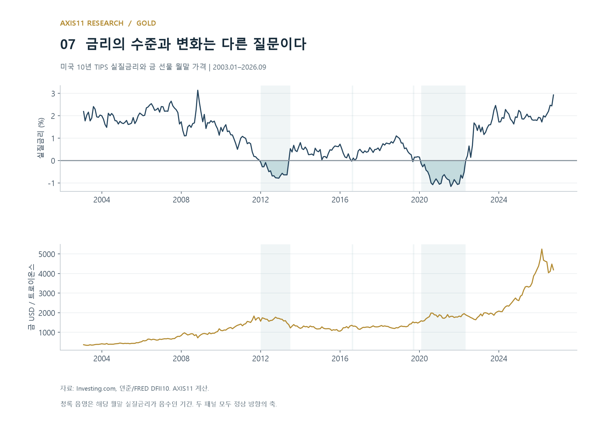

미국 10년 TIPS 실질금리의 전월 말 부호를 기준으로 월을 나눴다. 당월 말 부호를 사용하면 그달 금리 변화의 결과가 분류에 들어가므로, 상태와 변화를 구분하기 위해 전월 말 값을 사용했다. 각 상태에서 당월 실질금리가 하락했는지, 상승 또는 보합이었는지를 다시 구분했다.

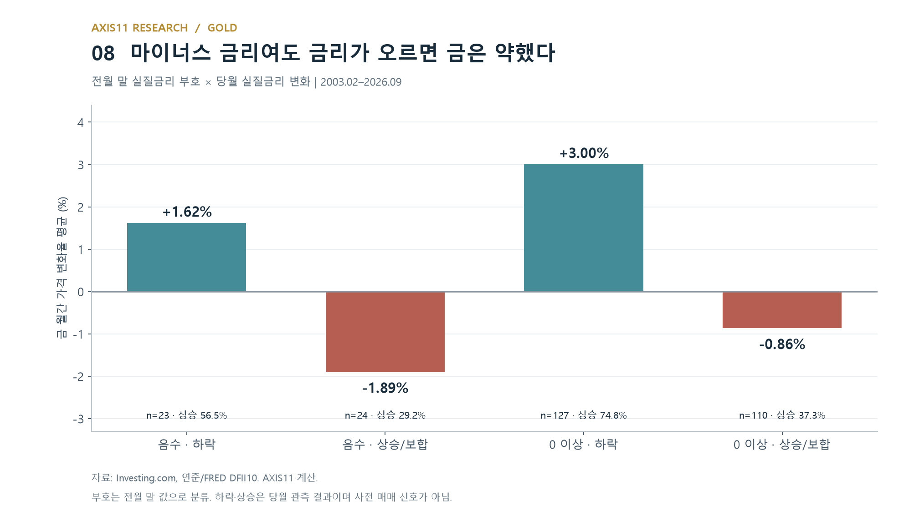

| 전월 말 실질금리 | 당월 실질금리 변화 | 월 수 | 금 월간 변화율 평균 | 금 상승 월 비율 |
|---|---|---:|---:|---:|
| 음수 | 하락 | 23 | +1.62% | 56.5% |
| 음수 | 상승·보합 | 24 | -1.89% | 29.2% |
| 0 이상 | 하락 | 127 | +3.00% | 74.8% |
| 0 이상 | 상승·보합 | 110 | -0.86% | 37.3% |

마이너스 실질금리에서도 금리가 올라가는 달에는 금 가격이 평균적으로 하락했다. 실질금리가 0 이상인 상태에서도 금리가 내려가는 달에는 금이 평균적으로 상승했다. 이 표본에서 더 뚜렷한 구분은 금리의 부호보다 **변화 방향**이었다.

부호만으로 묶으면 전월 말 금리가 음수였던 47개월의 금 가격 변화율 평균은 -0.18%, 0 이상이었던 237개월은 +1.21%다. 그렇다고 양의 실질금리가 금에 유리하다고 해석할 수는 없다. 두 표본은 서로 다른 시대를 담고 있고, 최근 급등기 상당 부분은 양의 실질금리 구간에 속한다.

분류 기준에도 민감하다. 당월 말 금리로 분류하면 음수 구간의 평균은 +0.35%, 나머지는 +1.13%다. 음수 구간의 평균 부호가 바뀐다. 이러한 민감성은 금리의 0% 선을 자동적인 투자 기준으로 삼기 어렵다는 점을 보여준다. 음수 금리 표본은 47개월이고 소수의 연속된 국면에 몰려 있어 독립적인 47번의 실험도 아니다.

## 6 관계가 없었던 것이 아니라, 관계를 다르게 읽어야 했다

실질금리 변화와 금 가격 변화의 산점도를 보면 음의 관계가 더 분명하다. 2003년 2월부터 2026년 9월까지 두 변수의 상관계수는 약 -0.45다. 다만 금리가 내려가는 모든 달에 금이 오르는 것은 아니며, 점들은 회귀선 주위에 넓게 흩어져 있다.

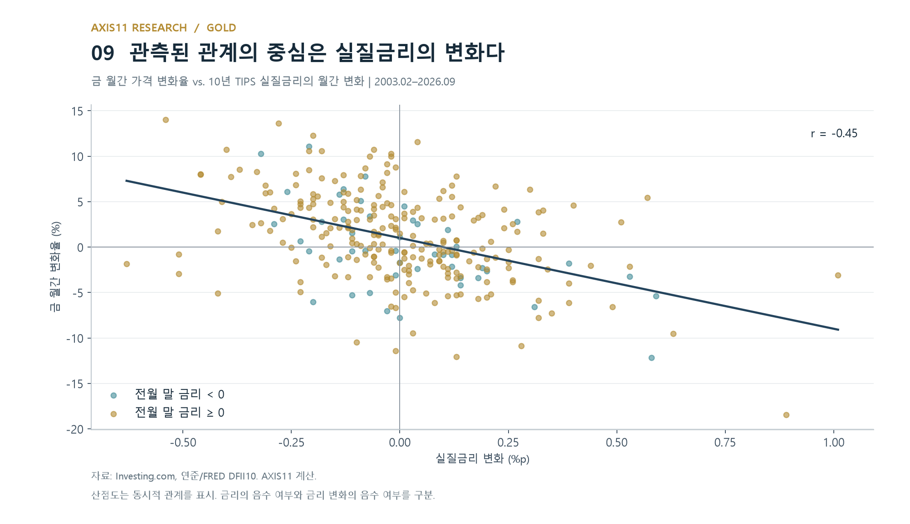

달러와 기대인플레이션을 함께 고려하면 관계가 사라질까? 여기서 기대인플레이션의 대용치로 사용하는 것은 **미국 10년 손익분기 인플레이션율(10-Year Breakeven Inflation Rate, BEI)**이다. 같은 만기의 명목 국채수익률에서 물가연동국채(TIPS)의 실질수익률을 뺀 값이다.[^9]

**10년 BEI = 10년 명목 국채수익률 − 10년 TIPS 실질수익률**

명목채권과 물가연동채권의 수익을 비교할 때 기준이 되는 향후 10년 평균 물가상승률의 시장 대용치로 읽을 수 있다. 다만 인플레이션 위험 프리미엄과 두 채권의 유동성 차이도 반영하므로, 시장의 순수한 기대물가나 향후 실제 물가와 정확히 같은 값은 아니다.

현행 달러지수까지 확보되는 2006년 이후 공통 표본으로, 금의 월간 로그 가격 변화율을 실질금리 변화, 10년 BEI 변화, 달러의 로그 변화율에 회귀했다.

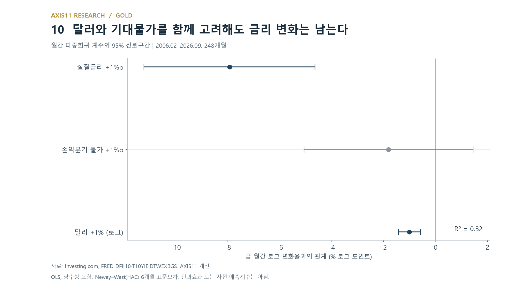

실질금리 변화의 계수는 -7.94였다. 다른 변수의 동시 변화를 통제한 상태에서 실질금리 0.25%포인트 상승은 금의 월간 로그 가격 변화율 약 1.98%포인트 하락과 연결됐다. 달러 1% 상승의 계수는 약 -1.01이었다. 두 계수의 95% 신뢰구간은 0을 포함하지 않았다.

반면 10년 BEI 변화의 계수는 이 모형에서 통계적으로 명확하지 않았다. 단순한 물가 기대와 금의 양의 상관관계가 다른 변수를 고려해도 그대로 유지되는 것은 아니라는 뜻이다. 이 결과를 물가 기대의 영향이 언제나 없다는 주장으로 확대해서는 안 된다.

전월 말 금리가 음수였는지를 추가해도 그 변수의 계수는 -1.05였고 95% 신뢰구간은 약 -2.40~+0.30으로 0을 포함했다. 이 표본과 모형에서는 **마이너스 금리 상태 자체가 금의 추가 상승과 연결된다는 근거를 찾기 어려웠다.**

여기까지의 계산은 동시적 관계를 측정한다. 금리 변화는 미리 알 수 있는 정보가 아니며, 공통된 정책·경기 충격이 금과 금리를 함께 움직일 수 있다. 회귀의 설명력도 약 32%였다. 금리와 달러는 중요하지만 가격 변화 전체를 설명하지는 않는다.

## 7 최근 상승은 기존 관계의 범위를 넘어섰다

관계의 강도는 시간에 따라 바뀐다. 금 가격과 실질금리·달러·물가 사이의 5년 이동 상관계수를 그려 보면 하나의 숫자로 전 기간을 요약하기 어려운 이유가 드러난다.

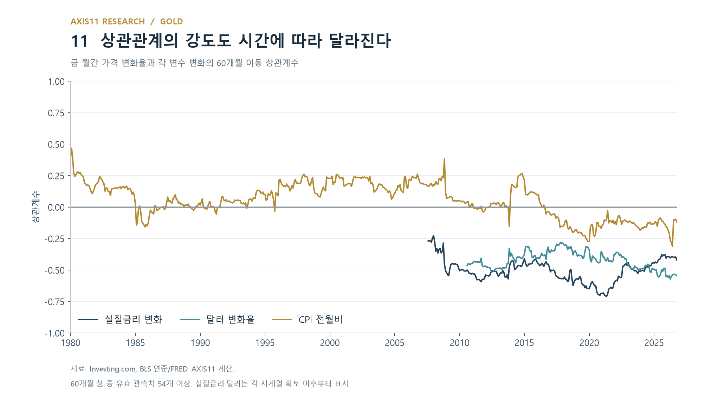

최근 상승은 특히 단순한 저금리 설명에 잘 들어맞지 않는다. 2022년 말 10년 실질금리는 1.58%, 2026년 9월 말에는 2.93%였다. 같은 기간 금 가격은 1,826.0달러에서 4,186.7달러로 올랐다. 10년 BEI는 2.30%에서 2.36%로 변했다. 긴 구간의 끝점만으로 그 안의 모든 움직임을 설명할 수는 없지만, 상승 전체를 실질금리 변화나 기대물가 급등의 결과라고 보기 어렵다.

관계가 얼마나 달라졌는지 보기 위해 2021년 말까지의 자료로 같은 모형을 추정한 뒤, 2022년 이후 실제 금리·기대물가·달러 변화를 대입했다. 미래 변수를 알고 계산한 사후 진단이며, 투자자가 당시 만들 수 있었던 예측이 아니다.

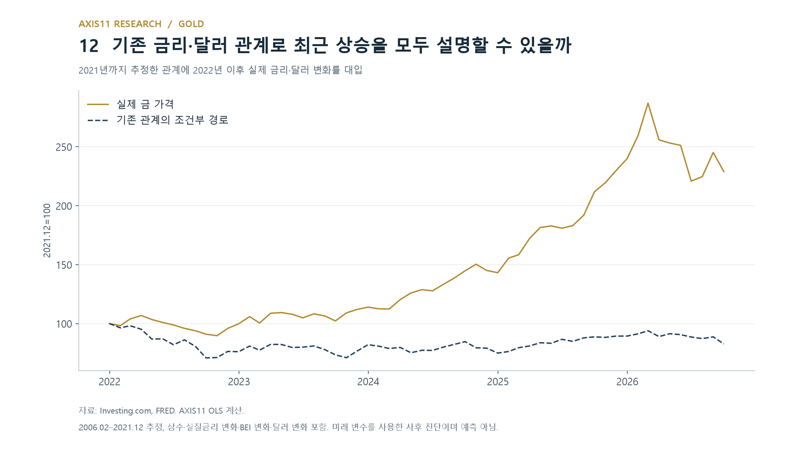

2021년 말 대비 2026년 9월 실제 가격은 약 129.0% 상승했다. 과거 계수와 상수항을 그대로 적용한 조건부 경로는 약 17.3% 하락했다. 이 격차는 기존의 간단한 모형만으로 최근 상승을 설명하기 어렵다는 의미다. 모형의 오류나 관계 변화, 빠진 변수의 영향을 모두 포함하므로 그 차이를 곧바로 중앙은행 수요나 지정학적 프리미엄의 규모로 해석할 수는 없다.

수요 쪽 자료는 검토할 방향을 제공한다. World Gold Council은 2025년 금 수요에서 ETF를 포함한 투자 수요의 확대를 강조했다. 연준의 Colin Weiss도 2024년 말 이후 민간 투자 수요의 증가와 중앙은행 매입을 함께 보아야 한다고 지적했다.[^7][^8]

지정학적 긴장의 고조도 이 수요를 이해하는 한 경로다. 전쟁과 국제질서의 불확실성이 커지면 투자자는 금융시장 충격에 대비할 자산을 찾는다. 그러나 금으로 향하는 수요에는 일반적인 안전자산 선호 외에 **준비자산을 실제로 사용할 수 있는가에 대한 우려**도 들어 있다. 자산의 신용도가 높고 시장이 깊어도, 보유국이 제재를 받아 자산에 접근할 수 없다면 준비자산으로서의 역할은 제한되기 때문이다.

2022년 러시아의 우크라이나 전면 침공 이후 미국은 러시아 중앙은행과의 거래를 금지했고, 미국과 동맹국의 조치는 러시아의 해외 준비자산 접근을 제한했다. 이는 일부 국가에 달러 중심 금융망과 해외 보관 준비자산의 제재 위험을 다시 생각하게 한 사건이었다. 제재는 달러에만 국한되지 않았으므로, 달러를 다른 서방 통화로 바꾸는 것만으로 위험이 모두 사라지는 것도 아니다.[^10][^11]

자국에 보관하는 실물 금은 다른 나라 정부나 금융기관의 상환 약속을 필요로 하지 않는다. 이런 특성은 제재 가능성을 우려하는 중앙은행이 금을 늘릴 동기가 될 수 있다. Arslanalp·Eichengreen·Simpson-Bell의 연구는 주요 준비통화 발행국의 금융제재와 중앙은행 준비자산 내 금 비중 상승 사이의 관계를 보고했다. 다자 제재에서는 다른 통화로 옮길 선택지가 줄어 금의 상대적 매력이 더 커질 수 있다는 해석이다. 다만 이 연구는 과거 여러 제재 사례를 분석한 것으로, 2022년 전쟁이 최근 금 가격 상승에 미친 영향을 별도로 추정한 결과는 아니다.[^11]

ECB의 2025년 분석도 러시아의 전면 침공 이후 중앙은행의 금 수요가 크게 늘었고, 중국·러시아와 지정학적으로 가까운 국가들에서 금 비중 증가가 더 두드러졌다고 지적한다. 이 자료는 **러시아 제재 이후 달러 외 준비자산을 찾는 동기가 금 수요를 뒷받침했을 가능성**과 부합한다. 모든 중앙은행이 같은 이유로 금을 샀다는 뜻은 아니다.[^12]

금도 제재 위험에서 완전히 자유롭지는 않다. 해외 보관 금에는 보관지의 법적 위험이 남고, 자국에 보관하더라도 국제시장에서 팔거나 담보로 사용하려면 거래 상대와 결제망이 필요하다. 따라서 이 변화는 '금이 달러를 대체한다'는 단정적인 이야기보다, **특정 국가에 대한 채권과 해외 금융망에 대한 의존을 일부 줄이려는 다변화 수요**로 이해하는 편이 적절하다.[^11]

중앙은행의 금 보유액이 늘었다는 숫자도 주의해서 읽어야 한다. 보유량이 같아도 가격이 오르면 평가액과 준비자산 내 비중이 높아진다. Weiss의 분석은 바로 이 평가 효과와 신규 매입을 구분한다. '금의 비중 상승 → 중앙은행의 달러 이탈 → 금의 추가 상승'이라는 설명이 자동으로 성립하는 것은 아니다.[^8]

이번 노트는 ETF·중앙은행 수요와 지정학적 위험을 자체 회귀에 넣어 검증하지 않았다. 관련 연구는 최근 상승을 이해할 추가 경로를 제시하지만, 앞선 모형의 설명되지 않는 부분을 모두 전쟁이나 제재의 효과로 돌릴 수는 없다. **지정학적 위험에 대비한 보유 수요가 늘었다는 논리와, 그 수요가 현재 가격에 얼마나 반영됐는지는 별도로 검토해야 한다.**

## 8 그렇다면 최근 조정은 무엇을 의미하는가

2026년 1월 29일 가격 고점 당시 10년 실질금리는 1.89%였다. 확보한 최신 관측치인 11월 5일에는 2.60%로 높아졌다. 광의 달러지수도 고점 당일 117.44에서 10월 30일 121.67로 약 3.6% 상승했다. 10년 BEI는 고점 당일 2.35%에서 11월 6일 2.23%로 낮아졌다. 각 지표의 최신 관측일은 다르다.

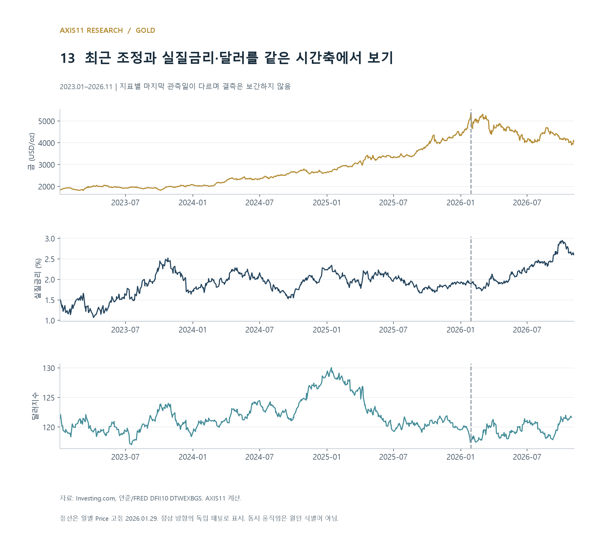

금 보유의 기회비용이 커지고 달러가 강해진 점은 가격 조정과 부합한다. 기대물가도 고점 당일보다 낮아졌다. 그러나 이 사실만으로 최근 하락이 전부 금리 때문이라고 말할 수는 없다. 직전 상승에 금리 외의 수요와 기대가 있었다면, 조정에는 그 기대의 변화도 들어 있을 수 있기 때문이다.

중요한 것은 금에 유리한 장기 논리와 매입 가격을 구분하는 일이다. 준비자산 다변화나 통화 불확실성에 대한 수요가 지속되더라도, 그 수요가 이미 가격에 충분히 반영됐다면 추가 상승은 별개의 문제가 된다. 반대로 고점에서 많이 하락했다는 사실만으로 그 논리가 사라졌다고 판단할 수도 없다.

이 노트의 자료로는 최근 조정이 끝났는지, 중앙은행이나 ETF 수요가 앞으로 얼마나 늘지 판단할 수 없다. 확인할 수 있는 것은 **급등 당시의 설명 하나로 이후의 가격 경로까지 보장할 수 없다는 점**이다.

## 9 물가를 헤지한다는 것과 구매력을 보존한다는 것

금은 1975년 이후 전체 기간에서는 미국 물가를 웃돌았다. 그러나 매입 시점을 바꿔 보면 결과가 달라진다. 매월 말부터 1·5·10·20년을 보유한 구간에서, 누적 CPI 상승을 웃돈 비율을 계산했다.

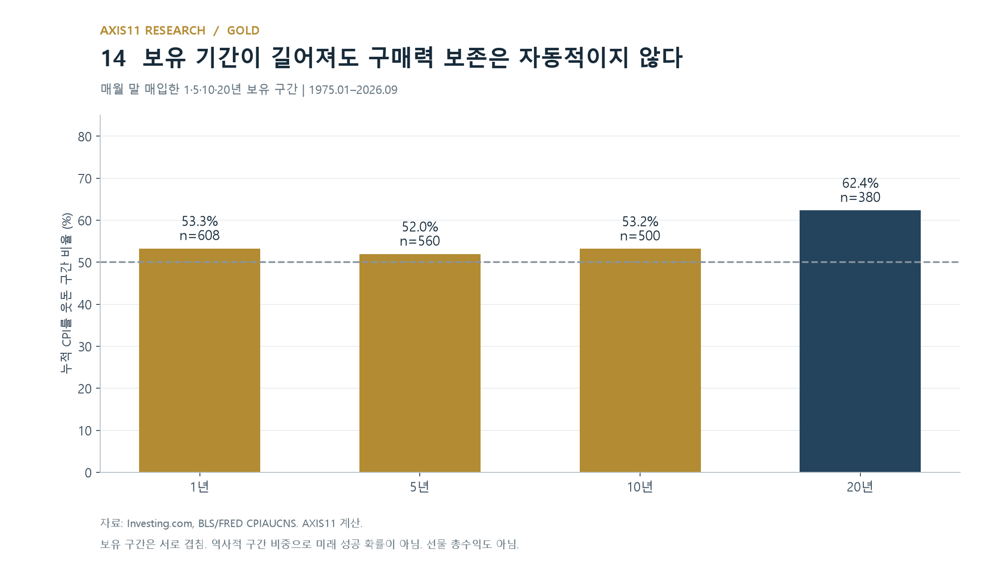

1년 구간은 53.3%, 5년은 52.0%, 10년은 53.2%, 20년은 62.4%였다. 보유 기간을 늘려도 모든 구간에서 구매력이 보존되지는 않았다. 1980년 1월 말부터 2000년 1월 말까지는 물가 조정 가격이 약 81.3% 하락했다. 이 비율은 겹치는 역사적 구간의 비중이며 미래 성공 확률이나 실제 선물 총수익률은 아니다.

금과 물가, 실질금리 사이에 아무런 관계가 없다는 결론은 적절하지 않다. 이번 자료에서도 실질금리 변화와 금 가격 변화의 음의 관계는 남았다. 다만 실질금리가 마이너스라는 상태가 상승을 보장하지 않았고, 현재 물가와의 낮은 단기 상관관계도 안정적인 헤지라는 설명과는 거리가 있었다.

1970년대의 경험은 인플레이션뿐 아니라 통화제도 전환과 미래에 대한 우려가 겹친 결과였다. 그 경험을 오늘의 투자 논리로 가져오려면 당시의 조건 중 무엇이 반복되고 있는지 확인해야 한다. 최근 상승과 조정에서도 같은 질문이 필요하다. 물가에 대한 우려인지, 실질금리의 변화인지, 새로운 보유 수요인지, 그리고 그 기대를 반영해 이미 얼마나 높은 가격을 지불하고 있는지다.

금이 무엇을 헤지하는지에 대한 답은 하나의 명칭보다 이 조건들에 가까이 있다. 금을 보유할 이유가 있다는 판단과, 지금의 가격에서 충분한 성과를 얻을 수 있다는 판단은 각각 검토해야 한다.

## 데이터와 방법

기준일은 2026년 11월 9일이다. 물가를 포함한 주 분석은 1975년 1월~2026년 9월, 최근 일별 가격은 11월 6일까지다. 월말 금 가격은 해당 월 마지막 거래일의 Price다. 미국 CPI는 월평균 성격의 지수이므로 구매력 계산은 월말 가격과 해당 월 물가를 결합한 근사치다.

금 자료는 Investing.com의 자료를 활용했고, 일별 기간은 1975년 1월 3일~2026년 11월 6일이다. 전체 역사의 월물 교체 규칙·백어드저스트 여부는 확인하지 못했다. 따라서 '엄밀한 최단 만기물' 대신 '금 선물 연결 가격'으로 표시한다. 계산 결과는 이 연결 가격의 특성이며, 담보 이자·거래 비용·실제 롤오버 손익을 포함한 투자 총수익이 아니다.

1968~1985년 역사 비교에는 세계은행 Pink Sheet 금 월평균 가격을 별도로 사용했다. 1971년 8월은 태환 중단 전후를 모두 포함하는 월평균으로, 제도 변화의 순수한 전후 효과를 측정하는 기준일이 아니다. 공식 고정가격 35달러와 민간 시장가격을 직접 이어 붙이지 않았다.

미국 CPI는 FRED의 CPIAUCNS(비계절조정), 월간 물가 동행성은 CPIAUCSL(계절조정)을 사용했다. 실질금리는 DFII10, 기대물가 대용치는 T10YIE, 달러는 DTWEXBGS다. T10YIE에는 인플레이션 위험·유동성 프리미엄이 포함될 수 있다. 달러지수는 ICE DXY가 아니다. 일별 경제지표는 월 중 마지막 유효 값을 사용해 금의 마지막 거래일과 미세하게 어긋날 수 있다.

확보된 CPI의 2025년 10월 관측치는 결측이다. 보간하지 않았고 해당 값이나 기준월 값이 필요한 계산에서 제외했다. 전체 월간 물가 상관계수의 유효 표본은 618개월, 전년비는 608개월이다. 실질금리 교차 분류는 2003년 2월~2026년 9월 284개월, 달러 포함 회귀는 2006년 2월~2026년 9월 248개월이다. 회귀 종속변수는 100×Δln(금 가격), 설명변수는 실질금리 변화(%p), BEI 변화(%p), 100×Δln(달러지수)이며 상수항을 포함한다. 신뢰구간은 Newey–West(HAC), 최대 시차 6개월 기준이다.

보유 기간별 실질 변화율은 `(종료 금/시작 금) ÷ (종료 CPI/시작 CPI) − 1`이다. 월간 평균은 산술평균이며 연율로 환산하지 않았다. 보유 구간과 이동 상관계수는 관측 기간이 겹친다. 최신 빈티지 자료를 이용한 기술통계·동시적 회귀이므로 발표 당시의 정보에 기초한 예측이나 인과효과로 해석하지 않는다.

2022년 이후 조건부 경로는 2006년 2월~2021년 12월 추정 회귀에 이후 실제 설명변수를 대입해 로그 변화율을 합산한 값이다. 상수항을 포함하지만 미래 변수와 모형 오차의 영향을 포함하며, 로그값을 가격으로 되돌릴 때의 평균 보정도 하지 않았다. 적정 가격·예측 가격·요인별 구조적 기여도 추정으로 사용하지 않는다. 모든 수치는 반올림했다.

데이터: [Investing.com 금 선물 과거자료](https://www.investing.com/commodities/gold-historical-data), [공식 롤오버 안내](https://www.investing-support.com/hc/en-us/articles/115003803345-When-are-futures-contracts-rolled-over-on-the-website), [World Bank Commodity Markets](https://www.worldbank.org/en/research/commodity-markets), FRED [CPIAUCNS](https://fred.stlouisfed.org/series/CPIAUCNS)·[CPIAUCSL](https://fred.stlouisfed.org/series/CPIAUCSL)·[DFII10](https://fred.stlouisfed.org/series/DFII10)·[T10YIE](https://fred.stlouisfed.org/series/T10YIE)·[DTWEXBGS](https://fred.stlouisfed.org/series/DTWEXBGS).

---

## 참고 자료

[^1]: IMF, [Money Matters — System in Crisis](https://www.imf.org/external/np/exr/center/mm/eng/mm_sc_04.htm). 1968년 금 풀 붕괴의 배경.
[^2]: U.S. Department of State, Office of the Historian, [Nixon and the End of the Bretton Woods System](https://history.state.gov/milestones/1969-1976/nixon-shock). 금 태환 중단과 1973년 변동환율 전환.
[^3]: Michael Bryan, Federal Reserve History, [The Great Inflation](https://www.federalreservehistory.org/essays/great-inflation). 대인플레이션과 정책 대응의 역사.
[^4]: Dipak Ghosh, Eric J. Levin, Peter MacMillan, Robert E. Wright, [Gold as an inflation hedge?](https://strathprints.strath.ac.uk/6926/), 2004. 장기 균형 관계와 단기 교란 요인.
[^5]: Claude B. Erb, Campbell R. Harvey, [The Golden Dilemma](https://www.nber.org/papers/w18706), NBER Working Paper 18706, 2013. 투자 기간에 따른 헤지 역할의 한계.
[^6]: Robert Barsky, Craig Epstein, Adrian Lafont-Mueller, Younggeun Yoo, [What Drives Gold Prices?](https://www.chicagofed.org/publications/chicago-fed-letter/2021/464), Chicago Fed Letter 464, 2021. 기대물가·실질금리·경제 비관의 역할.
[^7]: World Gold Council, [Gold Demand Trends: Q4 and Full Year 2025](https://www.gold.org/goldhub/research/gold-demand-trends/gold-demand-trends-full-year-2025), 2026. 투자 수요와 중앙은행 수요. 산업단체의 자료라는 점을 감안해 활용했다.
[^8]: Colin Weiss, [Why Gold Didn't Actually Overtake Treasury Securities as the World's "Favorite" Reserve Asset](https://www.federalreserve.gov/econres/notes/feds-notes/why-gold-didnt-actually-overtake-treasury-securities-as-the-worlds-favorite-reserve-asset-20260903.html), FEDS Notes, 2026년 9월 3일. 준비자산 평가 효과와 보유량 증가의 구분. 저자의 분석이며 연준의 공식 견해를 뜻하지 않는다.
[^9]: Federal Reserve Bank of St. Louis, [10-Year Breakeven Inflation Rate — T10YIE](https://fred.stlouisfed.org/series/T10YIE). 명목 10년 국채와 10년 TIPS 수익률 차이의 정의.
[^10]: U.S. Department of the Treasury, [Treasury Prohibits Transactions with Central Bank of Russia and Imposes Sanctions on Key Sources of Russia's Wealth](https://home.treasury.gov/news/press-releases/jy0612), 2022년 2월 28일. 러시아 중앙은행 관련 거래 금지 조치.
[^11]: Serkan Arslanalp, Barry Eichengreen, Chima Simpson-Bell, [Gold as International Reserves: A Barbarous Relic No More?](https://www.imf.org/en/publications/wp/issues/2023/01/27/gold-as-international-reserves-a-barbarous-relic-no-more-528089), IMF Working Paper 2023/014, 2023. 금융제재와 금 보유, 보관·거래에 따르는 한계. 연구자들의 분석이며 IMF의 공식 견해를 뜻하지 않는다.
[^12]: Anja Brüggen, Maurizio Michael Habib, Roger Gomis, Alessandro Vallin, [Gold demand: the role of the official sector and geopolitics](https://www.ecb.europa.eu/press/other-publications/ire/focus/html/ecb.irebox202506_01~f93400a4aa.en.html), ECB, The International Role of the Euro, 2025년 6월. 전쟁 이후 중앙은행 수요와 지정학적 다변화.
