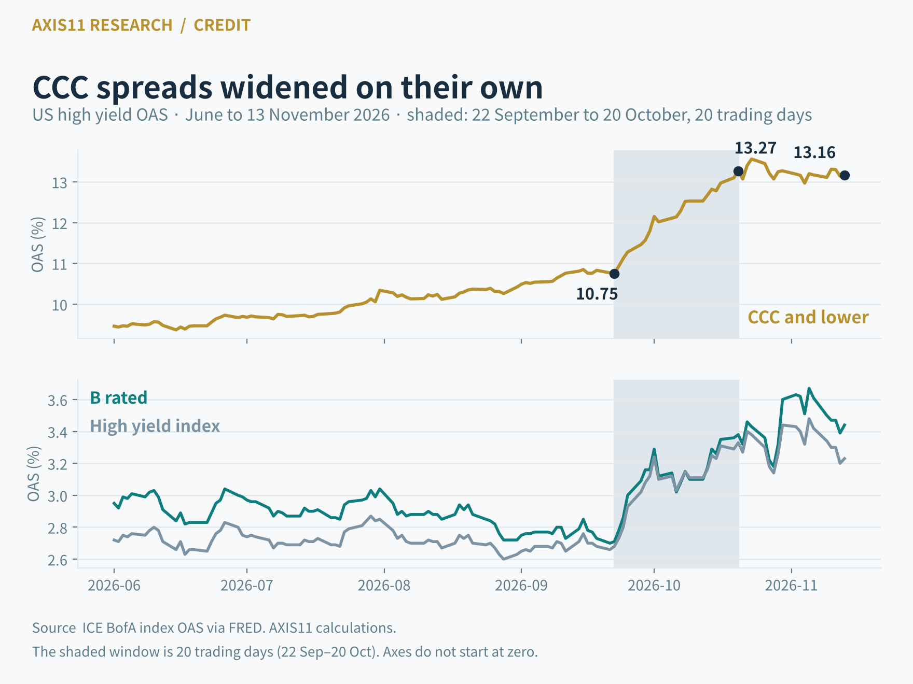
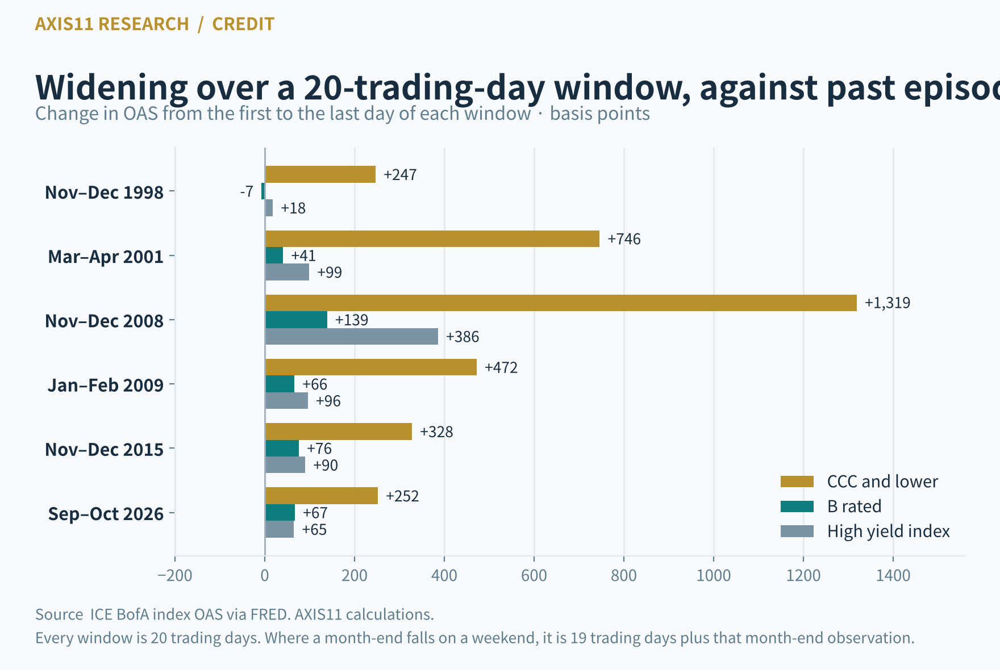
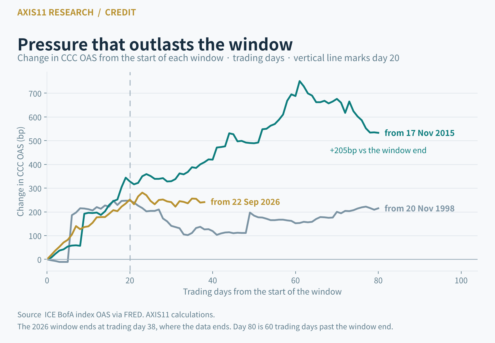

*What October’s sell-off in the lowest-rated bonds tells us about the rest of the credit market*

As US equities pulled back, the sharp widening in CCC spreads raised a question: was stress spreading from the weakest borrowers into the broader credit market? So far, the evidence points to concentrated stress against a backdrop of wider high yield spreads. With rates still high and inflation a concern, the distinction is worth watching.

Broad widening can signal that investors are reassessing growth or monetary policy. A much larger move at the bottom of the ratings scale can also reflect trouble at a handful of issuers. October showed both: a rise in spreads across high yield and a much sharper repricing in CCC and lower.

From 22 September to 20 October 2026, the option-adjusted spread (OAS) on US corporate bonds rated CCC and lower widened **252bp, from 10.75% to 13.27%**. The B spread widened 67bp and the broad high yield index 65bp. The gap between CCC and B widened by **185bp** over the same period.

*CCC and lower rose from 10.75% to 13.27% over the shaded window, while B and the index rose by about a quarter as much.*

## 1. Issuer stress and refinancing costs

**Stress was concentrated in a handful of issuers and sectors.** Vanguard’s November analysis found that four of roughly 150 CCC issuers in the Bloomberg high yield index accounted for more than 30% of the segment’s spread level at the time. Janus Henderson identified cable and satellite and wireline telecom as major contributors to the widening. CSC Holdings illustrates why: the cable operator faces stronger competition and pressure on revenue while carrying heavy debt. As earnings weaken, servicing that debt becomes harder and replacing it can cost more.

**Expensive refinancing can magnify those pressures.** A borrower with steady cash flow and distant maturities can wait for better conditions. A heavily indebted borrower with bonds coming due has less room to wait when investors demand a higher spread. Thin trading or concentrated selling can push its bond prices down further.

The two analyses support the case for concentration. Both use Bloomberg indexes, however, so they cannot tell us how much of the **252bp move in the ICE index** came from individual issuers or sectors. Vanguard’s figure measures concentration in the spread level, a separate question from who drove the widening.

## 2. How October compares with previous episodes

The chart compares spread changes across six windows using 20 daily observations per window. The methods section explains how weekend month-end marks are treated.

*On the same 20-observation basis, this widening is close to 1998 and about a fifth of 2008. What differs is that B and the index moved with it.*

**1998 was the clearest case of stress confined to the lowest ratings.** After Russia’s default and the LTCM crisis, CCC widened 247bp from 20 November to 18 December, while B tightened 7bp and the S&P 500 rose 2.1%. The Federal Reserve had cut rates to 4.75% shortly before the window opened. The CCC move was close to October 2026’s, but B and the broad index widened in the current episode.

**2015 offers a closer comparison across ratings.** Oil prices fell and Third Avenue’s fund, which held low-rated debt, adopted a liquidation plan under redemption pressure. CCC widened 328bp, B 76bp and the broad index 90bp. The S&P 500 fell just 0.34%, and the Fed’s first hike came the day after the window closed. Energy and fund liquidity were prominent then; recent commentary has focused more on telecom and media issuers.

The 2015 episode also shows how long sector stress can last. Sixty trading days after the window closed, CCC was another 205bp wider. Weakness in low-rated debt can persist even when large-cap equities hold up during the initial sell-off.

*1998 gave back about half of the widening once the window closed; 2015 widened further. 2026 has held roughly flat through the 18 trading days since.*

**2001 and 2008–09 show what broader stress can look like.** In 2001, the dotcom investment boom broke and the US entered recession. Equities rebounded around the Fed’s emergency cuts, but CCC widened 746bp and the broad index 99bp. In late 2008, CCC widened 1,319bp and the broad index 386bp as the S&P 500 fell about 12% during the window before rebounding. In early 2009, renewed concerns about bank losses and economic contraction coincided with 472bp of CCC widening and an 8.85% fall in the S&P 500. In each case, the low-rated sell-off accompanied stress in the economy or financial system.

## 3. What would show that stress is spreading?

On 13 November, CCC stood at **13.16%**. Over the 20 trading days ending that day, CCC widened 19bp and B widened 9bp, while the broad index tightened 8bp. CCC spreads remain elevated, but the gap with B is widening more slowly than it did in October.

The evidence so far is consistent with stress concentrated in vulnerable telecom and media issuers, with high refinancing costs a plausible amplifier. The first test is whether CCC spreads continue to widen after excluding the most distressed issuers. If they do, the strain is broader **within CCC**. The second test is whether B and BB also show wider spreads, weaker new issuance and more downgrades. Deterioration across those measures would make the case for a broader credit problem stronger.

## Data and method

- Spreads are the option-adjusted spreads of the ICE BofA US high yield indexes (index, B rated, CCC and lower), taken from FRED's daily series. The sample runs from 31 December 1996 to 13 November 2026 and uses only days on which all three series are observed (7,801 days).
- Every window is **20 trading days**, which is close to a calendar month. The series does carry month-end values dated to a weekend (101 of the 7,801 observations), so the 2008 and 2009 windows are 19 trading days plus one such month-end observation. Basis points in the text are differences in the percentage values multiplied by 100, and are rounded.
- The episode windows are 20 November to 18 December 1998, 27 March to 24 April 2001, 18 November to 15 December 2008, 30 January to 26 February 2009, 17 November to 15 December 2015, and 22 September to 20 October 2026.
- The horizontal axis in Figure 3 counts trading days from the start of each window. Day 20 is the end of the window and day 80 is 60 trading days past it. The 2026 window is drawn only to day 38, where the data ends on 13 November.
- The S&P 500 moves, the Vanguard and Janus Henderson analyses and the issuer-level detail are citations from outside this dataset. Both managers use the Bloomberg index, so they are not used to attribute the ICE index's widening to sectors or issuers.
- Index spreads also change as constituents enter and leave the index. They do not track the same set of companies over time.
