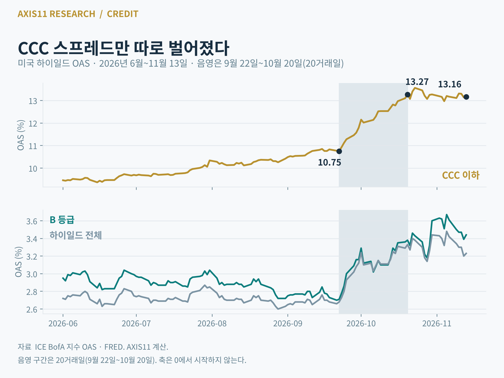
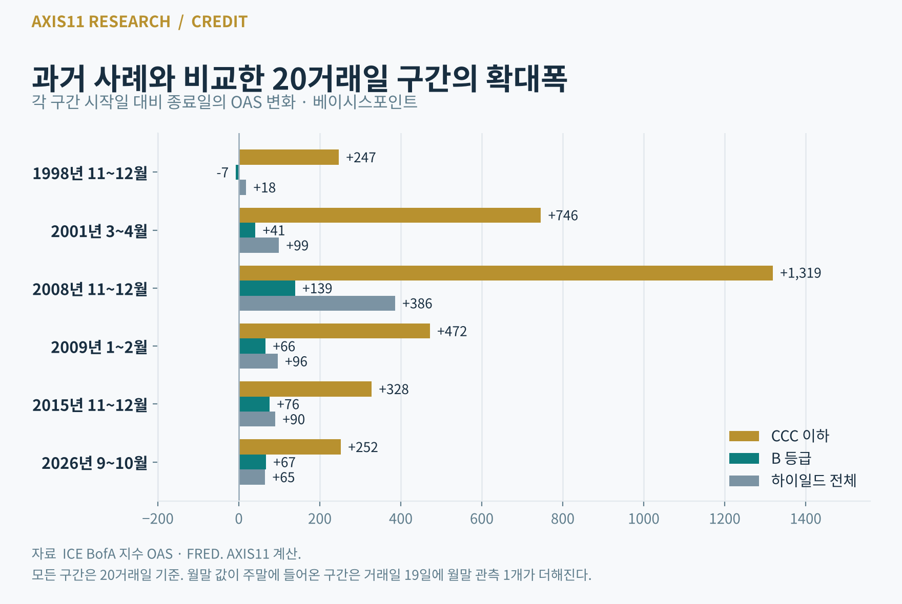
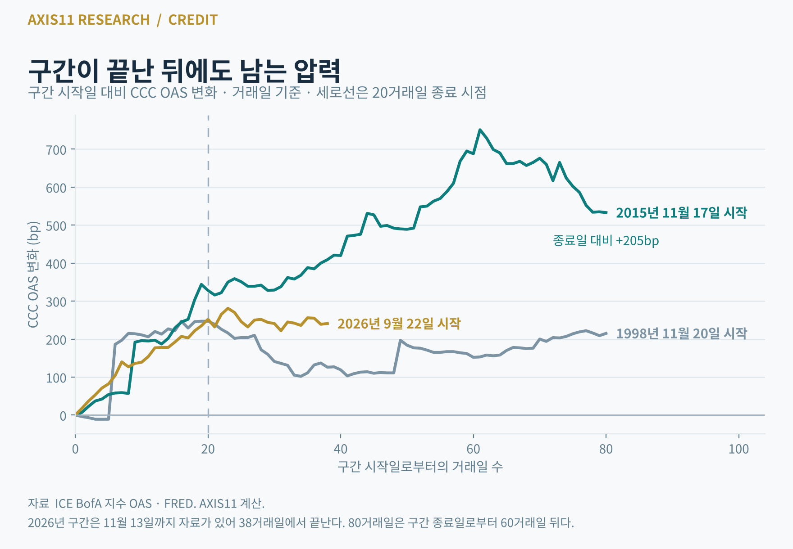

*252bp 확대가 어디에 몰렸는지, 과거 사례는 어떻게 달랐는지, 지금 무엇을 확인해야 하는지*

최근 미국 주식시장이 조정을 받으면서 신용시장도 함께 살펴봤다. CCC 스프레드의 확대만 떼어 놓고 보면, 가장 불안한 곳에서 먼저 문제가 생겨 점차 번지고 있다는 해석이 가능하다. 실제로 자료가 그런 조짐을 보여주는지가 이 노트의 질문이다. 결론부터 말하면, 아직은 시장 전반의 신용 위험으로 볼 만한 요인이 보이지 않는다. 다만 금리가 높은 가운데 물가가 잡히지 않은 상태이므로 위험 신호는 계속 확인할 필요가 있다.

하이일드 시장 전체의 위험 프리미엄이 높아질 때와, 가장 신용도가 낮은 채권만 따로 재평가될 때는 읽는 방법이 다르다. 전자는 시장이 경기나 정책을 다시 보고 있다는 뜻에 가깝고, 후자는 특정 기업과 업종의 문제가 지수에 드러나고 있다는 뜻에 가깝다. 최근 미국 하이일드에서는 두 가지가 같은 달에 함께 나타났다.

2026년 9월 22일부터 10월 20일까지 미국 CCC 이하 회사채의 옵션조정스프레드, OAS는 **10.75%에서 13.27%로 252bp** 올랐다. 같은 기간 B 등급은 67bp, 하이일드 전체는 65bp 올랐다. 시장 전반에서 요구되는 프리미엄도 높아졌지만, 가장 취약한 구간의 재평가는 그보다 훨씬 컸다. CCC와 B의 격차만 한 달 사이 185bp 더 벌어졌다.

*CCC 이하 OAS는 음영 구간에서 10.75%에서 13.27%로 올랐다. 같은 기간 B와 하이일드 전체의 상승폭은 그 4분의 1 수준이었다.*

## 1 최근 상승을 설명하는 두 가지 요인

첫째는 **일부 업종과 발행사에 집중된 신용 악화**다. 뱅가드의 11월 분석에 따르면 블룸버그 하이일드 지수에서 CCC 발행사 150여 곳 중 네 곳이 당시 CCC 스프레드 수준의 30% 이상을 차지했다. 야누스 헨더슨은 케이블·위성과 유선통신을 스프레드 확대에 크게 기여한 업종으로 지목했다. 케이블 사업자 CSC Holdings가 그런 사례다. 부채가 많은 상태에서 경쟁 심화와 매출 감소 압력을 함께 받았다. 이런 기업은 수익이 줄면 기존 이자 부담을 감당하기 어려워지고, 만기가 돌아올 때 새 채권을 발행하는 비용도 올라간다. 소수 발행사의 채권이 크게 하락해도 등급 지수에는 뚜렷하게 나타날 수 있다.

둘째는 **높은 차환 비용이 취약 기업의 문제를 증폭시킨다는 점**이다. 같은 금리 환경에서도 현금흐름이 안정적이고 만기가 넉넉한 기업은 버틸 여지가 있다. 반대로 이자 부담이 크고 만기가 가까운 회사는 투자자가 요구하는 스프레드가 조금만 높아져도 자금조달이 어려워진다. 여기에 거래가 뜸해지거나 매도가 몰리면 채권 가격은 더 떨어진다.

두 운용사의 분석은 이런 집중 현상을 뒷받침한다. 다만 두 분석은 블룸버그 지수를 사용하므로, 이를 근거로 ICE 지수의 252bp 가운데 각 업종이나 발행사가 몇 bp를 설명하는지까지 계산할 수는 없다.

## 2 과거 사례가 보여주는 차이

같은 기준으로 과거를 보면 이번 확대폭의 위치가 분명해진다. 아래는 모두 20거래일 구간에서 계산한 값이다.

*이번 확대폭은 1998년과 비슷하고 2008년의 5분의 1 수준이다. 다른 점은 B와 하이일드 전체가 함께 움직였다는 것이다.*

**1998년은 등급 간 분리가 가장 뚜렷했다.** 러시아 채무불이행과 LTCM 위기 이후, 11월 20일부터 12월 18일까지 CCC는 247bp 벌어졌지만 B는 7bp 좁아졌고 S&P 500은 2.1% 올랐다. 연준은 구간 직전에 금리를 4.75%로 내렸다. 시장 전반의 위험 선호가 회복되는 동안에도 가장 취약한 채권에는 매도 압력이 남을 수 있다는 사례다. 최근에도 등급 간 격차는 크게 벌어졌지만, 이번에는 B와 하이일드 전체도 함께 올랐다는 차이가 있다.

**2015년은 업종 충격이 저등급 채권에 집중된 사례다.** 유가가 하락하고, 저등급 채권에 투자하던 Third Avenue 펀드가 환매 압력 속에 청산 계획을 채택했다. 그 구간에 CCC는 328bp, B는 76bp, 하이일드 전체는 90bp 벌어졌다. S&P 500은 0.34% 하락하는 데 그쳤고, 연준의 첫 인상은 구간 종료 다음 날이었다. 세 등급의 움직임만 보면 최근과 닮았다. 당시에는 에너지와 펀드 유동성이 두드러졌고, 이번 공개 분석에서는 통신·미디어 쪽의 발행사별 문제가 더 두드러진다.

차이는 구간이 끝난 뒤에 나타났다. 2015년에는 구간이 끝나고 60거래일이 지난 뒤에도 CCC가 종료일보다 205bp 더 넓었다. 업종의 문제가 지속되면 대형주가 버티는 동안에도 저등급 채권의 압박은 길어질 수 있다.

*1998년은 구간이 끝난 뒤 확대폭의 절반가량을 되돌렸고, 2015년은 오히려 더 벌어졌다. 2026년은 구간 종료 뒤 18거래일 동안 비슷한 수준을 유지하고 있다.*

**2001년과 2008~09년은 스트레스가 더 넓게 번진 사례다.** 2001년에는 닷컴 투자 붐이 꺾이며 미국이 경기침체에 들어갔다. 연준의 긴급 인하를 전후해 주가는 반등했지만, 해당 구간에 CCC는 746bp, 하이일드 전체도 99bp 벌어졌다. 2008년 말에는 CCC가 1,319bp, 하이일드 전체가 386bp 확대됐다. S&P 500은 구간 중 약 12% 급락했다가 반등했다. 2009년 초에는 은행 손실과 경기 위축 우려가 다시 커지면서 CCC가 472bp 벌어지고 S&P 500은 8.85% 하락했다. 이들 사례에서는 저등급 채권의 악화와 함께 실물경제나 금융시스템의 스트레스도 확인됐다.

## 3 지금 무엇을 봐야 하나

11월 13일 기준 CCC는 **13.16%**다. 이날 끝나는 20거래일 구간에서 CCC는 19bp, B는 9bp 올랐고 하이일드 전체는 8bp 좁아졌다. **CCC의 위험 프리미엄은 여전히 높지만, 상대 격차가 벌어지는 속도는 10월보다 둔화했다.**

현재 자료가 가장 직접적으로 뒷받침하는 해석은 **통신·미디어의 일부 취약 발행사에 신용 악화가 집중됐고, 높은 차환 부담이 그 충격을 키웠다**는 것이다. 이 해석을 확인하려면 두 가지를 보면 된다. 첫째, 부실도가 높은 소수 발행사를 제외해도 CCC 채권의 스프레드가 폭넓게 오르는지다. 둘째, B와 BB에서도 스프레드 확대, 신규 발행 위축, 등급 하향이 함께 나타나는지다.

첫 번째 움직임만 두드러지면 저등급 내부의 문제로 볼 근거가 강하다. 두 번째까지 뚜렷해지면 신용 스트레스가 시장 전반으로 번지고 있다는 판단에 더 무게를 둘 수 있다.

## 데이터와 방법

- 스프레드는 ICE BofA 미국 하이일드 지수의 옵션조정스프레드(전체·B 등급·CCC 이하)이며, FRED의 일별 자료를 사용했다. 표본은 1996년 12월 31일부터 2026년 11월 13일까지이고, 세 계열이 모두 관측된 날만 사용했다(7,801일).
- 모든 구간은 **20거래일**이다. 달력으로는 한 달에 가깝다. 다만 이 계열에는 월말 값이 주말 날짜로 들어오는 경우가 있어(전체 7,801개 중 101개), 2008년과 2009년 구간은 거래일 19일에 월말 관측 1개가 더해진 형태다. 본문의 bp는 백분율 값의 차이에 100을 곱한 값이며 반올림했다.
- 사례 구간은 1998년 11월 20일~12월 18일, 2001년 3월 27일~4월 24일, 2008년 11월 18일~12월 15일, 2009년 1월 30일~2월 26일, 2015년 11월 17일~12월 15일, 2026년 9월 22일~10월 20일이다.
- 차트 3의 가로축은 구간 시작일부터 센 거래일 수다. 20거래일이 구간 종료 시점이고, 80거래일은 종료일로부터 60거래일 뒤다. 2026년 구간은 자료가 11월 13일에서 끝나 38거래일까지만 그렸다.
- S&P 500 변화율, 뱅가드·야누스 헨더슨의 분석, 발행사별 사정은 이 데이터셋에 포함되지 않은 인용이다. 두 운용사의 분석은 블룸버그 지수를 사용하므로 ICE 지수의 확대폭을 업종·발행사별로 나누는 근거로 쓰지 않았다.
- 지수 스프레드는 구성 종목의 편입·편출에 따라서도 달라진다. 같은 기업군을 계속 추적한 결과가 아니다.
