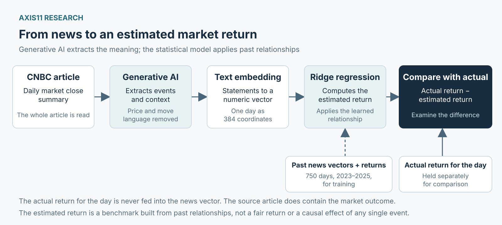

*Using past news–return relationships to put today’s market reaction in context*

## 1. A plausible story is easy to find after the move

The same interest-rate news can accompany rising shares one day and falling shares another. A rally becomes evidence of a strong economy; a sell-off reflects concern that rates will stay high. Both explanations sound plausible once the outcome is known.

The harder question is what evidence would favour one explanation over the other. What happened that day? How has the market responded to similar information in the past? How different was today’s reaction?

**AXIS11 built a model using CNBC’s public news and generative AI to provide a consistent benchmark for those questions.** It compares the day’s return with a value estimated from historical news–return relationships. This is an analysis of a market move that has already happened, with procedures designed to reduce the temptation to choose a story that fits it. The daily record appears on AXIS11 Research’s [Market Pulse](https://gregkkang.github.io/axis11.github.io/market-pulse/).

## 2. The research behind the approach

Bryan T. Kelly, Yinan Su and Chao Zhang’s 2026 NBER paper, **“Explaining Realized Returns: Roll’s R² 40 Years Later,”** asks how much of a market move can be explained even after the day’s information is available.[^1]

Forecasting is difficult, but explaining past returns is surprisingly difficult too. The paper revisits Richard Roll’s question using modern data and AI. Conventional numerical variables often produce negative out-of-sample explanatory power for monthly returns, with the remaining results generally below 10%.[^1]

Numbers alone leave out context. Inflation of 3% means something different when investors expected 2.8% rather than 3.2%. The composition of the release and its implications for monetary policy matter as well.

News reports contain that context. The researchers used generative AI to extract journalists’ explanations from Wall Street Journal market summaries, then related the extracted text to returns. They filtered out price and return language such as “the index fell 2%”: including the outcome in the input would give the model the answer it was meant to explain.[^1]

## 3. Turning news into numbers

A **text embedding** represents language as a set of numbers. Think of it as giving a sentence coordinates based on its meaning.

“Inflation exceeded expectations” and “prices rose more than forecast” describe similar events despite using different words. “Inflation slowed more than expected” describes a different event. An embedding represents these similarities and differences numerically.

A regression then learns how those representations relate to historical returns. Applied to a new day’s news, it estimates a return from that learned relationship. This can capture more context than a simple count of positive and negative words.

For illustration, suppose the news describes unexpectedly high inflation and reduced expectations for rate cuts. The model estimates a return of −1.5%, while the S&P 500 falls 2%. The actual return is 0.5 percentage points below the model’s estimate.

That gap prompts further questions. Did the model miss another event? Was the inflation surprise unusually large? Had investors’ priorities changed? **It does not establish that the market overreacted by 0.5 percentage points.** Missing information and model error can also explain the difference. These figures are hypothetical.

## 4. What the paper’s R² means

The figures supplied for this note put the paper’s out-of-sample R² at **29.82% daily and 40.30% monthly**. The official abstract reports approximately 30–40%; the exact table values and benchmark definitions remain to be independently checked.[^2]

Out-of-sample evaluation means testing the learned relationship on observations excluded from training. R² measures the reduction in squared error relative to a benchmark. It is not a directional hit rate: 40% does not mean the model was right on 40 days out of 100.

If the benchmark’s total squared error is 100 and the model’s is 60, R² is 40%. A monthly R² of 40.30% therefore means an error of about 59.70 on that scale. Squaring errors gives greater weight to large misses. Daily and monthly results use different observation units, so they should not be read as directly comparable forecasting accuracy.

**Out-of-sample explanation is also different from forecasting.** An article written after the close already reflects the day’s events and market reaction. Removing explicit price language does not undo the journalist’s choice of which events to emphasise after seeing the outcome. This limitation applies to AXIS11’s approach too.

## 5. The AXIS11 model

AXIS11 applies the approach to CNBC’s US market close summaries. The baseline has three stages:

1. **Generative AI extracts the news:** the events, expectations and relationships described in the article.
2. **A local embedding model represents the text numerically.**
3. **A Ridge regression estimates the return** associated with that representation, using relationships learned from earlier news and returns.

An earlier version relied on programmed sentence patterns to extract causal statements. It missed context and relationships between companies. Generative AI now reads the full article, extracting policy, macroeconomic, earnings, guidance, investment and geopolitical information relevant to that day. Programmatic checks verify supporting quotations and file consistency.

The extraction preserves who acted, who was affected and when the information became relevant. Strong overall earnings and weak guidance for one segment are both retained. Actual releases are distinguished from expectations, and new announcements from older news resurfacing. The AI is instructed to leave expectation figures unspecified when the article provides none.

These distinctions matter. An expected rate hold and an unexpected increase are different events, even though both mention interest rates.

The extracted statements exclude traded-asset prices, realised direction, returns and relative performance, including those of shares, indices, oil and bonds. Policy rates, inflation readings, company revenue and investment amounts remain because they describe the economic events. **The aim is to remove the market outcome from the input while retaining the facts needed to interpret it.**

*Figure 1. Generative AI extracts news information; the embedding and Ridge regression convert it into an estimated return for comparison with the actual return. Historical returns train the regression. The return for the day being analysed is excluded from the news-vector input.*

## 6. Data and checks

The source collection contains **752 articles for 2023–2025 and 208 through 29 October 2026: 960 in total**. URL dates can differ from trading dates, so articles were aligned by checking their text, index closes and other details. The target is the S&P 500 price index’s daily log return, calculated from FRED observations.

Each extracted information unit includes a supporting quotation. Programmatic checks covered date gaps, duplicates and source hashes across the 960 dates, and confirmed that all **6,333 evidence quotations** appear in the source articles. Of **4,125 information units** returned, 31 were corrected locally and 9 withheld, leaving **4,116** in use.

Quotation matching verifies the source text, not the interpretation. The AI could still link an event to the wrong actor or date, or omit relevant information. The checks were not an independent review of every extraction and did not measure the omission rate.

Each day’s English statements are grouped and converted into **384 numbers** by a local BGE-small embedding model. Ridge regression learns their relationship with the same day’s return. Neither the generative AI nor the embedding model was fine-tuned on this dataset.

The final training sample contains **750 days in 2023–2025**. Two dates—21 June and 22 November 2024—were excluded because no non-price information could be extracted. They were not assigned zero returns.

Ridge regression balances fit against a penalty on large coefficients. The penalty parameter, alpha, is currently fixed at **1**. This baseline setting was chosen to allow differences in the news representations to come through; it has not been validated as optimal.

The roles are distinct: AI extracts, the embedding represents, and regression estimates. **The AI does not directly decide what today’s “fair” return should be.** The regression coefficients also cannot be read as separate contributions from identifiable events such as earnings or interest rates.

## 7. What the baseline achieved

The model was assessed both on its training data and on later observations. Within the training period, chronological validation used earlier data to estimate relationships and later data to evaluate them.

| Evaluation | Days evaluated | R² |
|---|---:|---:|
| Fit to the 2023–2025 training data | 750 | 25.69% |
| Chronological validation within the training period | 561 | 1.57% |
| 2026 sample with available returns | 207 | 5.83% |

*The 2026 evaluation uses the 207 days for which independent FRED price data was available; 29 October is excluded.*

The 25.69% training fit falls to 1.57% in chronological validation and 5.83% in 2026. **Most of the apparent explanatory power did not carry into other periods.** The current baseline’s ability to explain returns is limited.

The 2026 sample was not used to fit regression coefficients or choose alpha. However, the extraction process and model design were revised after reviewing 2026 articles and results. It is therefore not a fully independent final test.

## 8. Reading Market Pulse

[Market Pulse](https://gregkkang.github.io/axis11.github.io/market-pulse/) records four things together: **the main news, the model’s estimated return, the actual return and the difference**.

A return above the estimate means the market performed better than this historical-relationship benchmark; a return below it means it performed worse. Neither statement, by itself, explains why. If the estimated and actual returns have opposite signs, the first issue is the model’s failure to reconstruct the direction.

Past evaluation errors provide context for the gap. A recent draft used the preceding **203 days** to construct **80% and 95% reference ranges**. These describe historical reconstruction errors. They are not fair-value bands or intraday trading ranges, do not isolate comparable events, and do not guarantee the same future coverage.

The model combines relationships across many articles rather than retrieving one closely matched historical day. Its residual can reflect omitted news, offsetting events, changing market relationships or estimation error. It is not a measure of overreaction or underreaction to a particular announcement.

Hindsight bias remains a further limitation. The source article contains the market outcome even when that language is removed from the extracted input. Publication times, article revisions and extraction completeness still require attention. Source quotations and the exclusion of price language help make the process more auditable, but cannot eliminate that problem.

The purpose of the daily record is to ask a consistent question: **what happened, what return do past news relationships associate with it, and how different was the actual move?** Recording misses alongside better explanations makes the benchmark useful for reviewing market narratives—and for identifying where the model itself needs improvement.

---

## Sources and open items

[^1]: Kelly, B. T., Su, Y., & Zhang, C. (2026), "Explaining Realized Returns: Roll's R² 40 Years Later," NBER Working Paper 35885, October 2026. The official abstract confirms the research question, the low explanatory power of conventional variables, the use of generative AI to extract newspaper-stated reasons with price and return language filtered out, and out-of-sample explanatory power of around 30–40% at the daily and monthly frequencies. <https://www.nber.org/papers/w35885>
[^2]: **Source table still to be checked:** access restrictions on the source PDF meant the table itself, and the definitions of the out-of-sample split and benchmark, could not be independently cross-checked.
