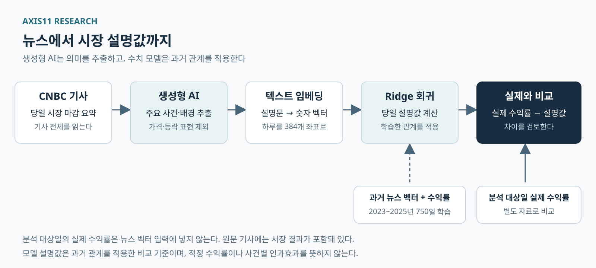

*뉴스를 과거의 경험과 비교해 오늘의 반응을 읽는 방법*

## 1. 시장이 오른 다음에야 그럴듯해지는 설명

같은 금리 뉴스가 나와도 어떤 날은 주가가 오르고, 어떤 날은 떨어진다. 시장이 오르면 "경기가 강하다는 신호"라고 하고, 시장이 내리면 "높은 금리가 오래 유지될 우려"라고 설명한다. 두 이야기 모두 가능하지만, 결과를 먼저 본 뒤 그 결과에 맞는 이유를 고르면 어떤 움직임에도 그럴듯한 설명을 붙일 수 있다.

문제는 설명이 그럴듯한지와 설명에 근거가 있는지가 다르다는 데 있다. 그날 실제로 어떤 일이 있었는지, 비슷한 일이 과거에 일어났을 때 시장은 어떻게 반응했는지, 오늘의 반응은 그 경험과 얼마나 달랐는지를 함께 살펴봐야 한다.

**AXIS11이 CNBC의 공개 뉴스와 생성형 AI로 모델을 만든 목적은 이 비교 기준을 갖추기 위해서다.** 시장이 움직인 결과에 맞춰 이야기를 바꾸는 일을 줄이고, 실제 사건과 과거의 관계를 바탕으로 오늘을 이해하려는 시도다. 이미 일어난 시장을 분석하되, 결과에 맞춰 설명을 고르는 사후 편향을 줄이려 한다. 매일의 결과는 AXIS11 Research의 [Market Pulse](https://gregkkang.github.io/axis11.github.io/market-pulse/)에 기록한다.

## 2. 논문이 던진 질문: 지나간 시장도 제대로 설명하기 어렵다

Bryan T. Kelly, Yinan Su, Chao Zhang의 2026년 NBER 논문 **「Explaining Realized Returns: Roll's R² 40 Years Later」**는 단순해 보이는 질문을 던진다. "시장이 움직인 뒤에 그날 있었던 정보까지 모두 볼 수 있다면, 우리는 그 움직임을 얼마나 설명할 수 있을까?"[^1]

미래를 예측하기 어렵다는 것은 익숙한 이야기다. 그런데 이미 발표된 물가, 기업 실적, 금리와 자금 흐름을 알고 있어도 지나간 수익률을 충분히 설명하기는 어렵다. 이 논문은 Richard Roll이 제기했던 문제를 현대적인 자료와 AI로 다시 살펴본다. 전통적인 숫자 자료만 사용하면 월간 표본 밖 설명력이 음수이거나 10% 미만인 경우가 많다는 것이 연구의 출발점이다.[^1]

왜 숫자만으로는 부족할까? 예를 들어 물가상승률이 3%라는 사실만으로는 그날 시장의 해석을 알기 어렵다. 예상은 2.8%였는지 3.2%였는지, 어느 항목이 높았는지, 중앙은행의 다음 결정에 어떤 의미가 있는지가 중요하다. 같은 숫자라도 예상과 상황에 따라 의미가 달라진다.

뉴스에는 이런 맥락이 문장으로 담겨 있다. 연구진은 월스트리트저널의 시장 요약 기사에서 기자가 시장 움직임의 이유로 제시한 내용을 추출하고, 이를 수익률과 연결했다. 다만 "지수가 2% 하락했다" 같은 가격·수익률 표현은 걸러냈다. 설명하려는 답을 입력에 넣으면 모델이 사건을 이해한 것처럼 보일 수 있기 때문이다.[^1]

## 3. 텍스트 임베딩: 문장을 '의미의 좌표'로 바꾼다

컴퓨터가 뉴스와 수익률의 관계를 학습하려면 문장을 숫자로 표현해야 한다. 이때 사용하는 것이 텍스트 임베딩이다. 어렵게 들리지만, 문장에 의미의 좌표를 붙이는 방법이라고 생각하면 된다.

"물가가 예상을 웃돌았다"와 "예상보다 강한 인플레이션이 확인됐다"는 단어는 달라도 비슷한 상황을 설명한다. 반면 "물가가 예상보다 빠르게 둔화됐다"는 방향이 다른 이야기다. 임베딩은 이런 의미의 차이와 유사성이 숫자 묶음에도 나타나도록 문장을 바꾼다.

그다음 회귀 모델은 이 숫자 묶음과 실제 시장 수익률의 관계를 학습한다. 과거에 어떤 의미의 뉴스가 어떤 수익률과 연결됐는지를 종합해, 새로운 날짜의 뉴스에 대응하는 설명값을 계산한다. 단순히 '좋은 뉴스'와 '나쁜 뉴스'를 세는 것보다 다양한 문맥을 다룰 수 있다.

가상의 하루를 생각해 보자. 예상보다 높은 물가가 발표됐고, 뉴스에는 금리 인하 기대가 후퇴했다는 내용이 실렸다. 모델이 이 문구를 바탕으로 −1.5%를 계산했고 실제 S&P 500은 −2% 움직였다고 가정하자. 실제 움직임은 모델 설명값보다 0.5%포인트 더 낮았다.

이 차이는 질문의 출발점이다. 함께 나온 다른 악재가 있었는지, 물가 발표가 예상에서 얼마나 벗어났는지, 시장의 관심이 달라졌는지 살펴볼 수 있다. 차이만으로 "시장이 0.5%포인트 과잉반응했다"고 확정할 수는 없다. 모델이 놓친 정보도 있기 때문이다. 위 숫자는 설명을 위한 가상 예시이며 실제 연구 결과는 아니다.

## 4. 일간 29.82%, 월간 40.30%를 쉽게 읽는 방법

논문의 OOS R²는 일간 **29.82%**, 월간 **40.30%**로 제시된다.[^2] 먼저 OOS는 모델의 관계를 학습하는 데 사용하지 않은 관측치로 평가한다는 뜻이다. 공부할 때 본 문제를 그대로 다시 푸는 데서 그치지 않고, 학습에 쓰지 않은 문제에서도 설명이 통하는지 확인하는 셈이다.

R²는 주가 방향을 맞힌 확률이 아니다. 100일 중 40일을 맞혔다는 뜻도 아니다. 기준과 비교했을 때 전체 설명 오차가 얼마나 줄었는지를 나타낸다.

예를 들어 뉴스를 사용하지 않는 기준의 오차 점수를 100이라고 가정하자. 모델을 사용한 뒤 점수가 60이 됐다면 오차가 40% 줄었다. 이때 R²는 40%이다. 실제 계산에서는 오차를 제곱하므로 큰 실수를 더 무겁게 센다. 따라서 월간 40.30%는 기준의 제곱오차 합계를 100으로 놓았을 때 모델의 오차가 약 59.70으로 줄었다고 읽으면 된다. 일간과 월간은 평가 단위가 다르므로 두 수치를 미래 예측의 정확도로 비교해서는 안 된다.

특히 **표본 밖 평가와 미래 예측은 다르다.** 학습에 쓰지 않은 날짜라도 그날 시장이 움직인 뒤 작성된 기사를 입력으로 사용했다면 사후 설명이다. 가격 표현을 지워도 기자가 결과를 보고 어떤 사건을 강조했을 가능성은 남는다. 이 한계는 AXIS11의 모델에도 적용된다.

## 5. AXIS11 모델: 생성형 AI가 읽고, 회귀 모델이 계산한다

AXIS11은 이 접근을 CNBC 미국 시장 마감 요약에 적용했다. 현재 기준 모델은 **생성형 AI의 뉴스 의미 추출 → 로컬 텍스트 임베딩 → Ridge 회귀**의 세 단계로 작동한다. 생성형 AI가 주요 정보를 정리한다. 임베딩 모델은 설명문을 숫자로 바꾸고, Ridge 회귀는 과거 뉴스–수익률 관계를 이용해 당일 설명값을 계산한다.

초기에는 프로그램으로 특정 문장 형태를 찾아 원인 절을 골랐지만, 중요한 배경이나 기업 간 관계를 놓치는 문제가 있었다. 현재는 생성형 AI가 기사 전체를 읽고 의미를 추출한다. 기업이나 업종의 움직임에 직접 연결된 원인뿐 아니라, 당일 시장을 이해하는 데 필요한 정책·거시지표·실적과 전망·투자·지정학적 배경도 포함한다. 의미를 고르는 일은 생성형 AI가 맡고, 프로그램은 원문 인용과 파일의 일치 여부 등을 확인한다.

추출할 때는 **사건의 주체, 영향을 받는 대상, 정보의 시점**을 함께 보존한다. 기업 전체 실적은 좋았지만 특정 사업 전망은 나빴다면 양쪽을 담는다. 실제 발표와 사전 예상, 당일 새 정보와 예전 발표의 재등장도 구분한다. 기사에 예상치가 없다면 AI가 임의로 만들어 넣지 않도록 했다.

가령 "금리 동결이 예상된다"와 "예상 밖 금리 인상이 발표됐다"는 전혀 다른 정보다. '금리'라는 단어가 있다는 이유로 같은 재료로 취급하면 시장을 이해하기 어렵다. 생성형 AI를 도입한 이유는 이런 문맥과 관계를 더 온전하게 남기기 위해서다.

입력 설명문에서는 주가·지수·유가·채권 등 거래자산의 가격과 실현된 방향, 수익률, 상대 성과를 제외하는 것을 원칙으로 한다. 반면 정책금리, 물가상승률, 기업 매출과 투자액은 사건의 내용이므로 보존한다. 숫자를 전부 지우는 것이 아니라, **설명할 시장의 결과와 설명에 필요한 경제적 사실을 구분하는 것**이다.

*그림 1. 생성형 AI가 추출한 뉴스 정보를 임베딩과 Ridge 회귀로 수치화한 뒤 실제 수익률과 비교한다. 과거 수익률은 회귀 학습에 사용하며, 분석 대상일의 실제 수익률은 뉴스 벡터 입력에 넣지 않는다.*

## 6. 실제 자료와 검증 절차

수집한 원문은 2023~2025년 **752건**, 2026년 10월 29일까지 **208건**, 총 **960건**이다. URL 날짜와 실제 거래일이 다를 수 있어 본문과 지수 종가 등을 대조해 정렬했다. 설명 대상은 FRED에서 확보한 S&P 500 가격지수의 전 거래일 대비 로그수익률이다.

생성형 AI는 추출한 정보마다 원문 근거 인용을 붙였다. 프로그램 검사에서는 960개 날짜의 누락·중복과 원문 해시를 확인했고, 근거 인용 **6,333개**가 모두 원문에 존재함을 검증했다. 반환된 정보 단위 4,125개 중 31개를 국소적으로 수정하고 9개를 보류해, 최종적으로 **4,116개 정보 단위**를 사용했다.

다만 인용문이 원문에 있다는 사실만으로 AI의 해석까지 모두 정확하다는 뜻은 아니다. 주체나 시점을 잘못 연결했는지, 중요한 정보를 빠뜨렸는지는 별도의 문제이다. 이번 점검은 전 기간을 독립적으로 재검토하거나 누락률을 측정한 검증은 아니다.

추출한 영어 설명문은 하루 단위로 묶어 로컬 BGE-small 임베딩 모델로 384개 숫자로 변환한다. 실제 수익률은 벡터 입력에 넣지 않았다. 그다음 이 벡터와 같은 날 수익률의 관계를 Ridge 회귀로 학습했다. 생성형 AI와 임베딩 모델 자체를 이번 자료로 미세조정한 것은 아니다.

최종 학습 표본은 2023~2025년 **750일**이다. 비가격 정보를 추출하지 못한 2024년 6월 21일과 11월 22일은 제외했으며 수익률 0으로 채우지 않았다.

Ridge는 자료를 맞추는 오차와 지나치게 큰 계수에 대한 벌점을 함께 줄이는 회귀 방식이다. 현재 벌점 강도인 alpha는 1로 고정했다. 뉴스별 차이를 더 반영하기 위해 선택한 설정이며, 검증에서 최적이라고 입증된 설정이라는 뜻은 아니다.

여기서 각 단계의 역할을 구분해야 한다. 생성형 AI는 뉴스의 의미를 추출한다. 임베딩은 설명문을 숫자로 바꾼다. Ridge는 그 숫자와 과거 수익률의 관계를 이용해 설명값을 계산한다. **AI가 오늘의 적정 수익률을 직접 판단하는 구조는 아니다.** 또한 회귀계수를 금리·실적 등 개별 사건의 기여도로 바로 읽을 수도 없다.

## 7. 모델은 얼마나 설명했나?

학습한 자료를 얼마나 잘 맞추는지와 다른 날짜에도 관계가 유지되는지를 나눠 확인했다. 학습기간 안에서는 앞선 기간으로 학습하고 뒤 기간을 평가하는 시간순 검증을 수행했다. 현재 기준 모델의 결과는 다음과 같다.

| 평가 | 평가일 | R² |
|---|---:|---:|
| 2023~2025년 학습자료 자체 적합 | 750일 | 25.69% |
| 학습기간 안 시간순 검증 | 561일 | 1.57% |
| 2026년 수익률 확보 표본 평가 | 207일 | 5.83% |

*2026년 평가는 독립 FRED 가격 자료가 확보된 207일 기준이며, 10월 29일은 제외했다.*

학습자료에서 25.69%라는 수치만 보면 상당한 설명력이 있다고 생각할 수 있다. 하지만 시간순 검증에서는 1.57%, 2026년에는 5.83%였다. 이미 본 자료에 잘 맞는 관계가 다른 기간에도 그대로 유지되지는 않았다. 현재 모델의 설명력에는 분명한 한계가 있다. 2026년 자료는 회귀계수 학습이나 alpha 선택에는 사용하지 않았다. 다만 2026년 기사와 평가 결과를 확인한 뒤 추출과 설계를 수정했으므로, 완전히 독립된 최종 검증으로 보지는 않는다.

## 8. 매일의 브리핑을 어떻게 읽을까?

AXIS11은 이 기준 모델의 결과를 매일 AXIS11 Research의 [Market Pulse](https://gregkkang.github.io/axis11.github.io/market-pulse/)에 게시한다. 독자가 **그날의 주요 뉴스, 과거 관계를 적용한 모델 설명값, 실제 수익률, 둘의 차이**를 함께 볼 수 있도록 하는 것이 목적이다.

실제가 모델보다 높으면 과거 관계를 적용한 기준보다 강한 반응, 낮으면 약한 반응으로 기록할 수 있다. 다만 '더 높다'와 '호재에 더 강하게 반응했다'는 같은 말이 아니다. 모델과 실제의 방향이 반대라면 모델이 방향 자체를 제대로 재구성하지 못했는지부터 봐야 한다.

이 차이가 흔한지 드문지는 해당 날짜보다 앞선 평가일들의 오차와 비교한다. 최근 초안에서는 앞선 203일의 오차로 80%·95% 참고범위를 만들었다. 이는 과거 재구성 오차의 범위이다. 시장의 적정가치 범위나 장중 고가·저가, 미래에도 같은 비율로 들어온다는 보장은 아니다. 같은 종류의 사건만 골라 비교한 빈도도 아니다.

모델은 과거 여러 뉴스와 수익률의 관계를 압축해 사용한다. 매번 가장 비슷한 기사를 찾아 일대일로 대조하는 방식은 아니다. 실제와의 차이에는 빠뜨린 뉴스, 여러 사건의 상쇄, 시장 관계의 변화, 모델 자체의 오차가 함께 들어갈 수 있다. 따라서 이를 특정 사건에 대한 과잉·과소반응으로 곧바로 확정하지 않는다.

생성형 AI를 썼다고 사후 편향이 사라지는 것도 아니다. AI가 읽는 원문에는 이미 시장 성과가 들어 있고, 기자도 결과를 본 뒤 설명을 골랐을 수 있다. 기사 수정 이력과 당시 공개 시각, 의미 추출의 완전성도 확인 과제로 남는다. 가격 표현을 제거하고 원문 근거를 남기는 절차는 이 편향을 줄이고 점검하기 위한 장치이다.

매일의 기록에서 확인하려는 질문은 일관된다. **오늘 무슨 일이 있었고, 과거에 학습한 관계에서는 어떤 움직임과 연결되며, 실제 반응은 얼마나 달랐는가?** 설명이 잘 맞은 날과 맞지 않은 날을 함께 쌓아, 결과에 맞는 이야기를 고르는 습관을 줄이려 한다. 생성형 AI는 그 비교에 필요한 뉴스의 맥락을 정리하고, 수치 모델은 같은 기준으로 질문을 반복할 수 있도록 돕는다.

---

## 출처와 확인 사항

[^1]: Kelly, B. T., Su, Y., & Zhang, C. (2026), "Explaining Realized Returns: Roll's R² 40 Years Later," NBER Working Paper 35885, 2026년 10월. 공식 초록에서 연구 질문, 전통적 변수의 낮은 설명력, 생성형 AI를 통한 뉴스 원인 추출·가격 표현 제거, 일간·월간 약 30~40% OOS 설명력을 확인했다. <https://www.nber.org/papers/w35885>
[^2]: **원문 표 확인 필요:** 정확한 일간 29.82%·월간 40.30%는 의뢰 시 지정된 수치이다. 원문 PDF 접근 제한으로 해당 표 및 OOS 분할·기준값 정의까지 독립 대조하지 못했다. 공식 초록의 약 30~40%와는 부합한다.
