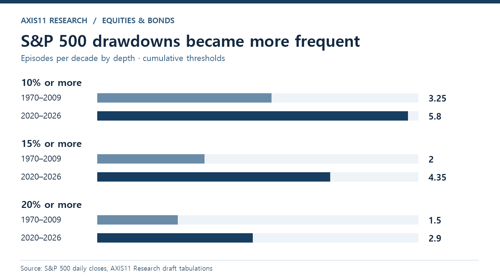
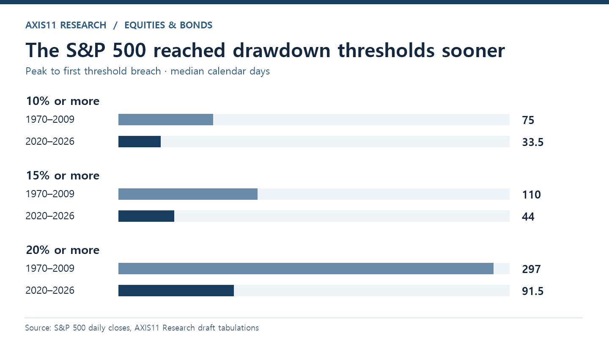
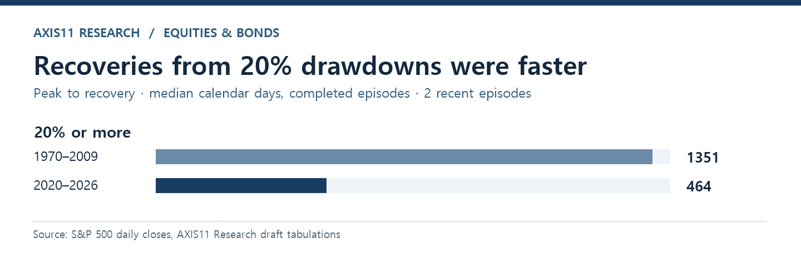
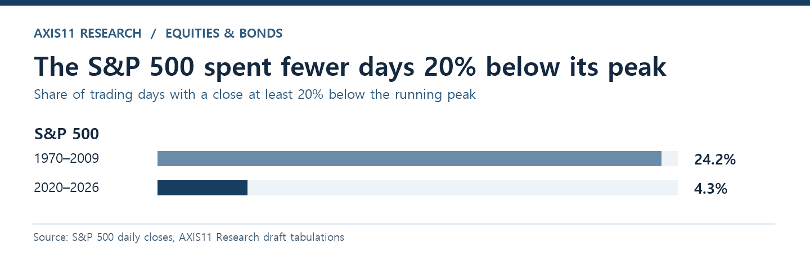
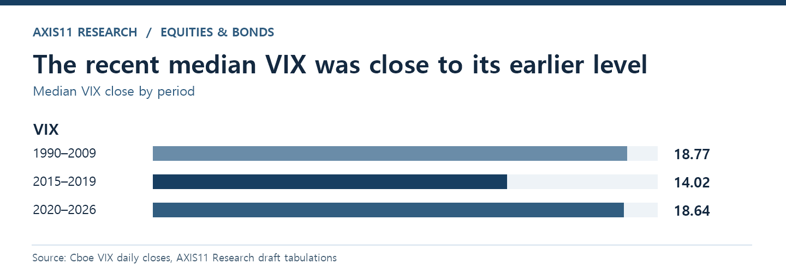
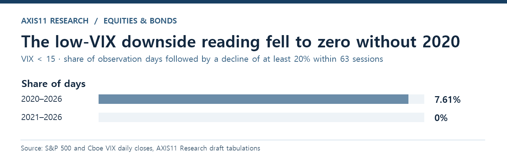
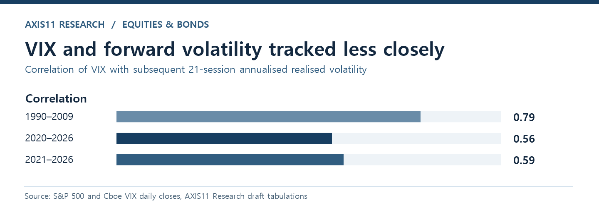
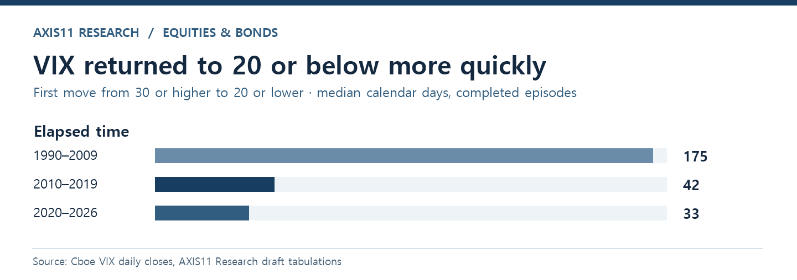

*Faster recoveries do not erase the risk of faster losses*

The long-run record of equities supports the case for staying invested. But during a sell-off, investors do not know whether recovery is months or years away. They must decide whether to hold, reduce exposure or, after selling, buy back in. Those decisions affect their eventual return even if the index later regains its peak.

This note examines daily S&P 500 closes. Comparing 1970–2009 with the period since 2020, the frequency of drawdowns reaching 20% rose from **1.50 to 2.90 per decade**. Yet median peak-to-recovery time fell from **1,351 to 464 calendar days**, and the share of trading days at least 20% below the running peak declined from **24.2% to 4.3%**.

These measures describe different risks: how often losses occur, how quickly they arrive and how long they persist. Faster recovery improves one part of the experience without necessarily making the others easier to manage.

## 1. Defining a drawdown and its recovery

Drawdown measures the decline from the highest closing level reached so far. If an investor buys at 100, the index rises to 120 and then falls to 96, their purchase-price loss is 4%, while the index drawdown is 20%. The episode ends when the index returns to 120.

| Measure | Definition |
| --- | --- |
| Frequency | Episodes reaching each threshold for the first time, scaled to a decade |
| Time to threshold | Calendar days from the peak to the first close at that drawdown |
| Recovery from the trough | Calendar days from the episode's lowest close back to the previous peak |
| Total recovery | Calendar days from the peak back to the same level |
| Share of days underwater | Share of trading days closing at least that far below the previous peak |

Local-peak measures would also capture rallies and renewed declines within a long bear market. Those moves matter to investors who buy or add exposure during it. Here, the question is when the previous running peak is recovered. All intervening rallies and falls belong to the same episode.

The thresholds are cumulative: a 22% drawdown counts in the 10%, 15% and 20% groups. Each threshold has its own first-crossing date. The groups therefore overlap, and a single episode can influence frequency, speed and recovery across all three.

## 2. Large corrections have been more frequent—and faster

*Figure 1. Episodes per decade by depth, counted cumulatively at each threshold.*

The recent sample has higher frequencies at all three thresholds. Drawdowns reaching 10% increased from 3.25 to 5.80 per decade; those reaching 15% rose from 2.00 to 4.35. At 20%, the rate rose from 1.50 to 2.90. **The recent 20% result comes from only two episodes over roughly seven years.** One additional event would materially change the annualised comparison.

Changing the comparison’s starting date preserves the broad direction but changes its magnitude. A separate tabulation puts 10% drawdowns at about 4.1 per decade since 2010 and 5.9 since 2015. The latter is close to the post-2020 rate, and the windows share several episodes. These results offer limited support for identifying 2020 itself as a structural break.

Rolling counts provide another perspective. In a separate tabulation, the latest ten-year window matched the sample maximum for the number of episodes reaching each of the 10%, 15% and 20% thresholds. The recent period has been unusually eventful on this measure.

*Figure 2. Median calendar days from the peak to the first close at each threshold.*

Losses also accumulated faster. Median time from the peak to a 10% drawdown fell from 75 to 33.5 calendar days. At 15%, it fell from 110 to 44 days; at 20%, from 297 to 91.5. These measure the first crossing of each threshold, rather than the time to the eventual trough.

The two-event sample gives an exceptionally rapid fall such as the 2020 Covid crash considerable influence. Still, the practical distinction matters. A 20% loss spread over roughly ten months allows repeated reviews of earnings and risk limits. A similar loss in about three months compresses those decisions. A subsequent recovery cannot restore the time available to respond.

## 3. Deep drawdowns have recovered sooner

*Figure 3. Median calendar days from the peak back to the previous peak for 20% drawdowns, completed episodes.*

For completed episodes reaching 20%, median peak-to-recovery time declined from 1,351 to 464 days—about 66%, or roughly 3.7 years versus 1.3. Earlier episodes remain in their comparison group even if recovery occurred later, provided it is observed by the data cutoff. A financial-crisis drawdown is therefore not excluded simply because recovery came after 2010.

Peak-to-recovery time combines the decline and rebound. A faster fall could shorten it without any improvement in the rebound, so trough-to-recovery time was also examined. That measure was shorter since 2020 for the overlapping 15% and 20% groups, but longer for the 10% group. Faster recovery from the deepest falls has not extended uniformly to shallower corrections.

*Figure 4. Share of trading days with a close at least 20% below the running peak.*

Closes at least 20% below the running peak accounted for 24.2% of trading days in 1970–2009 and 4.3% since 2020. This counts the days actually beyond that threshold, including repeated crossings. Peak-to-recovery time instead includes the entire episode, even after the index has moved back within 20% of its peak.

The earlier sample includes the prolonged 1970s slump, dotcom bust and financial crisis. Long episodes weigh heavily on the share of days underwater, whereas the recent recovery median gives each of two episodes equal weight. Both measures indicate shorter periods of deep losses in the recent sample. Neither establishes how quickly the next drawdown will recover.

## 4. Faster recovery also allows more episodes to be counted

Under this definition, a new drawdown episode can begin only after the previous peak is regained. Five years below a peak count as one episode, however many sharp declines occur within them. A recovery after six months followed by another 20% fall counts as two. Frequency and duration are therefore partly linked by construction.

The hypothetical paths below cover the same ten years. Episodes do not overlap and each recovers within the period.

| Hypothetical path over ten years | Market A | Market B |
| --- | ---: | ---: |
| Episodes of 20% or more | 1 | 4 |
| Peak to recovery per episode | 5 years | 6 months |
| Total time below the previous peak | 5 years | 2 years |
| Share of the period below the previous peak | 50% | 20% |

Market B has more large-loss episodes but less total time below its previous peaks. The last two rows include the full decline-and-recovery periods, rather than only days beyond a 20% loss. This illustrates how more frequent corrections can coexist with shorter periods underwater. **It does not establish which market has the better cumulative return:** that also depends on gains between episodes and the ending index level.

The comparison does not show that faster recoveries cause more frequent corrections. Shock timing, price dynamics and sample composition also matter. Attributing shorter recoveries to policy responses or market structure would require separate evidence from each episode.

## 5. The VIX looks different depending on the comparison period

The VIX expresses the S&P 500’s option-implied volatility over the next 30 days in annualised terms. It measures the size of expected moves in both directions, rather than predicting the market’s direction. [Cboe’s explanation](https://www.cboe.com/insights/posts/what-the-vix-and-vix-1-d-indices-attempt-to-measure-and-how-they-differ)

*Figure 5. Median VIX close by period.*

Median VIX was 18.77 in 1990–2009 and 18.64 since 2020, compared with just 14.02 in 2015–2019. It closed below 15 on about 60% of days in that latter period, versus about 17% since 2020. Recent typical levels resemble the longer historical comparison much more than the unusually calm late 2010s.

Realised S&P 500 volatility has also been about 50% higher since 2020 than in 2015–2019. That measure includes upward and downward moves. Larger daily fluctuations can coexist with faster recovery to a previous peak.

### A low VIX and a subsequent 20% fall

For each observation day, the next test asks whether the S&P 500 subsequently closed at least 20% below that day’s close within 63 trading sessions. The starting price resets daily, unlike the running-peak drawdowns above. The roughly three-month window also extends beyond the VIX’s own 30-day horizon.

| VIX on the observation day | 1990–2009 | 2010–2019 | Since 2020 |
| --- | ---: | ---: | ---: |
| Below 15 | 0.00% | 1.21% | 7.61% |
| 15 to below 20 | 1.75% | 0.12% | 2.21% |
| 20 to below 30 | 5.31% | 0.00% | 0.54% |
| 30 or above | 13.54% | 0.00% | 5.37% |

*Each figure is the share of observation days in that VIX band that were followed, within 63 sessions, by a close at least 20% below the observation day's close.*

*Figure 6. Share of days with the VIX below 15 that were followed by a decline of at least 20% within 63 sessions.*

Since 2020, 7.61% of observation days with VIX below 15 were followed by a 20% decline within 63 sessions. Starting the sample in 2021 reduces that share to 0%. Low VIX has preceded a large fall, but this sample does not show the post-2020 frequency persisting once 2020 is excluded.

Adjacent 63-session windows overlap almost entirely. One crash can produce many qualifying observation days, so these percentages are not counts of independent crashes. A zero means no qualifying observation was found in that sample; it does not establish that the risk was zero.

### The VIX against volatility actually realised

*Figure 7. Correlation of the VIX with subsequent 21-session annualised realised volatility.*

The correlation between VIX and realised volatility over the following 21 sessions fell from 0.79 in 1990–2009 to 0.56 since 2020, or 0.59 excluding 2020. Average VIX remained above subsequent average realised volatility in each period. These findings describe different features: the average gap captures their relative levels, while correlation measures how closely higher VIX readings align with higher subsequent volatility. Neither alone establishes a structural increase in forecast error.

## 6. VIX spikes faded faster, but a return to calm took longer

*Figure 8. Median calendar days from the VIX first reaching 30 or above to its first close at 20 or below.*

Median time from a VIX reading of at least 30 to a close at or below 20 fell from 175 calendar days in 1990–2009 to 42 in 2010–2019 and 33 since 2020. Further spikes before the return to 20 remain part of the same episode. By this measure, elevated implied volatility subsided sooner in recent years.

| VIX shock threshold → return threshold | 1990–2009 | 2010–2019 | Since 2020 |
| --- | ---: | ---: | ---: |
| 25 → 20 | 70 days | 22 days | 15 days |
| 30 → 20 | 175 days | 42 days | 33 days |
| 35 → 20 | 246 days | 42 days | 30 days |
| 40 → 20 | 298 days | 157 days | 194 days |
| 25 → 15 | 790 days | 64 days | 97 days |
| 30 → 15 | 1,345 days | 56 days | 123 days |
| 35 → 15 | 946 days | 55 days | 112 days |
| 40 → 15 | 1,449 days | 137 days | 651 days |

*Median of completed episodes: calendar days from first exceeding the upper threshold to first reaching the lower one.*

A return to 15 produces a different comparison. The 30-to-15 median was 56 days in the 2010s and 123 days since 2020. For shocks reaching 40, the recent period was slower than the 2010s at both return thresholds. The initial retreat from high volatility and the restoration of very low volatility are distinct stages.

## Conclusion

Since 2020, the S&P 500 has experienced large drawdowns more frequently and reached loss thresholds faster than in the long historical comparison. Yet recoveries from deep drawdowns were shorter and fewer trading days were spent at least 20% below the running peak. A market can recover more quickly while leaving investors less time to manage the initial loss.

Recovery time matters to investors who hold through a decline. The speed of the loss also matters to those constrained by risk limits or cash needs, and a rapid rebound raises the cost of delaying re-entry. These are different ways to experience the same market path.

The recent deep-drawdown sample contains only two episodes, and the low-VIX results depend heavily on including 2020. The evidence supports a narrower conclusion than a permanent change in market safety: **in this sample, large-loss episodes became more frequent while deep losses persisted for less time.** Frequency, speed and recovery are needed together to describe that experience.

## Data and method

| Item | Definition and coverage |
| --- | --- |
| S&P 500 | Daily closes, 5 January 1970 to 25 November 2026. Excludes dividends |
| Cboe VIX | Data supplied for January 1990 to November 2026. Combined analysis uses the sample aligned to S&P 500 dates |
| Period labels | "Since 2020" runs to the last observation. 2026 is a partial year |
| Drawdown | Close ÷ the highest close to that date in the data − 1 |
| Episode assignment | The first date each threshold is reached. Peaks before the data begins are out of scope |
| Frequency and recovery | Scaled to a decade by the length of the period. Recovery is the median calendar days of episodes completed by the last observation |
| Realised volatility | Standard deviation of daily simple returns × √252 |
| Subsequent realised volatility | Annualised standard deviation of log returns over the following 21 sessions |
| Subsequent decline | Lowest close within the following 63 sessions against the observation day's close. Windows overlap |
| VIX normalisation | Calendar days from first exceeding the upper threshold to first reaching the lower threshold. Completed episodes |

*Source: AXIS11 Research tabulations of the supplied S&P 500 and Cboe VIX daily closes. The text and charts draw on the same tabulations.*
