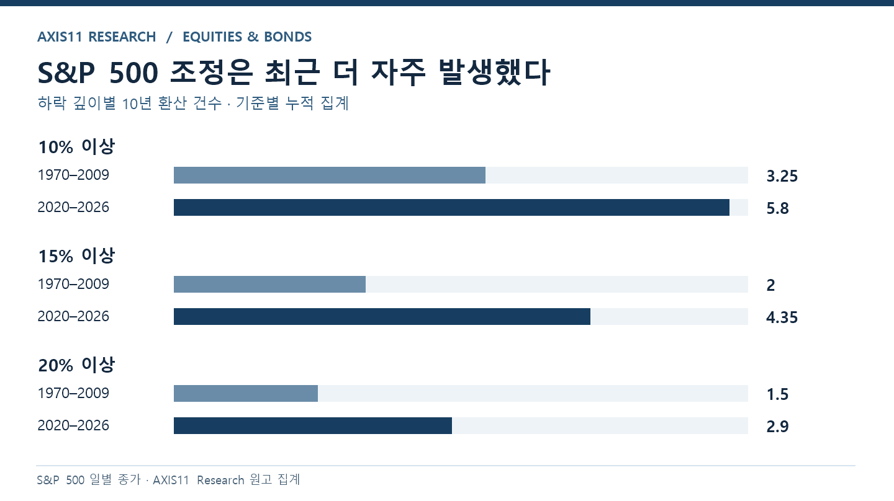
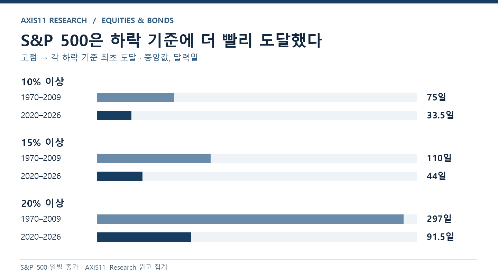
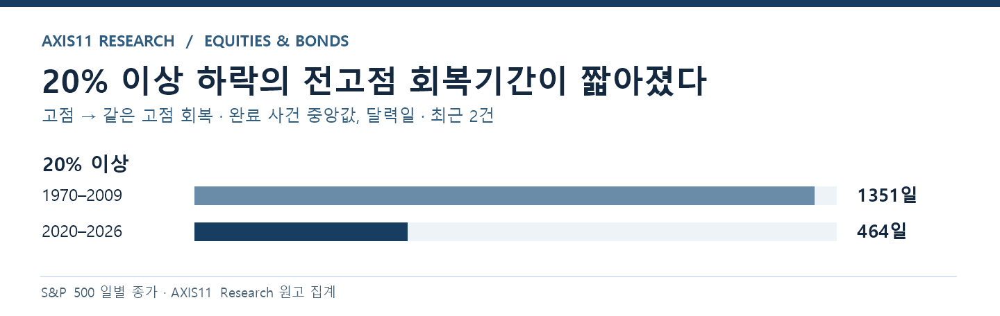
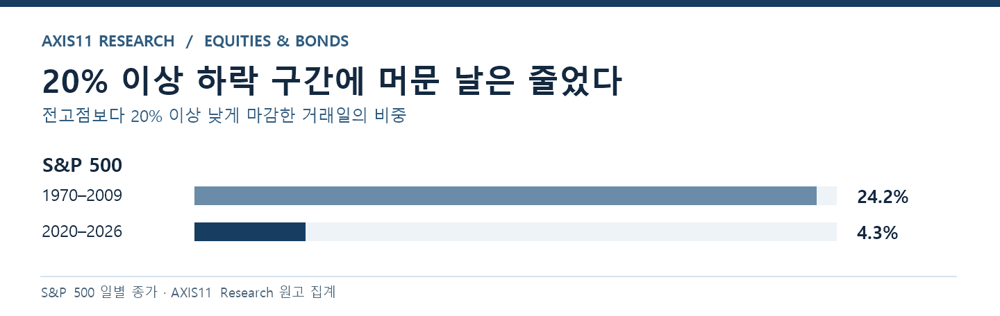
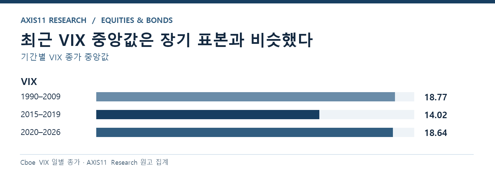
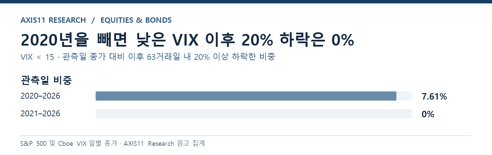
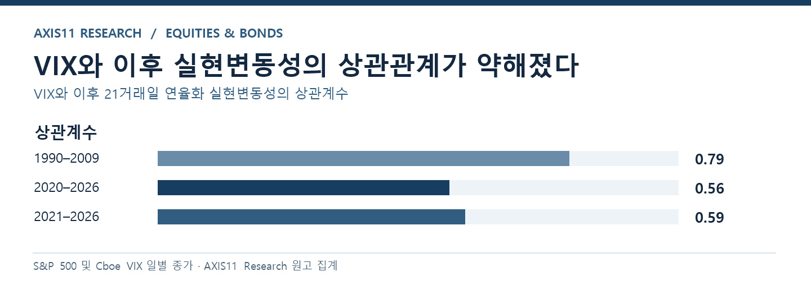
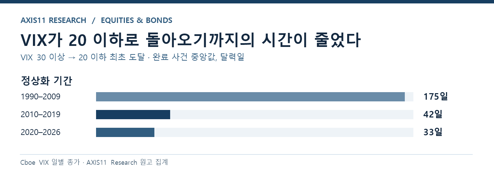

*조정은 더 자주 찾아왔고, 하락에 대응할 시간은 짧아졌다. 깊은 손실 상태에 머문 기간은 오히려 줄었다.*

투자는 장기적 관점에서 해야 한다는 얘기를 자주 듣는다. 주식의 장기 누적 성과를 보면 그 의미는 충분히 이해된다. 하지만 막상 시장이 하락하는 동안 투자자는 그 조정이 몇 달 만에 끝날지 알 수 없다. 보유를 이어갈지, 위험을 줄일지, 줄였다면 언제 다시 늘릴지 결정해야 한다. 지수가 전고점을 되찾아도 하락 중에 내린 결정은 장기 성과에 남는다.

S&P 500 일별 종가를 분석해 봤다. 1970~2009년과 2020년 이후를 비교하면, 20% 이상 하락은 10년 환산 1.50건에서 2.90건으로 늘었다. 같은 깊이의 조정에서 전고점을 회복하기까지 걸린 기간의 중앙값은 1,351일에서 464일로 줄었다. 전고점보다 20% 이상 낮게 마감한 거래일의 비중도 24.2%에서 4.3%로 낮아졌다.

얼마나 자주 큰 조정을 겪었는지, 손실이 얼마나 빨리 쌓였는지, 깊은 손실이 얼마나 오래 지속됐는지를 나눠 보면, 회복이 빨라진 시장이 어떤 기회를 주고 어떤 위험을 남기는지 판단할 수 있다.

## 1 하락을 어디서부터 한 번으로 셀 것인가

이 분석에서 쓰는 드로다운(drawdown)은 그날의 종가가 이전 최고 종가보다 얼마나 낮은지를 뜻한다. 100에 매수해 120까지 올랐다가 96으로 떨어졌다면 매수 시점 대비 손실은 4%지만 드로다운은 20%다. 지수가 다시 120에 도달하면 그 사건이 끝난 것으로 봤다.

| 측정 항목 | 기준 |
| --- | --- |
| 발생 빈도 | 각 하락 기준에 최초 도달한 사건 수를 10년으로 환산 |
| 하락 기준 도달기간 | 고점부터 해당 하락률에 처음 도달할 때까지의 달력일 |
| 저점 이후 회복기간 | 사건의 최저 종가부터 이전 고점을 회복할 때까지의 달력일 |
| 전체 회복기간 | 고점부터 같은 수준을 회복할 때까지의 달력일 |
| 깊은 손실 상태의 비중 | 전고점 대비 해당 하락률 이상 낮게 마감한 거래일의 비중 |

국지적 고점(local peak)을 출발점으로 삼으면 전고점을 회복하기 전의 반등과 재하락도 각각 포착할 수 있다. 장기 약세장에서 새로 진입했거나 반등에 맞춰 비중을 늘린 투자자에게는 그 움직임도 중요하다. 이 글은 이전 고점에서 시작한 손실을 언제 회복했는지에 초점을 맞췄다. 따라서 한 번 전고점 아래로 내려가면 중간에 여러 차례 반등과 재하락이 있더라도 같은 사건으로 집계했다.

10%, 15%, 20%는 누적 기준이다. 한 사건에서 22%까지 하락했다면 세 기준에 모두 포함된다. 각 기준에 도달한 날짜는 다를 수 있으므로, 기간별 집계에서도 해당 하락률에 처음 도달한 날짜를 사용했다. 한 번의 급락이 빈도와 하락 속도, 회복기간에 동시에 영향을 줄 수 있다는 점은 결과를 읽는 데 중요하다.

## 2 조정은 더 자주 발생했고, 하락은 더 빨랐다

*그림 1. 하락 깊이별 10년 환산 사건 수. 기준별 누적 집계.*

2020년 이후에는 세 기준 모두에서 조정이 더 자주 발생했다. 10% 이상은 10년당 3.25건에서 5.80건, 15% 이상은 2.00건에서 4.35건으로 늘었다. 20% 이상도 1.50건에서 2.90건으로 늘었지만, 최근 약 7년간 관측된 사건은 두 건이다. 짧은 관측 구간에서는 사건 한 건이 추가될 때 10년 환산 빈도가 크게 달라진다.

비교의 출발점을 바꿔도 최근 조정이 많았다는 방향은 유지되지만 차이의 크기는 달라진다. 별도 집계에서 10% 이상 조정은 2010년 이후 10년당 약 4.1건, 2015년 이후 5.9건이었다. 2015년 이후와 2020년 이후의 빈도가 비슷하고, 두 구간은 최근 여러 사건을 공유한다. 2020년을 시장 구조가 바뀐 시점으로 특정할 근거는 제한적이다.

이동 구간을 이용해도 최근 10년은 빈도가 높은 구간이다. 별도 집계에서 최근 10년의 10%, 15%, 20% 이상 하락 건수는 각각 표본 내 10년 이동 구간의 최대치와 같았다.

*그림 2. 고점에서 각 하락 기준에 처음 도달할 때까지 걸린 달력일의 중앙값.*

하락 속도에서도 차이가 나타났다. 고점에서 10% 하락에 이르기까지 중앙값은 75일에서 33.5일로 줄었다. 15%까지는 110일에서 44일, 20%까지는 297일에서 91.5일로 짧아졌다. 여기서 재는 것은 조정의 최저점까지 걸린 시간이 아니라 정해진 손실 폭에 처음 닿기까지 걸린 시간이다.

특히 20% 기준은 최근 사건 두 건으로 계산했다. 2020년 코로나19 급락처럼 이례적으로 빠른 조정의 영향이 큰 표본이다. 그럼에도 투자 경험에서 이 구분은 중요하다. 20% 손실이 약 10개월에 걸쳐 발생하면 이익 전망과 위험 한도를 여러 차례 검토할 시간이 있다. 같은 손실이 약 세 달 만에 쌓이면 재평가와 거래를 훨씬 짧은 기간 안에 해야 한다. 이후 지수가 빠르게 회복하더라도 그때의 대응 시간은 짧았다는 사실이 남는다.

## 3 크게 하락한 뒤에는 전고점을 더 빨리 되찾았다

*그림 3. 20% 이상 하락 사건의 고점부터 전고점 회복까지 걸린 달력일 중앙값. 완료된 사건 기준.*

20% 이상 하락의 전고점 회복기간 중앙값은 1,351일에서 464일로 약 66% 줄었다. 약 3.7년과 1.3년의 차이다. 이 계산은 과거 표본에서 하락 기준에 도달한 사건이 비교 기간 종료 후에 회복됐더라도 실제 회복일이 확인되면 포함한다. 금융위기 때 시작된 하락이 2010년 이후에 회복됐다는 이유로 과거 집계에서 빠지지는 않는다.

전체 회복기간은 하락과 반등을 모두 포함한다. 고점에서 빠르게 내려왔기 때문에 전체 기간이 짧아졌을 수도 있다. 이를 구분하려고 저점 이후 전고점까지의 시간도 따로 살펴봤다. 2020년 이후에는 15%와 20% 이상 하락의 저점 이후 회복기간이 짧아졌다. 10% 이상 그룹에서는 저점 이후 회복이 오히려 길어졌다. 세 그룹은 서로 겹치며, 각각의 중앙값은 사건 구성에 영향을 받는다. 깊은 조정에서 관측된 회복 속도를 10% 안팎의 모든 조정에 적용하기는 어렵다.

*그림 4. 전고점보다 20% 이상 낮게 마감한 거래일의 비중.*

전고점보다 20% 이상 낮게 마감한 날은 1970~2009년 거래일의 24.2%, 2020년 이후 거래일의 4.3%였다. 이 지표에는 20% 이상 하락한 상태로 일시 복귀했다가 다시 벗어난 날도 실제 종가에 따라 반영된다. 전고점을 회복하기까지의 모든 날을 세는 회복기간과 구분하면, 투자자가 깊은 손실 구간에 얼마나 오래 노출됐는지를 볼 수 있다.

과거 구간에는 1970년대의 장기 침체, 닷컴버블 붕괴, 글로벌 금융위기가 포함된다. 이처럼 회복이 오래 걸린 사건은 전체 거래일 기준의 비중을 크게 끌어올릴 수 있다. 반면 최근의 회복기간 중앙값에는 두 사건이 같은 비중으로 들어간다. 두 지표가 함께 줄었다는 결과는 최근 표본에서 깊은 손실의 체류 시간이 짧았다는 관찰을 뒷받침한다. 다음 하락에서도 같은 기간 안에 회복할지를 이 비교로 판단하기는 어렵다.

## 4 회복이 빠르면 조정을 다시 셀 기회도 늘어난다

전고점 기준 집계에서는 전고점을 회복해야 다음 사건이 시작될 수 있다. 고점에서 20% 이상 내려간 뒤 5년 동안 원래 고점으로 돌아오지 못했다면, 그 안에 여러 차례 급락이 있어도 한 사건이다. 반대로 지수가 반년 만에 고점을 되찾고 다시 20% 하락하면 새로운 사건으로 집계된다.

아래는 같은 10년 동안의 가상 경로다. 각 사건은 겹치지 않고 해당 기간 안에 회복된다고 가정했다.

| 10년간의 가상 경로 | 시장 A | 시장 B |
| --- | ---: | ---: |
| 20% 이상 하락한 사건 | 1회 | 4회 |
| 사건당 고점부터 회복까지 | 5년 | 6개월 |
| 전고점 미회복 기간 합계 | 5년 | 2년 |
| 전체 기간 중 전고점 미회복 비중 | 50% | 20% |

시장 B에서는 큰 손실을 경험하는 횟수가 더 많지만, 전고점 아래에서 보낸 시간은 더 짧다. 표의 마지막 두 행은 전고점 회복 전까지의 전체 시간을 합산한 값이다. 조정이 늘어나면 위험이 커진 것처럼 느껴진다. 그러나 빠른 회복을 전제로 한다면 시장 B의 장기 누적성과가 더 나을 수밖에 없다.

물론 S&P 500에서 회복 단축이 빈도 증가를 촉진했는지는 별도 검증이 필요하다. 가격 경로가 움직이는 속도, 새로운 충격이 도착한 간격, 서로 다른 시기의 표본 구성도 빈도에 영향을 미친다. 정책 대응과 시장 구조가 회복을 앞당겼다는 설명 역시 각 하락장의 정책 시점과 시장 반응을 대조해야 평가할 수 있다.

## 5 요즘의 VIX는 정말 높은가

VIX는 S&P 500 옵션가격에 반영된 향후 30일의 기대 변동성을 연율로 표시한다. 앞으로 가격이 움직일 것으로 평가되는 폭을 읽는 지표이며, 상승과 하락을 모두 반영한다. [Cboe의 설명](https://www.cboe.com/insights/posts/what-the-vix-and-vix-1-d-indices-attempt-to-measure-and-how-they-differ)

*그림 5. 기간별 VIX 종가 중앙값.*

1990~2009년의 VIX 중앙값은 18.77, 2020년 이후는 18.64였다. 2015~2019년에는 14.02였다. 이 시기에는 거래일의 약 60%에서 VIX가 15 미만이었지만, 2020년 이후에는 약 17%였다. 과거 장기 구간을 기준으로 삼으면 최근의 대표적인 VIX 수준은 비슷하다. 2010년대 후반의 경험을 평상시로 기억하면 최근 시장이 훨씬 불안하게 느껴질 만하다.

실제로 움직인 가격을 봐도 비교 기간이 중요하다. S&P 500의 연율화 실현변동성은 2015~2019년과 비교해 2020년 이후 약 50% 높았다. 실현변동성에는 상승과 하락이 모두 들어간다. 가격의 일별 움직임이 커졌다는 관찰과 전고점 회복이 빨라졌다는 관찰은 동시에 성립할 수 있다.

### 낮은 VIX와 이후 20% 하락

VIX가 낮은 날을 골라, 그날의 S&P 500 종가에서 출발해 이후 63거래일 안에 20% 이상 낮은 종가가 나타났는지 살펴봤다. 앞에서 본 전고점 기준 조정과 달리 매일 출발점이 달라진다. 63거래일은 약 석 달로, VIX 자체의 30일 관측 시계보다 길다.

| 관측일 VIX | 1990~2009년 | 2010~2019년 | 2020년 이후 |
| --- | ---: | ---: | ---: |
| 15 미만 | 0.00% | 1.21% | 7.61% |
| 15 이상 20 미만 | 1.75% | 0.12% | 2.21% |
| 20 이상 30 미만 | 5.31% | 0.00% | 0.54% |
| 30 이상 | 13.54% | 0.00% | 5.37% |

*표의 수치는 해당 VIX 구간의 관측일 가운데, 이후 63거래일 안에 관측일 종가 대비 20% 이상 하락한 날이 나온 비중이다.*

*그림 6. VIX 15 미만 관측일 가운데 이후 63거래일 안에 20% 이상 하락이 뒤따른 비중.*

VIX 15 미만에서 20% 이상 하락을 뒤따라 경험한 관측일의 비중은 2020년 이후 7.61%였고, 시작점을 2021년으로 옮기면 0%였다. 낮은 VIX 이후 큰 하락이 가능하다는 사례는 남지만, 2020년을 포함했을 때와 같은 빈도가 이후에도 이어졌다는 근거는 이 표본에서 확인하기 어렵다.

앞뒤 거래일의 63거래일 구간은 거의 전부 겹친다. 한 번의 급락이 여러 관측일에 함께 반영되므로, 이 비중에는 시장 사건의 수와 그 사건에 노출된 관측일의 수가 모두 영향을 준다. 표의 0%는 해당 표본에 관측된 사례가 없었다는 뜻이다.

### VIX와 실제 변동성의 관계

*그림 7. VIX와 이후 21거래일 연율화 실현변동성의 상관계수.*

VIX의 관측 시계에 가까운 이후 21거래일의 실현변동성과 비교하면, 상관계수는 1990~2009년 0.79에서 2020년 이후 0.56으로 낮아졌다. 2020년을 제외하면 0.59였다. 기간별 평균 VIX는 이후 실현변동성의 평균보다 높았다. 평균 수준과 상관관계는 서로 다른 정보를 준다. 평균의 차이는 VIX가 이후 실현변동성보다 어느 방향으로 높거나 낮았는지를 보여주고, 상관관계는 VIX가 높은 날에 상대적으로 높은 실현변동성이 뒤따랐는지를 보여준다. 두 집계만으로 예측 오차가 구조적으로 커졌는지를 판정하기는 어렵다.

## 6 옵션시장에서도 충격은 더 빨리 가라앉았는가

*그림 8. VIX가 30 이상에 도달한 뒤 처음 20 이하로 내려오기까지 걸린 달력일 중앙값.*

VIX가 30 이상에 도달한 뒤 처음 20 이하로 내려오기까지 걸린 기간은 중앙값 기준 1990~2009년 175일, 2010~2019년 42일, 2020년 이후 33일이었다. VIX가 중간에 다시 뛰더라도 20 이하에 도달하기 전까지는 같은 사건으로 셌다. 이 비교에서는 큰 폭으로 오른 VIX가 20 이하로 내려오는 과정이 최근에 짧았다.

| VIX 충격 기준 → 복귀 기준 | 1990~2009년 | 2010~2019년 | 2020년 이후 |
| --- | ---: | ---: | ---: |
| 25 → 20 | 70일 | 22일 | 15일 |
| 30 → 20 | 175일 | 42일 | 33일 |
| 35 → 20 | 246일 | 42일 | 30일 |
| 40 → 20 | 298일 | 157일 | 194일 |
| 25 → 15 | 790일 | 64일 | 97일 |
| 30 → 15 | 1,345일 | 56일 | 123일 |
| 35 → 15 | 946일 | 55일 | 112일 |
| 40 → 15 | 1,449일 | 137일 | 651일 |

*완료 사건의 중앙값. 상단 기준 이상으로 오른 뒤 하단 기준 이하에 처음 도달하기까지의 달력일.*

복귀 기준을 15로 내리면 최근과 2010년대의 순서는 바뀐다. VIX 30에서 15까지는 2010년대에 56일, 2020년 이후에는 123일이 걸렸다. VIX가 40 이상 오르는 극단적 충격에서도 최근의 정상화가 2010년대보다 빨랐다고 보기 어렵다. 충격 직후의 높은 변동성이 가라앉는 속도와, 2010년대 후반처럼 낮은 변동성으로 돌아오는 속도는 다르게 움직였다.

## 결론

2020년 이후 S&P 500은 과거 장기 표본보다 큰 폭의 조정을 자주 겪었고, 하락 기준에 더 빨리 도달했다. 동시에 깊은 손실 상태로 마감한 날은 줄었고, 큰 하락 뒤 전고점을 회복하기까지의 시간도 짧아졌다. 이 비교에서 회복은 빨라졌지만, 손실이 쌓이는 동안 판단에 쓸 수 있는 시간도 짧아졌다.

하락 중 비중을 유지한 투자자에게는 회복까지 걸린 기간이 중요하다. 위험 한도나 현금 수요 때문에 비중을 줄여야 했던 투자자에게는 손실이 얼마나 빠르게 쌓였는지, 이후 얼마나 빨리 시장에 다시 노출될 수 있었는지도 중요하다. 같은 시장을 보유해도 관측하는 위험이 달라지는 이유다.

최근의 20% 이상 하락 표본은 두 건이다. 낮은 VIX에서 큰 하락이 뒤따른 비중도 2020년을 포함하느냐에 크게 좌우됐다. 이번 표본에서 가장 뚜렷한 차이는 위기의 횟수와 그 위기에 머문 시간이 서로 다른 방향으로 움직였다는 점이다. 하락의 빈도와 속도, 회복까지 걸린 시간을 함께 봐야 그 경험을 설명할 수 있다.

## 자료와 방법

| 항목 | 정의 및 범위 |
| --- | --- |
| S&P 500 | 1970년 1월 5일~2026년 11월 25일 일별 종가. 배당 제외 |
| Cboe VIX | 1990년 1월~2026년 11월 제공 자료. 결합 분석은 S&P 500과 날짜를 맞춘 표본 기준 |
| 기간 표기 | '2020년 이후'는 관측 종료일까지. 2026년은 부분 연도 |
| 드로다운 | 당일 종가 ÷ 데이터 내 해당 일까지의 최고 종가 − 1 |
| 사건 배정 | 하락 기준별 최초 도달일. 데이터 시작 전 고점은 반영 범위 밖 |
| 빈도 및 회복 | 기간 길이에 따라 10년 환산. 회복기간은 관측 종료까지 완료된 사건의 달력일 중앙값 |
| 실현변동성 | 일별 단순수익률 표준편차 × √252 |
| 이후 실현변동성 | 이후 21거래일 로그수익률의 연율화 표준편차 |
| 이후 하락 | 관측일 종가 대비 이후 63거래일 중 최저 종가로 계산. 관측 구간 중첩 |
| VIX 정상화 | 상단 기준 이상에 도달한 뒤 하단 기준 이하에 처음 도달할 때까지의 달력일. 완료 사건 기준 |

*자료: 제공된 S&P 500·Cboe VIX 일별 종가를 사용한 AXIS11 Research 집계. 본문과 차트는 같은 집계에 기초한다.*
