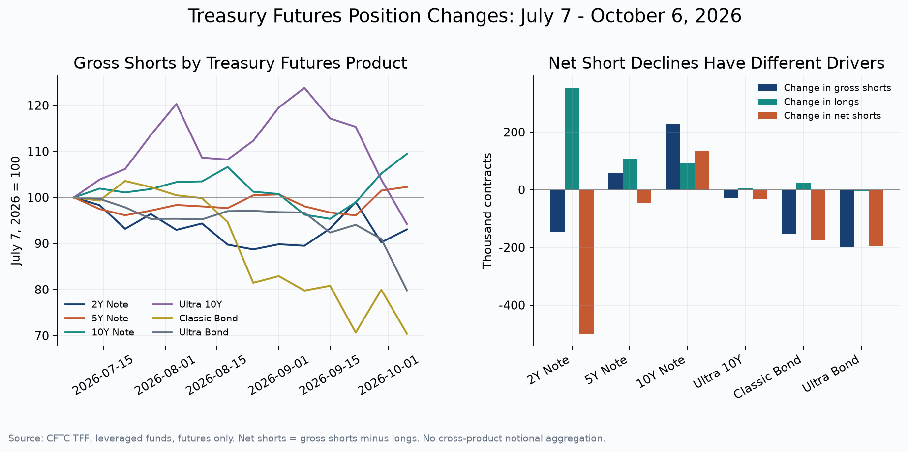
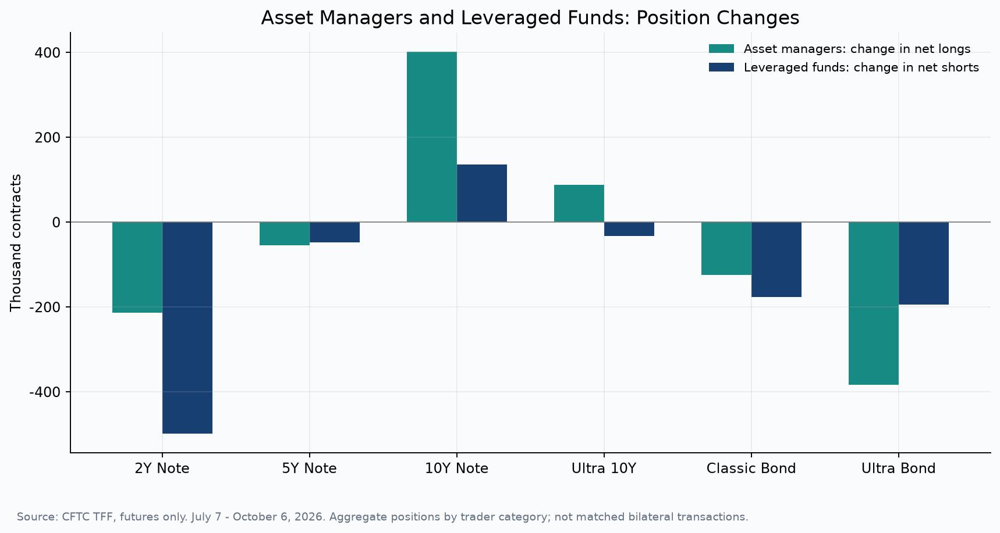
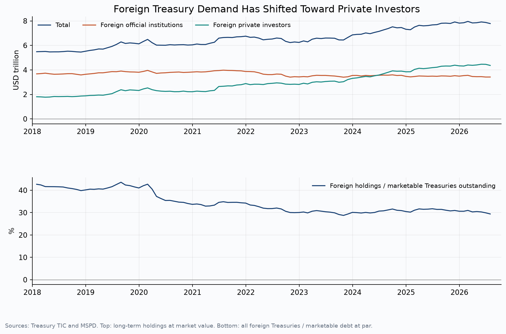
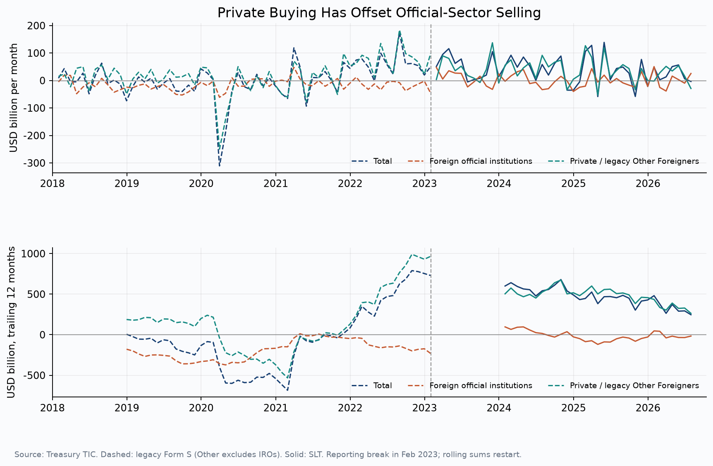
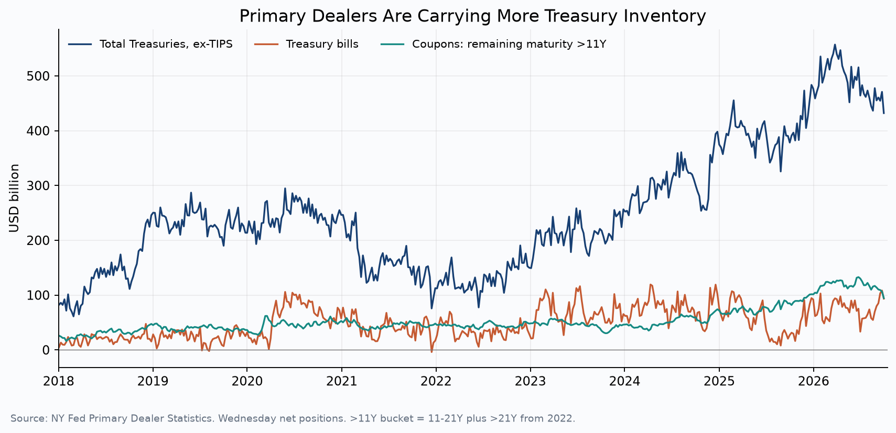
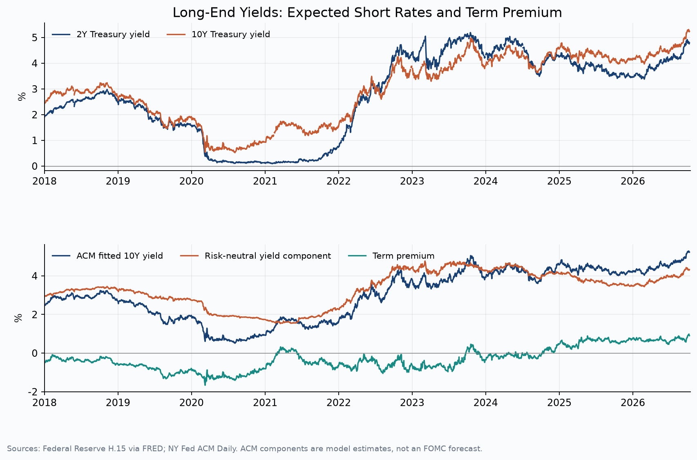
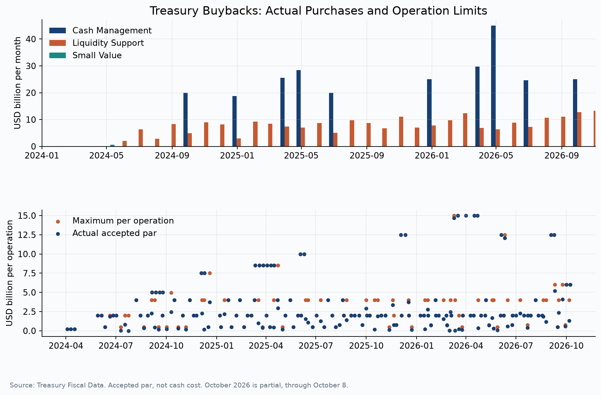

Treasury issuance is only part of the supply problem. **The market also depends on who holds the bonds and how those holdings are financed.** Hedge funds help absorb cash Treasuries through repo-funded basis trades. But that demand can reverse when the return opportunity narrows or financing becomes harder to obtain. If other investors are unwilling to take the bonds at prevailing prices, an unwind can push yields higher than the expected path of monetary policy alone would suggest.

The latest data show **short covering in long-dated Treasury futures, weak foreign official demand and continued buying by private foreign investors**. They do not establish a broad forced unwind. Aggregate repo rates show little sign of acute funding stress, and private foreign purchases remain positive. The question is whether those buyers and dealer balance sheets could absorb more selling if the trade contracts further.

eSLR relief and Treasury buybacks can ease that transfer by reducing the burden on intermediaries. Their effectiveness depends on how much capacity they release and how quickly bonds reach willing holders. Neither policy, on its own, guarantees sufficient long-term demand.

The backdrop is a broad rise in global government bond yields. The BIS reports that between 1 June and 3 September 2026, 10-year yields rose 31bp in the United States, 34bp in Germany, 27bp in Japan and 24bp in the United Kingdom. The US 10-year subsequently rose from 4.77% on 3 September to 5.24% on 9 October. [BIS, September 2026 Quarterly Review](https://www.bis.org/publications/qr-202609/yields-climb-yet-risk-appetite-holds-firm); [US 10-year Treasury yield](https://fred.stlouisfed.org/series/DGS10).

Higher yields can expose losses at banks, insurers and pension funds, trigger redemptions, and put pressure on leveraged positions. This note focuses on the Treasury basis trade: what could make it contract, how the resulting cash sales might amplify a rate shock, and whether foreign demand and policy support provide enough capacity to absorb them.

## 1. A smaller basis trade means less leverage, and possibly higher yields

A cash–futures basis trade typically combines **a cash Treasury purchase financed in repo with a short position in Treasury futures**. The fund seeks to earn the difference between the cash bond and futures prices as they converge towards delivery, after financing and other costs. The futures short offsets much of the cash bond’s interest-rate exposure, allowing a large position to be supported by relatively little equity.

The cash bond still has to be financed. If repo cannot be rolled, or lenders and clearing houses demand more collateral, the fund may have to sell the bond and close the futures short. Even a sharp fall in yields can create a liquidity problem: variation margin on the short futures position may be due before the gain on the cash bond is available to meet it. **A largely hedged position can therefore face a cash shortage even without a large net directional loss.** Changes in relative prices can create losses as well. [Dallas Fed analysis of the trade and its funding risks](https://www.dallasfed.org/research/economics/2025/0715).

Three functions matter: Treasury issuance adds supply; investors provide demand to hold it; dealers intermediate between buyers and sellers and help arrange financing. When a basis position closes, the cash bond must move to another holder. Dealers may have to warehouse it while that buyer is found.

If the next holder requires a higher yield, the bond price must fall. **Closing the trade reduces leverage, but the transition can still raise long-term yields and the government’s future borrowing costs.** Whether deleveraging is orderly depends on the speed of selling, the willingness of investors to buy and the capacity of intermediaries to bridge the gap.

## 2. Where the contraction shows up: short covering is clearer at the long end

Futures positions offer an initial clue. Closing a basis trade involves buying back a futures short as well as selling the cash bond. The table below therefore focuses on changes in leveraged funds’ **gross shorts over the 13 weeks from 7 July to 6 October 2026**, rather than treating every decline in net shorts as evidence of an unwind.

*Figure 1. Left: leveraged funds' gross short, indexed to 100 at 7 July. Right: changes in gross short, long and net short over the same period. Source: CFTC TFF Futures Only, in contracts by product.*

| Treasury futures contract | Gross short change | Long change | Net short change | Gross short, % change |
|---|---:|---:|---:|---:|
| 2-year Note | −145.6 | +353.4 | −499.0 | −6.9% |
| 5-year Note | +59.2 | +106.5 | −47.3 | +2.3% |
| 10-year Note | +229.2 | +93.4 | +135.8 | +9.5% |
| Ultra 10-year | −27.9 | +4.6 | −32.4 | −5.8% |
| Classic Bond | −152.0 | +23.8 | −175.8 | −29.6% |
| Ultra Bond | −198.3 | −4.0 | −194.4 | −20.2% |

*Position changes in thousands of contracts. Net short = gross short − long. Rounding may cause small differences.*

**Short covering was concentrated in Classic Bond and Ultra Bond futures**, where gross shorts fell by about 30% and 20%, respectively. Gross shorts in the 10-year contract rose by about 9%, and those in the 5-year contract also increased. The pattern is a shift across maturities rather than a uniform retreat from Treasury futures shorts.

The distinction between gross and net positions is especially important at the front end. The 2-year net short fell by 499,000 contracts, but roughly 71% of that change came from additional longs. Gross shorts declined by only 146,000 contracts. **The long-end decline in gross shorts is a clearer potential unwind signal than the much larger fall in the 2-year net short.**

CFTC’s leveraged funds category also includes directional trades, curve positions and hedges. These figures cannot identify how much cash Treasury selling accompanied the futures changes. Federal Reserve staff research combining fund-level cash, futures and repo data estimated basis positions of about **$830bn** in September 2025. That establishes the trade’s potential scale; it does not provide a multiplier for converting current CFTC changes into dollar sales. [Federal Reserve methodology and estimates](https://www.federalreserve.gov/econres/notes/feds-notes/decomposing-hedge-funds-u-s-treasury-exposures-20260622.html).

### A shift in futures demand is more visible than funding stress

One plausible explanation is weaker demand for long-dated futures. Asset managers’ futures purchases can support the relative-value opportunity for funds taking the opposite position: long cash bonds and short futures. Over this period, asset managers’ net longs and leveraged funds’ net shorts both declined at the long end.

*Figure 2. Changes in asset managers' net long and leveraged funds' net short, 7 July to 6 October 2026. Source: CFTC TFF Futures Only. "Asset managers" is the domestic and foreign Asset Manager/Institutional category.*

Asset managers’ net longs fell by **125,000 contracts** in Classic Bond futures and **383,000 contracts** in Ultra Bond futures, while increasing by **402,000 contracts** in the 10-year Note. Leveraged fund positioning shifted in a corresponding direction. This pattern is consistent with a reallocation of futures exposure across maturities and provides less support for a market-wide forced unwind. It does not establish causation: a decline in net longs can reflect either closed longs or additional short hedges.

**Aggregate repo rates provide little evidence of a funding shock.** On 9 October 2026, SOFR−EFFR was **−1bp** and SOFR−TGCR was **2bp**. The largest SOFR−EFFR spread since July was only **5bp**. These rates do not rule out pressure on particular funds or deliverable bonds; that would require issue-level financing, haircut and margin data.

Further contraction depends on whether long-end futures demand recovers and whether the basis still offers an adequate return after funding and capital costs. Weaker demand or narrower net returns could encourage further reductions. Improving relative value could attract positions back, provided funds retain access to financing and risk capacity. [Dallas Fed analysis of futures demand and financing](https://www.dallasfed.org/research/economics/2025/0715).

| Factor to judge | Condition for further contraction | Condition for re-expansion |
|---|---|---|
| Long-end futures demand | Continued decline in net buying at that maturity | Recovery of futures demand at that maturity |
| Trade return | Narrower compensation after funding and capital costs | Recovery of the net return in the cash–futures spread |
| Funding and risk capacity | Less repo supply, higher margin and haircuts | Restored funding access, collateral terms and risk capacity |

The observed futures pattern makes a demand shift a plausible explanation. Without transaction-level returns and financing data, its contribution cannot be separated from other causes.

## 3. Foreign demand has shifted from official to private investors

Treasury International Capital (TIC) data distinguish two broad foreign buyer groups. **Official investors** include central banks and government institutions managing reserve assets. **Private, or non-official, investors** include banks, insurers, pension funds, asset managers and investment funds.

Official purchases reflect reserve accumulation, allocation decisions and exchange-rate intervention. Private purchases depend more directly on yields, hedging costs, relative value and risk limits. A larger private role makes these investment conditions more important at the margin. Higher Treasury yields may attract buyers, but rising currency-hedging costs can offset the gain, while volatility can reduce the risk capacity available to hold bonds.

*Figure 3. Top: foreign holdings of long-term Treasuries. Bottom: foreign holdings of long- and short-term Treasuries as a share of total marketable Treasury debt outstanding, shown for reference. Source: Treasury TIC and MSPD. The lower panel compares market-value holdings with par-value outstanding.*

Between January 2018 and July 2026, foreign holdings of long-term Treasuries changed as follows.

| Holder | January 2018 | July 2026 | What the change means |
|---|---:|---:|---|
| Official investors | $3.68trn | $3.42trn | Holdings have not kept pace with the growth in supply |
| Private investors | $1.81trn | $4.36trn | The driver of the increase in foreign holdings |
| Total foreign | $5.48trn | $7.78trn | Larger in absolute terms |

Total foreign holdings of bills and longer-term Treasuries fell from about **43% to 29%** of marketable Treasury debt outstanding. Foreign holdings increased in dollars, but issuance grew faster. Foreign investors have therefore absorbed a smaller share of the expanding market.

Recent flows show the same split between the official and private sectors.

*Figure 4. Monthly foreign net purchases of long-term Treasuries and the 12-month total. Source: Treasury TIC. The reporting change of February 2023 is shown with a dotted and solid line, and the 12-month total is not calculated across the break.*

In the 12 months to July 2026, foreign official investors sold a net **$16.8bn** of long-term Treasuries. Private investors bought **$263.4bn**, leaving total foreign net purchases of approximately **$246.5bn**. **Foreign demand has continued, but the increase has come from private buyers.**

If higher hedging costs or volatility also weaken private buying, other investors would have to absorb more supply, potentially at lower prices and higher yields.

Private foreign demand is not entirely separate from the basis trade. It includes offshore hedge funds, and the Fed’s [research on Cayman funds and TIC](https://www.federalreserve.gov/econres/notes/feds-notes/the-cross-border-trail-of-the-treasury-basis-trade-20251015.html) identifies holdings that can be missed through repo collateral transfers. Treating all private foreign purchases as an independent source of unleveraged demand would therefore overstate the buffer. Both overlap and undercounting complicate the assessment.

## 4. Can dealers hold the paper until a buyer appears?

**Dealers provide a temporary home for bonds while matching sellers with buyers.** A wave of sales increases inventory and the financing needed to carry it. Sufficient balance-sheet and repo capacity can spread the adjustment over time. When that capacity is constrained, prices may have to fall further before trades clear.

*Figure 5. Primary dealer net Treasury inventory, excluding TIPS. Source: NY Fed. Bills and coupons over 11 years are components of total inventory.*

Dealer net Treasury inventory reached **$432bn** at end-September 2026, compared with roughly **$272bn** in mid-March 2020. The market has grown too, so the dollar comparison alone does not establish greater stress. The relevant question is how much additional inventory dealers can carry, given capital requirements, internal risk limits and repo availability.

The reason for the unwind matters as much as its size. Funds exiting a less profitable trade can usually stagger sales. Funds facing margin calls or lost financing may need cash immediately, making price secondary. The latter places a much sharper demand on dealer capacity.

eSLR relief and buybacks target this stage of the adjustment: financing inventory, holding it temporarily and finding an exit.

## 5. How can long-term yields end up higher than expected?

A basis contraction can add pressure to yields when cash bonds are sold faster than other investors are willing to buy them. This repricing can occur alongside a change in the expected policy-rate path. **Even if rate cuts are expected, long-term yields may fall less—or rise—if investors demand more compensation to hold duration.**

*Figure 6. Top: actual 2-year and 10-year Treasury yields. Bottom: the ACM 10-year fitted yield with its risk-neutral component and term premium. Source: Fed H.15 and NY Fed ACM. The risk-neutral component is the model's estimate of the expected future short-rate component.*

On 9 October 2026 the 10-year Treasury yield was **5.24%**. In the ACM model, the 10-year fitted yield of **5.23%** divides into a risk-neutral component of **4.33%** and a term premium of **0.90%**. Of the roughly **98bp** rise in the fitted yield since end-2025, about **83bp** came from the risk-neutral component and about **16bp** from the term premium.

The decomposition helps frame two sources of pressure. A revised expected short-rate path changes the outlook for repo funding costs. A higher term premium changes the compensation investors require to hold long-dated cash bonds. Neither component alone measures the basis: trade returns also depend on futures prices, the curve, the cheapest-to-deliver bond and financing terms. Margin requirements determine how much cash the fund needs to maintain the position.

An unexpected rate or volatility shock can therefore start a feedback loop. Changes in relative prices and collateral needs force positions to shrink; cash sales then put further pressure on yields. Willing buyers and available dealer capacity can interrupt that process. If both weaken together, a manageable adjustment can become a much sharper price move.

## 6. What eSLR relief and buybacks can absorb

### eSLR relief: lowering the capital cost of intermediating Treasuries and repo

The supplementary leverage ratio (SLR) requires banks to hold capital against total leverage exposure, regardless of risk weights. Treasury holdings and repo transactions can therefore consume scarce balance sheet despite their relatively low credit risk and thin margins. Where the leverage requirement is binding, relief can make additional inventory and client financing more economical.

The **eSLR recalibration, finalised in November 2025 and effective April 2026**, ties the enhanced buffer at large bank holding companies to 50% of the Method 1 GSIB surcharge, and caps the enhanced portion at their depository subsidiaries at 1 percentage point. Including the subsidiaries' 3% base SLR, the standard is at most 4%. [Final rule press release](https://www.federalreserve.gov/newsevents/pressreleases/bcreg20251125b.htm) and the [full rule text](https://www.fdic.gov/board/eslr-frn-final-rule-2025.pdf).

The recalibration can make room for banks to warehouse bonds and finance clients during an adjustment. Actual capacity still depends on internal limits, profitability and competing uses of capital. **Relief can reduce the price pressure caused by constrained intermediation; it cannot ensure that long-term investors will buy at the existing yield.**

### Treasury buybacks: an exit for existing bonds

Treasury buybacks purchase securities already outstanding. Liquidity-support operations provide an exit for less actively traded, off-the-run bonds and can help dealers turn over inventory. Cash-management operations serve a different purpose, adjusting near-term maturities and cash flows.

*Figure 7. Amounts actually accepted by purpose, and the maximum size against the amount accepted at each operation. Source: Treasury Fiscal Data. Amounts are par; October 2026 runs to the 8th.*

| Period | Liquidity support | Cash management | Total accepted |
|---|---:|---:|---:|
| 2024 | $44.6bn | $38.7bn | $84.0bn |
| 2025 | $96.8bn | $98.9bn | $195.8bn |
| Jan–8 Oct 2026 | $99.2bn | $124.3bn | $223.5bn |

*The 2024 total includes $0.6bn of small-scale testing. Rounding may cause differences in the totals.*

From September 2026, Treasury also increased the maximum size of liquidity-support purchases in long-dated nominal coupon buckets. That creates an additional potential exit for holders reducing long-end exposure. [Treasury announcement](https://home.treasury.gov/news/press-releases/sb0607).

Of the **$223.5bn** repurchased this year, **$99.2bn** was for liquidity support. Cash-management purchases should not be counted as equivalent support for long-dated selling. Even liquidity-support purchases span eligible issues rather than mapping directly to the positions being unwound. Buybacks also leave the government’s overall financing requirement in place. Their main contribution is to improve liquidity and inventory turnover in the securities purchased.

**eSLR relief expands the scope to intermediate; buybacks offer an exit for selected existing bonds.** Together they can make an unwind easier to manage. If sustained demand to hold Treasuries weakens, however, smoother trading can still lead to a new equilibrium at higher yields.

## Conclusion: less leverage can still mean a difficult adjustment

The data show long-end futures short covering, a shift in asset managers’ exposure across maturities and little aggregate repo stress. That is consistent with an orderly reduction in some relative-value positions, rather than clear evidence of a broad funding-driven unwind. Public futures data alone cannot establish the cash sales involved.

The vulnerability lies in what happens if selling accelerates. Foreign official demand is weak, private foreign buying remains important, and part of that private demand overlaps with leveraged funds. Dealers can bridge the transfer, but their ability to do so depends on available balance sheet, funding and risk capacity.

eSLR relief and Treasury buybacks strengthen that bridge. The data do not establish whether their capacity is sufficient to offset a given unwind, and neither substitutes for investors willing to hold the bonds.

**The risk is greatest when a rate or volatility shock forces leveraged sales just as private demand weakens and dealer capacity becomes scarce.** In that combination, long-term yields may have to rise further to attract new holders, reinforcing the initial shock. Monitoring those conditions together is more useful than treating every decline in futures shorts as a crisis signal.

---

**Data as of:** CFTC 6 October 2026; NY Fed repo, rates and ACM 9 October 2026; dealer inventory and MSPD 30 September 2026; TIC July 2026; buybacks 8 October 2026. This is a structural assessment using data released with a lag. Neither the offsetting effect of policy in basis points nor the actual size of any basis unwind is estimated from this public data.

**Data and reproduction:** the definitions and validation appendix, the source tables for recent position changes and futures demand, the original sources with collection timestamps, and the chart reproduction script are all included in the AXIS11 data package. Every chart can be reproduced from the official source files.
