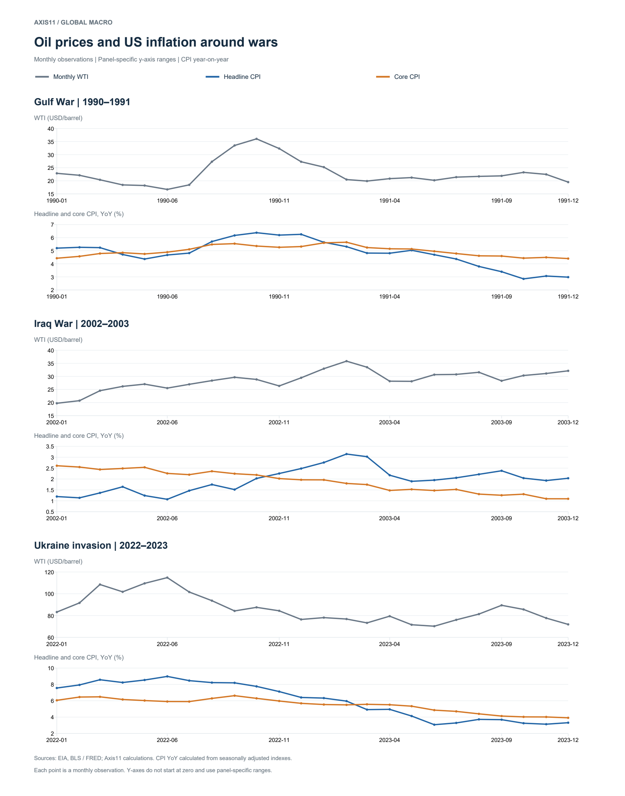
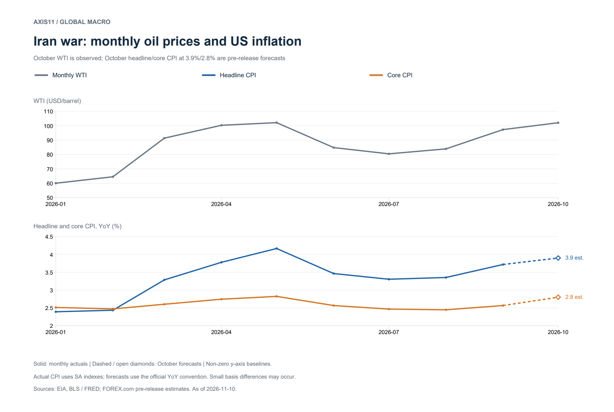
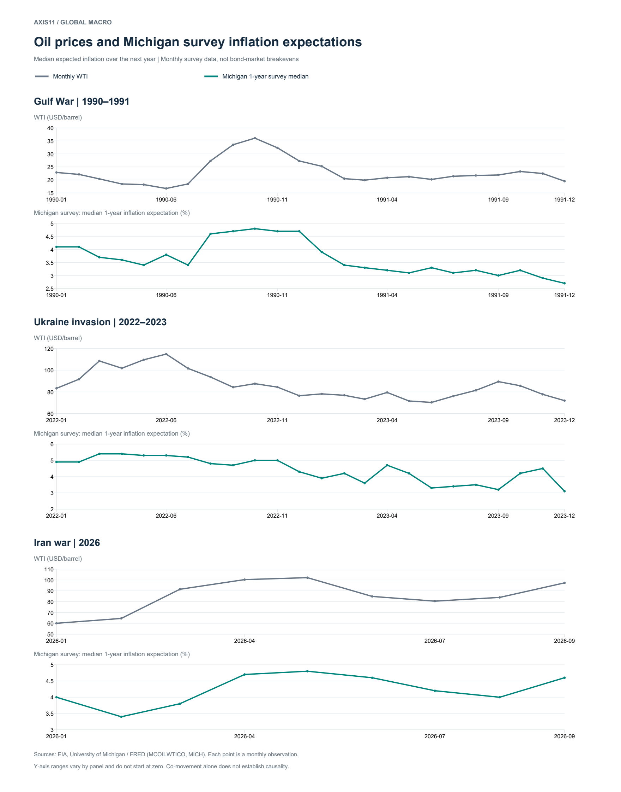

*Why lower oil prices may ease inflation without reversing every effect of the shock*

Ahead of the US October CPI release, markets expect headline inflation of 3.9% year on year and core inflation of 2.8%. Another Federal Reserve rate increase in December is again part of the policy debate. That near-term risk should be considered alongside the outlook for 2027. Assuming oil prices fall next year, how much inflation pressure would ease—and what would remain? [October CPI preview](https://www.forex.com/en/news-and-analysis/us-cpi-preview-will-inflation-fall-enough-to-put-a-fed-hike-in-doubt/)

That assumption carries over the medium-term view set out in September's note, [The Oil Paradox: Abundant Resources, Scarce Supply](/research/commodities/abundant-oil-scarce-supply/): what is scarce is not the resource but the routes that move it, and expectations of diplomacy and of supply-and-demand adjustment can turn prices before physical flows recover. That note asked where the oil price was heading. This one takes the direction as given and asks a different question — how much of the inflation the shock created comes back down with it.

Several pressures overlap. Post-pandemic disinflation remains incomplete. AI infrastructure demand is straining memory and other semiconductor supply, raising component costs for some PCs and smartphones. War has added energy and logistics costs. Reports of AI-driven “chipflation” identify a potential consumer-goods channel, but the effect on CPI depends on quality adjustment, item weights and actual retail-price changes. A higher accumulated price level also differs from a higher current inflation rate. [Reporting on AI “chipflation”, 2026](https://www.investing.com/news/stock-market-news/ai-chipflation-spreading-from-data-centers-to-wider-economy-morgan-stanley-warns-4724276)

**If war-related energy costs normalise, will the inflation expectations associated with the shock decline too?** Answering that requires separating three channels: energy prices paid directly by households, costs passed through by firms, and changes in expectations and wage setting.

Fuel purchased by households affects headline CPI directly. Energy used in factories, transport and distribution affects the cost of other goods and services. Excluding energy from core CPI removes the first channel from that measure, but leaves the second in place.

A brief oil spike may be absorbed through contracts, inventories and margins. A persistent increase is more likely to reach selling prices and service charges. If workers then seek compensation for lost purchasing power, the pressure can spread further. Lower oil prices do not immediately undo contracts, wage adjustments or price increases already implemented.

Historical episodes show different adjustment speeds. During the Gulf War, oil and headline inflation rose first, while core inflation eased more slowly as conditions normalised. In 2022, core inflation increased for a time after oil began falling. These patterns illustrate the issue; isolating oil’s contribution requires more than observing the sequence. [Federal Reserve, Presno and Prestipino, 2024](https://www.federalreserve.gov/econres/notes/feds-notes/oil-price-shocks-and-inflation-in-a-dsge-model-of-the-global-economy-20240802.html)

## 1. Energy costs are inside core inflation too

CPI measures the final price paid by consumers. Petrol belongs to the energy component; an airline ticket belongs to core services, even though its price reflects jet-fuel costs. A retail good similarly includes energy used in production, packaging, warehousing and delivery.

This note uses **direct effect** for household energy purchases, **indirect effect** for energy costs embedded in other prices, and **second-round effect** for changes in expectations, wages and price-setting behaviour. Passing on a fuel bill is different from a self-reinforcing wage-price process. Some research uses “second-round” more broadly; the distinction here is analytical.

| Route | When energy prices rise | When energy prices fall | Relation to headline and core |
|---|---|---|---|
| Final energy purchases | Consumer prices for petrol, heating oil and the like rise | Downward pressure on consumer fuel prices | The direct route into headline CPI |
| Transport and distribution | Diesel and bunker fuel rise → freight rates and surcharges rise → passed into wholesale and retail prices | Freight, surcharges and distribution costs ease → less need to raise prices | Reaches food and core goods indirectly |
| Air services | Jet fuel rises → operating costs rise → pressure to raise fares | Lower fuel costs → room to cut fares or rebuild margin | Reaches core services indirectly |
| Production and inputs | Process energy, petroleum-based inputs and packaging cost more | Production costs and input bills ease | Reaches food and core goods indirectly |
| Expectations, wages, price setting | Perceived inflation rises → compensating wage claims and pre-emptive price adjustment become possible | Short-run expectations ease → less pressure for further wage and price increases | Reaches wider core prices, conditionally |

Electricity and natural gas also enter both household bills and business costs. Their US prices, however, do not track crude mechanically: fuel markets, generation mix, regulated tariffs and contracts differ. An oil-price result therefore cannot simply be extended to all energy prices. [EIA, factors affecting gasoline prices](https://www.eia.gov/energyexplained/gasoline/factors-affecting-gasoline-prices.php)

## 2. From a higher input bill to a higher selling price

The pressure starts with the firm’s cost structure. Energy-intensive production and freight-heavy businesses face larger cost increases from the same shock. Pass-through then depends on demand and competition. Strong demand and competitors’ price increases make adjustment easier; weak demand may force the firm to accept a lower margin.

Costs also travel through suppliers. A firm buying an intermediate product inherits some of its producer’s energy bill, even if its own operations use little fuel. Imports carry foreign production and shipping costs as well. In the Federal Reserve’s 2024 model, higher domestic marginal costs and import-price pass-through are the main routes from oil to core prices. [Presno and Prestipino, 2024](https://www.federalreserve.gov/econres/notes/feds-notes/oil-price-shocks-and-inflation-in-a-dsge-model-of-the-global-economy-20240802.html)

For illustration, suppose energy-related inputs account for 5% of a firm’s costs. A 20% increase in those inputs raises total costs by about 1%, all else equal. Passing through half would put roughly 0.5% upward pressure on the selling price. **This is a hypothetical firm-level calculation**, not an estimate for CPI. An aggregate estimate requires industry cost shares, pass-through rates and consumer-basket weights.

## 3. Expectations and wages can extend the shock

Petrol prices are highly visible. Kilian and Zhou examine how petrol-price shocks affect US households’ inflation expectations. Higher expected inflation can encourage larger wage claims and pre-emptive price increases, depending on labour-market conditions and firms’ pricing power. A rise in short-term expectations does not, by itself, mean long-term expectations are unanchored. [Dallas Fed, Kilian and Zhou, 2020](https://www.dallasfed.org/research/economics/2020/0922)

Higher wages can carry cost pressure into services with little direct energy exposure. Once that happens, persistence depends partly on subsequent wage and price decisions. Falling oil is more likely to slow further wage increases than to reverse nominal wages already agreed.

These effects are not equally strong in every episode. Kilian and Zhou’s 2023 survey finds more limited US core-price responses than in the euro area or United Kingdom, and little evidence of large effects on US long-run inflation expectations. **Energy pass-through into core prices is not sufficient evidence of a wage-price spiral.** [Oil Price Shocks and Inflation, 2023](https://www.dallasfed.org/-/media/documents/research/papers/2023/wp2312.pdf)

## 4. What past wars show about timing

The charts use monthly average WTI spot prices and US headline and core CPI. Historical inflation rates are calculated year on year from seasonally adjusted indexes, so they may differ slightly from the unadjusted rates quoted in official releases. Tables select dates from the full monthly series. [EIA oil price](https://fred.stlouisfed.org/data/MCOILWTICO), [BLS headline CPI](https://fred.stlouisfed.org/data/CPIAUCSL), [BLS core CPI](https://fred.stlouisfed.org/data/CPILFESL)

*Figure 1. WTI and headline and core CPI around wars: all monthly observations*

**The Gulf War: a fast energy shock and a slow core adjustment**

| Date | WTI, USD/barrel | Headline CPI YoY | Core CPI YoY |
|---|---:|---:|---:|
| Jul 1990 | 18.45 | 4.82% | 5.11% |
| Oct 1990 | 36.04 | 6.38% | 5.36% |
| Mar 1991 | 19.90 | 4.82% | 5.24% |
| Oct 1991 | 23.23 | 2.85% | 4.43% |

From July to October 1990, WTI rose about 95%. Headline inflation increased by 1.56 percentage points and core by 0.25. By March 1991, oil was about 45% below October and headline inflation had fallen 1.56 points, while core had eased only 0.12 points. Core reached 4.43% by October 1991.

Headline and core adjusted at different speeds, but oil was not the only influence. The BLS retrospective attributes the 1991 disinflation to energy, food and a weak economy. The core decline cannot be assigned entirely to energy normalisation. [BLS, inflation in 1991](https://www.bls.gov/opub/mlr/1992/05/art1full.pdf)

**The Iraq War: rising oil does not mean rising core inflation**

| Date | WTI | Headline CPI YoY | Core CPI YoY |
|---|---:|---:|---:|
| Dec 2002 | 29.46 | 2.48% | 1.96% |
| Feb 2003 | 35.83 | 3.15% | 1.80% |
| May 2003 | 28.11 | 1.89% | 1.53% |
| Dec 2003 | 32.13 | 2.04% | 1.09% |

Between December 2002 and February 2003, WTI rose about 22% and headline inflation increased, while core inflation slowed. Oil-related pressure could have been offset by developments elsewhere. The core **index** still rose from 192.1 to 192.5: a rising price level and a falling year-over-year inflation rate are compatible.

Oil fell about 22% from February to May, alongside further declines in headline and core inflation. Core disinflation had already begun before oil normalised, limiting what the episode can tell us about oil’s independent effect.

**The invasion of Ukraine: oil falling while core inflation rose**

| Date | WTI | Headline CPI YoY | Core CPI YoY |
|---|---:|---:|---:|
| Jan 2022 | 83.22 | 7.56% | 6.05% |
| Jun 2022 | 114.84 | 8.98% | 5.91% |
| Sep 2022 | 84.26 | 8.19% | 6.62% |
| Dec 2022 | 76.44 | 6.40% | 5.69% |
| Jun 2023 | 70.25 | 3.07% | 4.85% |
| Dec 2023 | 71.90 | 3.32% | 3.92% |

WTI rose about 38% between January and June 2022. Headline inflation increased while core inflation edged down. The core index nevertheless rose from 286.757 to 294.050, about 2.54%. Base effects and movements in other components influence the year-over-year rate alongside current energy costs.

From June to September, oil fell about 27%, but core inflation rose from 5.91% to 6.62%. September’s BLS release recorded a 4.9% monthly decline in petrol prices alongside increases in shelter, medical care and other categories. This demonstrates divergence between oil and core; it does not prove that the core increase was delayed oil pass-through. [BLS, September 2022](https://www.bls.gov/news.release/archives/cpi_10132022.htm)

A Federal Reserve model provides a separate estimate of causality. The foreign oil-supply shocks in the first half of 2022 are estimated to contribute 0.13, 0.22, 0.19 and 0.15 percentage points to core inflation across the four quarters. These are contributions to **quarterly annualised inflation**, not year-over-year rates. They indicate persistence beyond the initial shock, rather than attributing all observed core inflation to oil. [Notes to the model’s figures](https://www.federalreserve.gov/econres/notes/feds-notes/oil-price-shocks-and-inflation-in-a-dsge-model-of-the-global-economy-accessible-20240802.htm)

**After the Iran war: a difference in how far headline and core rose**

| Date | WTI | Headline CPI YoY | Core CPI YoY |
|---|---:|---:|---:|
| Feb 2026 | 64.51 | 2.43% | 2.47% |
| May 2026 | 102.13 | 4.17% | 2.82% |
| Sep 2026 | 97.31 | 3.72% | 2.57% |
| Oct 2026 | 102.07 **actual monthly average** | **3.9% expected** | **2.8% expected** |

October WTI is an observed EIA monthly average; October headline and core CPI are pre-release forecasts. Earlier rows use seasonally adjusted indexes, while the forecasts follow the unadjusted year-over-year convention commonly quoted by markets. The CPI release is scheduled for 8:30 a.m. US Eastern time on 10 November, or 2:30 a.m. New Zealand time on 11 November. [EIA/FRED](https://fred.stlouisfed.org/data/MCOILWTICO), [market forecast](https://www.forex.com/en/news-and-analysis/us-cpi-preview-will-inflation-fall-enough-to-put-a-fed-hike-in-doubt/), [BLS schedule](https://www.bls.gov/schedule/news_release/cpi.htm)

*Figure 2. Oil and inflation since the Iran war, with the October CPI forecast*

Between February and May, oil rose about 58%, while headline and core inflation increased by about 1.73 and 0.35 percentage points. The core increase warrants examination of indirect pressure, but is not a measurement of oil’s contribution. That requires industry costs, selling prices and other supply-demand influences. [EIA oil price](https://fred.stlouisfed.org/data/MCOILWTICO), [BLS headline CPI](https://fred.stlouisfed.org/data/CPIAUCSL), [BLS core CPI](https://fred.stlouisfed.org/data/CPILFESL)

## 5. Lower costs need not reverse earlier price increases

Higher oil prices force a choice between margins and selling prices. Firms unable to reprice immediately may wait for contract renewals or scheduled revisions. Those increases can still proceed after oil falls, particularly when firms are recovering earlier losses. Lower costs then create a choice between cutting prices and rebuilding margins. Competition and demand determine how much saving reaches consumers.

Inventories and fuel hedges add delays in both directions. High-cost stocks or fixed contracts can postpone savings when spot prices fall; cheaper stocks and hedges can cushion a rise. The contract structure determines the timing.

Asymmetry can appear even at the pump. St. Louis Fed analysis describes “rockets and feathers”: petrol prices sometimes rise quickly with crude but fall more slowly. Local competition, inventories, seasonality and search costs can contribute. The pattern varies across markets and periods, but cautions against simply reversing a coefficient estimated during rising prices. [Owyang and Vermann, 2014](https://www.stlouisfed.org/publications/regional-economist/october-2014/rockets-and-feathers-why-dont-gasoline-prices-always-move-in-sync-with-oil-prices)

## 6. Sizing the direct and indirect effects

A simple direct-effect calculation starts with gasoline’s CPI weight and crude’s share of its retail price. Gasoline’s BLS relative importance was 2.895% in December 2025; crude accounted for 50.3% of the retail gasoline price in August 2026. Holding the weight at 2.895%, the crude share at roughly 50%, and other costs and taxes constant, a ±20% crude move implies about ±10% in gasoline and ±0.29% in the CPI **level**. **Linearity and symmetry are assumptions here, not empirical findings.** [BLS](https://www.bls.gov/cpi/factsheets/motor-fuel.htm), [EIA](https://www.eia.gov/petroleum/gasdiesel/gaspump_hist.php)

The Federal Reserve’s 2024 model estimates a broader response. A foreign supply shock initially raising the real oil price by 10% increases first-year four-quarter headline inflation by about 0.15 percentage points and core inflation by about 0.06. The oil shock subsequently fades. This is a model result for that shock path, rather than a permanent price increase or a replication of the actual CPI basket. [Federal Reserve study](https://www.federalreserve.gov/econres/notes/feds-notes/oil-price-shocks-and-inflation-in-a-dsge-model-of-the-global-economy-20240802.html), [figure notes](https://www.federalreserve.gov/econres/notes/feds-notes/oil-price-shocks-and-inflation-in-a-dsge-model-of-the-global-economy-accessible-20240802.htm)

| Initial change in the real oil price | Effect on first-year headline inflation | Effect on first-year core inflation | Reading |
|---|---:|---:|---|
| +10% | about +0.15pp | about +0.06pp | The paper's result for a rising shock |
| +20% | about +0.30pp | about +0.12pp | Linear scaling of that result |
| −10% | about −0.15pp | about −0.06pp | Reference figure assuming linearity and symmetry |
| −20% | about −0.30pp | about −0.12pp | Reference figure assuming linearity and symmetry |

The headline estimate already includes the core channel, so the columns must not be added. Nor should the gasoline calculation be added to the model result: it estimates an overlapping direct channel by another method. The negative rows assume a symmetric response; they are not independently estimated falling-price effects. Actual adjustment depends on margins, contracts and wages.

Evidence of downward pass-through comes from a 2017 Federal Reserve study, which estimates that the 2014–16 oil collapse reduced US core PCE inflation by about 0.2 percentage points in each of 2015 and 2016. Lower energy costs can therefore ease inflation beyond the energy component. The estimate should not be treated as a fixed coefficient for any oil decline today. [Conflitti and Luciani, 2017](https://www.federalreserve.gov/econres/notes/feds-notes/oil-price-pass-through-into-core-inflation-20171019.html)

## 7. Do expectations fall when the war ends?

Realised inflation and expected inflation must be examined separately. The University of Michigan median one-year inflation expectation provides a direct measure of household expectations around past episodes. [University of Michigan via FRED, MICH](https://fred.stlouisfed.org/data/MICH)

| Episode | Date | Monthly average WTI | Expected inflation, next 1 year |
|---|---|---:|---:|
| Gulf War | Jul 1990 | $18.45 | 3.4% |
| Gulf War | Oct 1990 | $36.04 | 4.8% |
| Gulf War | Mar 1991 | $19.90 | 3.3% |
| Ukraine invasion | Jun 2022 | $114.84 | 5.3% |
| Ukraine invasion | Dec 2022 | $76.44 | 4.3% |
| Ukraine invasion | Jun 2023 | $70.25 | 3.3% |

Gulf War expectations rose alongside oil and had returned close to their pre-war level by March 1991. Oil and short-term expectations also fell together in 2022–23, even though the Ukraine war continued. These episodes are consistent with a role for fuel prices and wider economic conditions, rather than requiring a formal end to hostilities.

In 2026, one-year expectations rose from 3.4% in February to 4.8% in May, eased to 4.0% in August, then returned to 4.6% in September. The timing overlaps the energy shock, but does not identify the share caused by the war. [University of Michigan via FRED](https://fred.stlouisfed.org/data/MICH)

*Figure 3. Oil and the Michigan survey median expectation for inflation over the next year*

Kilian and Zhou’s structural analysis goes beyond this co-movement. It identifies petrol-price shocks that affect US households’ one-year inflation expectations, with cumulative effects that persist for a time and then fade. This supports a channel through which energy normalisation can lower short-term expectations. Its measures and model are not identical to the simple comparison of survey medians above, and petrol does not explain every expectations change. [Dallas Fed](https://www.dallasfed.org/research/economics/2020/0922)

The evidence supports **a route from lower energy prices to lower short-term inflation expectations**. It does not establish that ending a war is sufficient to stabilise long-term expectations or core inflation. Long-term expectations may have moved much less initially, while non-energy cost and demand pressures remain. Persistent AI-related input costs or post-pandemic pressures could therefore limit the broader disinflation even as the energy contribution fades.

## 8. How far has the shock spread?

The transmission can be assessed through crude and refined-product prices, household fuel bills, freight and intermediate costs, non-energy selling prices, expectations and wages. This is a framework for checking the evidence, rather than a fixed sequence: stages overlap, and contracts and demand can weaken individual links.

During the rise, watch whether firms absorb the cost or reset prices and charges. During normalisation, watch whether savings reverse earlier increases, slow new increases or restore margins. The same oil move can produce different headline and core responses in both magnitude and timing. Core CPI excludes direct energy purchases, not every energy cost embedded in other prices.

That distinction also frames the policy outlook. Current inflation may sustain the case for a December rate increase while lower energy costs next year ease short-term expectations. Both can be true. The policy implication depends on whether energy relief reaches broader price setting and wage growth, and on how much non-energy pressure remains.

## Data and method

- The historical tables use the EIA's monthly average WTI price and the BLS's seasonally adjusted headline and core CPI indexes. The selected dates and the values twelve months earlier were taken from FRED. Inflation is calculated as 100 × (index / index twelve months earlier − 1).
- The historical changes in the tables are observations. The causal effect of oil is kept separate, in the model-based literature cited. The changes in activity, supply chains and policy that accompanied each war are also present in the actual price data.
- Core CPI and core PCE are used as complementary measures of the same transmission structure. Figures keep the source and the unit of their own index.
- The wars are selected episodes, not a controlled experiment. The lag in year-over-year inflation is not used on its own to identify the lag in cost pass-through.
- The October 2026 figures of 3.9% headline and 2.8% core are pre-release forecasts, not observations. The October WTI price of $102.07 is an actual monthly average. The assumption that oil falls in 2027 is the premise of this note's analysis, not a settled forecast or a market consensus.
- The expectations table uses the University of Michigan median expectation for inflation over the next year (MICH), which is a different measure from long-run expectations or from realised CPI inflation.
- The charts use all monthly observations for each episode, separately from the selected dates in the tables. Y-axis ranges are set per panel and do not start at zero. The expectations series is the Michigan survey median, not the breakeven inflation rate implied by nominal and inflation-linked bonds.
- As of 10 November 2026.

## Sources

1. [Federal Reserve, Presno and Prestipino (2024) — Oil price shocks and inflation in a DSGE model of the global economy](https://www.federalreserve.gov/econres/notes/feds-notes/oil-price-shocks-and-inflation-in-a-dsge-model-of-the-global-economy-20240802.html)
2. [EIA — Factors affecting gasoline prices](https://www.eia.gov/energyexplained/gasoline/factors-affecting-gasoline-prices.php)
3. [Dallas Fed, Kilian and Zhou (2020) — Gasoline prices and inflation expectations](https://www.dallasfed.org/research/economics/2020/0922)
4. [Kilian and Zhou (2023) — Oil Price Shocks and Inflation, Dallas Fed Working Paper 2312](https://www.dallasfed.org/-/media/documents/research/papers/2023/wp2312.pdf)
5. [EIA monthly average WTI spot price — FRED MCOILWTICO](https://fred.stlouisfed.org/data/MCOILWTICO)
6. [BLS headline CPI, seasonally adjusted — FRED CPIAUCSL](https://fred.stlouisfed.org/data/CPIAUCSL)
7. [BLS core CPI, seasonally adjusted — FRED CPILFESL](https://fred.stlouisfed.org/data/CPILFESL)
8. [BLS — Inflation in 1991, Monthly Labor Review](https://www.bls.gov/opub/mlr/1992/05/art1full.pdf)
9. [BLS — CPI news release, September 2022](https://www.bls.gov/news.release/archives/cpi_10132022.htm)
10. [Federal Reserve — Notes to the DSGE model's figures (accessible version)](https://www.federalreserve.gov/econres/notes/feds-notes/oil-price-shocks-and-inflation-in-a-dsge-model-of-the-global-economy-accessible-20240802.htm)
11. [Owyang and Vermann (2014) — Rockets and feathers, St. Louis Fed](https://www.stlouisfed.org/publications/regional-economist/october-2014/rockets-and-feathers-why-dont-gasoline-prices-always-move-in-sync-with-oil-prices)
12. [BLS — Motor fuel CPI fact sheet](https://www.bls.gov/cpi/factsheets/motor-fuel.htm)
13. [EIA — Composition of the retail gasoline price](https://www.eia.gov/petroleum/gasdiesel/gaspump_hist.php)
14. [Conflitti and Luciani (2017) — Oil price pass-through into core inflation](https://www.federalreserve.gov/econres/notes/feds-notes/oil-price-pass-through-into-core-inflation-20171019.html)
15. [FOREX.com — October CPI preview](https://www.forex.com/en/news-and-analysis/us-cpi-preview-will-inflation-fall-enough-to-put-a-fed-hike-in-doubt/)
16. [Reporting on AI "chipflation", citing Morgan Stanley](https://www.investing.com/news/stock-market-news/ai-chipflation-spreading-from-data-centers-to-wider-economy-morgan-stanley-warns-4724276)
17. [BLS — CPI release schedule](https://www.bls.gov/schedule/news_release/cpi.htm)
18. [University of Michigan median expected inflation, next 1 year — FRED MICH](https://fred.stlouisfed.org/data/MICH)
