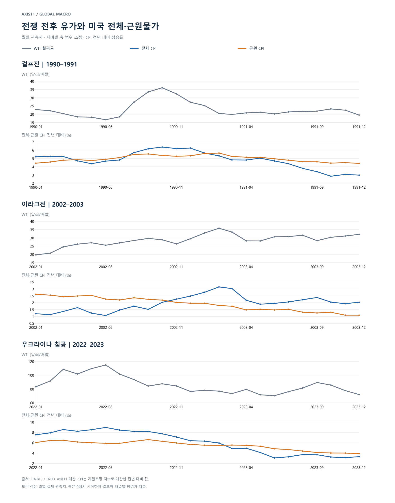
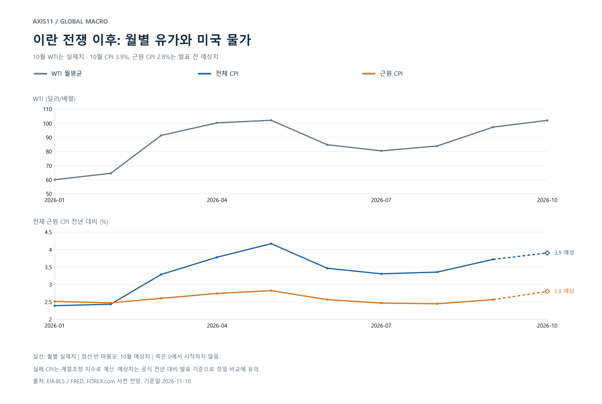
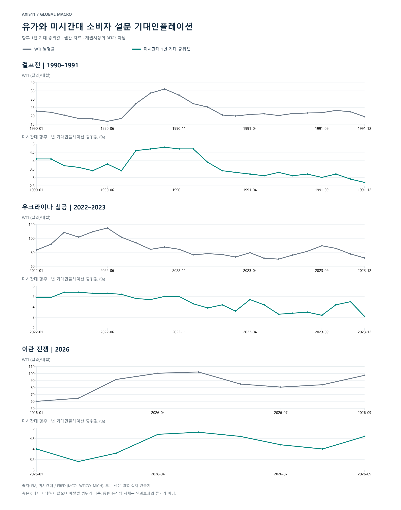

*미국의 생산비·가격 결정·기대 경로와 전쟁 전후의 경험*

미국의 10월 CPI 발표를 앞두고 시장이 예상하는 전년 대비 상승률은 전체 3.9%, 근원 2.8%다. 높은 물가가 이어지면서 12월 연준의 추가 금리 인상 가능성이 다시 정책 판단의 중심에 놓여 있다. 그러나 단기적인 긴축 위험과 2027년의 물가 경로는 구분해 볼 필요가 있다. 이 노트는 내년 유가가 낮아진다는 기본 시나리오 아래, 에너지 비용의 완화가 어느 범위까지 물가 압력을 줄일 수 있고 어떤 위험은 남는지를 검토하기 위해 작성했다. [10월 CPI 사전 전망](https://www.forex.com/en/news-and-analysis/us-cpi-preview-will-inflation-fall-enough-to-put-a-fed-hike-in-doubt/)

이 전제는 9월 노트 [Paradox: 풍부한 원유 그러나 부족한 공급](/research/commodities/abundant-oil-scarce-supply/ko/)에서 정리한 중기 견해를 이어받은 것이다. 희소한 것은 자원 자체가 아니라 그것을 옮기는 수송 경로이며, 협상과 공급·수요 적응에 대한 기대가 실제 물동량 정상화보다 먼저 가격을 돌려세울 수 있다는 내용이었다. 그 노트가 유가의 방향을 다뤘다면, 이 노트는 방향을 전제로 두고 다른 질문을 던진다. 그 충격이 만든 물가 가운데 어디까지가 유가와 함께 되돌아오는가.

현재 미국의 물가는 여러 충격이 겹친 결과다. 팬데믹 이후 물가 안정 과정이 완결되지 않은 가운데, AI 인프라 투자 확대가 메모리 등 반도체 수급을 압박하고 PC·스마트폰 같은 소비재의 원가와 판매가격에도 영향을 주고 있다. 여기에 전쟁에 따른 에너지·물류 비용 상승이 더해졌다. AI 수요에 따른 메모리 가격 상승이 일부 소비자 전자제품의 가격 인상으로 이어졌다는 보도가 이어졌다. 다만 반도체 가격 상승률이 품질 조정과 품목 비중을 거쳐 CPI에 반영되는 정도는 별도로 확인해야 한다. 누적된 높은 가격 수준과 현재의 물가상승률 역시 구분할 필요가 있다. [AI 칩플레이션 보도, 2026년](https://www.investing.com/news/stock-market-news/ai-chipflation-spreading-from-data-centers-to-wider-economy-morgan-stanley-warns-4724276)

이때 검토해야 할 질문은 다음과 같다. **전쟁이 끝나고 유가가 정상화되면, 전쟁 이후 높아진 기대인플레이션도 낮아질 수 있을까? 과거 사례와 연구는 이러한 기대에 얼마나 명확한 근거를 제공하는가?** 답을 얻으려면 에너지의 직접 가격 효과와 기업의 비용 전가, 기대·임금의 변화를 구분해야 한다. 유가 하락을 전체 물가 안정의 충분조건으로 가정하지 않고, 여러 물가 요인 가운데 전쟁·에너지 충격의 기여가 어느 경로로 확대되거나 완화되는지를 살펴본다.

에너지 충격의 물가 파급력을 판단할 때 핵심은 휘발유 가격의 등락보다 충격이 비에너지 상품과 서비스의 가격 결정에 얼마나 깊이 반영되는가에 있다. 가계가 직접 구매하는 연료는 전체 CPI를 움직이고, 기업이 생산·운송·유통 과정에서 사용하는 에너지는 근원물가의 원가를 움직인다. 근원 CPI에서 에너지 항목을 제외하는 것은 이러한 비용의 파급까지 제거한다는 의미가 아니다.

유가 상승이 단기간에 끝나면 기업은 재고와 계약, 마진 조정을 통해 비용 증가를 일부 흡수할 수 있다. 반면 높은 에너지 비용이 지속되면 출고가와 서비스 요금의 재설정이 늘어나고, 실질소득 감소에 대한 임금 조정까지 겹칠 경우 충격은 보다 넓은 가격으로 확산될 수 있다. 유가가 반락한 뒤에도 이미 체결된 계약과 조정된 임금, 진행 중인 가격 인상이 남는 이유다. 상승과 하락은 같은 경로를 통과하지만, 전달 속도와 최종 크기까지 같을 필요는 없다.

이 구조는 전쟁 전후의 미국 물가에서도 관찰된다. 걸프전에서는 유가와 전체물가 상승률이 먼저 높아졌고, 정상화 국면에서는 근원물가의 둔화가 뒤따랐다. 2022년에는 유가가 하락하기 시작한 뒤에도 근원 CPI 상승률이 한동안 더 높아졌다. 이 노트는 이러한 시차를 생산비 전가와 가격 조정의 관점에서 분석하고, 역사적 동반 움직임과 연구가 추정한 유가 자체의 효과를 구분한다. [연준, Presno·Prestipino, 2024](https://www.federalreserve.gov/econres/notes/feds-notes/oil-price-shocks-and-inflation-in-a-dsge-model-of-the-global-economy-20240802.html)

## 1. 근원물가에도 에너지 비용이 들어 있다

CPI는 소비자가 지불하는 최종가격을 측정한다. 휘발유를 구매하면 그 가격은 에너지 CPI에 들어간다. 항공권을 구매하면 항공유 비용이 포함된 운임이 항공료 지수에 들어간다. 항공료는 근원 CPI에 포함되므로, 항공유 가격의 변화는 에너지 항목을 거치지 않고도 근원물가에 영향을 줄 수 있다. 상품도 마찬가지다. 소매가격에는 공장 가동에 사용된 에너지, 포장재, 창고 운영비, 운송비가 포함된다.

즉, 전체물가에 대한 **직접 효과**는 소비자가 에너지를 구매하는 가격의 변화이고, 근원물가에 대한 **간접 효과**는 에너지가 다른 상품과 서비스의 비용으로 들어가는 과정이다. 여기에 기대와 임금·가격 결정의 변화가 더해지는 **2차 효과**를 따로 구분해야 한다. 기업의 연료비 전가와 임금·가격의 반복 상승은 서로 다른 과정이다. 일부 문헌은 근원가격에 대한 영향을 넓게 2차 효과로 부르지만, 여기서는 분석을 위해 구분한다.

| 경로 | 에너지 가격 상승 시 | 에너지 가격 하락 시 | 전체·근원물가와의 관계 |
|---|---|---|---|
| 최종 에너지 구매 | 휘발유·난방유 등 소비자가격 상승 | 연료 소비자가격 하락 압력 | 전체 CPI의 직접 경로 |
| 운송·유통 비용 | 경유·선박연료 상승 → 운임·할증료 상승 → 납품·소매가격 전가 | 운임·할증료 및 유통비 완화 → 가격 인상 필요 축소 | 식품 및 근원상품에 간접 반영 |
| 항공 서비스 | 항공유 상승 → 운항 원가 상승 → 운임 인상 압력 | 연료비 절감 → 운임 인하 또는 마진 회복 여지 | 근원 서비스에 간접 반영 |
| 생산·원료 비용 | 공정 에너지·석유계 원료·포장재 비용 증가 | 생산 원가 및 원료비 부담 완화 | 식품 및 근원상품에 간접 반영 |
| 기대·임금·가격 결정 | 체감물가 상승 → 보상 임금 요구·선제적 가격 조정 가능 | 단기 기대 완화 → 추가 임금·가격 인상 압력 완화 가능 | 조건부로 더 넓은 근원물가에 반영 |

전기와 천연가스도 소비자의 직접 구매와 기업의 투입 비용이라는 두 역할을 갖는다. 다만 미국 전력·가스 가격은 원유와 동일하게 움직이지 않는다. 연료별 수급, 발전 구성, 규제요금과 계약이 다르기 때문이다. 따라서 유가 충격의 효과를 전력·가스 가격 전체의 변동으로 확대 해석하지 않는다. [EIA, 휘발유 가격 결정 요인](https://www.eia.gov/energyexplained/gasoline/factors-affecting-gasoline-prices.php)

## 2. 생산비 충격이 실제 판매가격으로 바뀌는 조건

에너지 비용 상승이 근원물가로 전달되는 크기는 기업의 비용 구조와 가격 결정에 달려 있다. 운송비나 공정 에너지 비중이 높은 업종은 같은 유가 충격에도 더 큰 원가 변화를 겪는다. 그러나 최종가격으로 전가되는 비율은 비용 비중만으로 결정되지 않는다. 수요가 강하고 경쟁사가 동시에 가격을 올리면 전가가 쉬워질 수 있다. 수요가 약하거나 경쟁이 치열하면 기업은 마진을 줄여 비용 증가를 흡수할 수 있다.

중간재를 통한 전가도 중요하다. 한 기업의 에너지 비용 상승이 납품가격에 반영되면, 이를 구매하는 다음 기업에는 중간재 비용 상승으로 나타난다. 최종 소비재의 직접 에너지 사용량이 적더라도 공급망 상류의 비용을 간접적으로 부담할 수 있다. 수입품 역시 해외 생산·운송 단계에서 같은 압력을 받는다. 연준의 2024년 모형에서 유가 충격이 근원물가를 높이는 핵심 경로도 국내 생산의 한계비용 상승과 수입가격 전가다. [Presno·Prestipino, 2024](https://www.federalreserve.gov/econres/notes/feds-notes/oil-price-shocks-and-inflation-in-a-dsge-model-of-the-global-economy-20240802.html)

규모를 이해하기 위한 단순 예를 들면, 에너지 관련 비용이 총비용의 5%인 기업에서 해당 투입비용이 20% 오르면 총비용은 다른 조건이 같을 때 약 1% 증가한다. 기업이 이 증가분의 절반을 소비자에게 전가하면 판매가격에는 약 0.5%의 상승 압력이 생긴다. 이는 **가상 기업의 설명용 계산**이며, 미국 CPI의 실증 추정치가 아니다. 실제 효과는 업종별 투입비용과 전가율, CPI 비중을 합산해야 한다.

## 3. 기대와 임금은 비용 충격의 범위와 지속성을 바꾼다

주유소 가격은 자주 관찰되는 생활 가격이다. Kilian·Zhou는 휘발유 가격 충격이 미국 가계의 기대인플레이션에 영향을 줄 수 있음을 분석했다. 기대물가가 높아지면 근로자는 구매력 보전을 위해 더 높은 임금 인상을 요구하고, 기업은 미래 비용을 예상해 가격을 조정할 수 있다. 다만 이 경로의 실제 강도는 노동시장과 가격 결정 여건에 달려 있으며, 단기 기대 상승이 장기 기대의 이탈을 의미하지는 않는다. [Dallas Fed, Kilian·Zhou, 2020](https://www.dallasfed.org/research/economics/2020/0922)

임금 조정은 에너지 사용량이 작은 서비스업으로도 비용 압력을 확산시킬 수 있다. 이 단계에 이르면 처음의 유가 충격보다 임금·가격 조정의 지속성이 중요해진다. 반대로 유가가 떨어져도 이미 오른 명목임금이 같은 폭으로 내려갈 필요는 없다. 조정은 임금 수준의 하락보다 이후 임금 인상률 둔화로 나타날 수 있다.

하지만 이런 2차 효과가 모든 에너지 충격에서 강하게 발생하는 것은 아니다. Kilian·Zhou의 2023년 문헌 검토는 미국의 근원 소비자물가 반응이 유로지역·영국보다 제한적이고, 미국의 장기 기대인플레이션이 에너지 충격으로 크게 변했다는 근거도 찾기 어렵다고 정리한다. **에너지가 근원물가에 영향을 줄 수 있다는 사실과, 임금·가격의 자기강화 과정이 발생했다는 판단은 구분해야 한다.** [Oil Price Shocks and Inflation, 2023](https://www.dallasfed.org/-/media/documents/research/papers/2023/wp2312.pdf)

## 4. 전쟁 전후 데이터: 상승과 정상화가 같은 속도로 진행되지는 않았다

아래 수치는 WTI 월평균 현물가격과 미국 전체·근원 CPI다. 상승률은 비교의 일관성을 위해 계절조정 지수로 계산한 전년 대비 값이다. 공식 보도자료의 비계절조정 전년 대비 수치와 소폭 다를 수 있다. 표는 각 사건의 선택 시점이며 연속 월별 전체 자료가 아니다. [EIA 유가](https://fred.stlouisfed.org/data/MCOILWTICO), [BLS 전체 CPI](https://fred.stlouisfed.org/data/CPIAUCSL), [BLS 근원 CPI](https://fred.stlouisfed.org/data/CPILFESL)

*차트 1. 전쟁 전후 WTI와 전체·근원 CPI: 전체 월간 관측치*

**걸프전: 에너지 충격의 빠른 반영과 근원물가의 느린 조정**

| 시점 | WTI, 달러/배럴 | 전체 CPI 상승률 | 근원 CPI 상승률 |
|---|---:|---:|---:|
| 1990.7 | 18.45 | 4.82% | 5.11% |
| 1990.10 | 36.04 | 6.38% | 5.36% |
| 1991.3 | 19.90 | 4.82% | 5.24% |
| 1991.10 | 23.23 | 2.85% | 4.43% |

상승 구간인 1990년 7~10월 WTI는 약 95% 올랐다. 전체 CPI 상승률은 1.56%포인트, 근원은 0.25%포인트 높아졌다. 이후 1991년 3월까지 유가는 약 45% 반락했고 전체 상승률은 1.56%포인트 낮아졌지만, 근원은 0.12%포인트 둔화하는 데 그쳤다. 1991년 10월에는 근원 상승률이 4.43%로 낮아졌다.

직접 에너지 효과와 비에너지 가격의 조정 속도가 달랐던 사례다. 당시 경기침체도 중요한 요인이었다. BLS의 사후 분석 역시 1991년 물가 둔화를 에너지·식품 가격 및 약한 경기와 연결한다. 표의 근원 움직임 전체를 유가의 인과효과로 해석할 수는 없다. [BLS, 1991년 물가 분석](https://www.bls.gov/opub/mlr/1992/05/art1full.pdf)

**이라크전: 유가가 올라도 근원 상승률이 함께 높아지는 것은 아니다**

| 시점 | WTI | 전체 CPI 상승률 | 근원 CPI 상승률 |
|---|---:|---:|---:|
| 2002.12 | 29.46 | 2.48% | 1.96% |
| 2003.2 | 35.83 | 3.15% | 1.80% |
| 2003.5 | 28.11 | 1.89% | 1.53% |
| 2003.12 | 32.13 | 2.04% | 1.09% |

2002년 12월~2003년 2월 WTI는 약 22% 올랐고 전체 CPI 상승률도 높아졌다. 그러나 근원 상승률은 낮아졌다. 유가가 근원물가에 주는 상방 압력이 존재하더라도 다른 항목의 둔화가 이를 상쇄할 수 있다는 뜻이다. 실제로 이 두 달 동안 근원 **가격지수**는 192.1에서 192.5로 상승했지만 전년 대비 **상승률**은 둔화했다. 가격 수준과 상승률을 구분해야 하는 사례다.

이후 2~5월 유가는 약 22% 하락했고 전체·근원 상승률이 함께 낮아졌다. 다만 근원 둔화는 유가 정상화 이전부터 진행되고 있었다. 이 사례는 에너지 충격만으로 근원물가 전체의 방향을 설명하기 어렵다는 점을 보여준다.

**우크라이나 침공: 유가 반락과 근원물가 상승이 겹친 구간**

| 시점 | WTI | 전체 CPI 상승률 | 근원 CPI 상승률 |
|---|---:|---:|---:|
| 2022.1 | 83.22 | 7.56% | 6.05% |
| 2022.6 | 114.84 | 8.98% | 5.91% |
| 2022.9 | 84.26 | 8.19% | 6.62% |
| 2022.12 | 76.44 | 6.40% | 5.69% |
| 2023.6 | 70.25 | 3.07% | 4.85% |
| 2023.12 | 71.90 | 3.32% | 3.92% |

2022년 1~6월 유가는 약 38% 상승했다. 전체 CPI 상승률은 높아졌지만 근원 상승률은 소폭 낮아졌다. 그러나 이 기간 근원 가격지수 자체는 286.757에서 294.050으로 약 2.54% 상승했다. 유가 상승기에도 근원 상승률은 비교 기준과 다른 항목의 움직임에 따라 달라진다.

6~9월에는 유가가 약 27% 반락했지만 근원 상승률은 5.91%에서 6.62%로 높아졌다. 9월 BLS 자료에서도 휘발유는 전월 대비 4.9% 하락한 반면, 주거·의료 등은 올랐다. 이 동반 움직임 자체가 과거 유가 충격의 지연 전가를 입증하는 것은 아니다. 다만 현재의 유가 방향과 현재의 근원 상승률이 다르게 움직일 수 있다는 점은 분명하다. [BLS, 2022년 9월](https://www.bls.gov/news.release/archives/cpi_10132022.htm)

유가 충격의 근원 기여를 분리한 연준 모형은 보다 구체적인 근거를 제공한다. 2022년 상반기 해외 석유공급 충격의 근원물가 기여도는 1분기 0.13, 2분기 0.22, 3분기 0.19, 4분기 0.15%포인트로 추정됐다. 단위는 **분기 전기비 연율**이다. 충격 시점 이후에도 근원 기여가 남았다는 결과이며, 관측된 근원 인플레이션 전체가 유가 때문이었다는 의미는 아니다. [연준 모형의 도표 설명](https://www.federalreserve.gov/econres/notes/feds-notes/oil-price-shocks-and-inflation-in-a-dsge-model-of-the-global-economy-accessible-20240802.htm)

**이란 전쟁 이후: 전체와 근원에 나타난 상승 폭의 차이**

| 시점 | WTI | 전체 CPI 상승률 | 근원 CPI 상승률 |
|---|---:|---:|---:|
| 2026.2 | 64.51 | 2.43% | 2.47% |
| 2026.5 | 102.13 | 4.17% | 2.82% |
| 2026.9 | 97.31 | 3.72% | 2.57% |
| 2026.10 | 102.07 **실제 월평균** | **3.9% 예상** | **2.8% 예상** |

10월 WTI는 EIA의 실제 월평균 현물가격이며 CPI·근원 CPI는 발표 전 예상치다. 앞선 행의 상승률은 계절조정 지수로 계산했지만, 10월 예상치는 시장이 인용하는 공식 전년 대비 발표 기준이므로 소수점 단위의 정밀한 비교에는 주의가 필요하다. CPI 발표 예정 시각은 미국 동부 11월 10일 오전 8시 30분, 뉴질랜드 시간 11월 11일 오전 2시 30분이다. [EIA/FRED](https://fred.stlouisfed.org/data/MCOILWTICO), [시장 예상](https://www.forex.com/en/news-and-analysis/us-cpi-preview-will-inflation-fall-enough-to-put-a-fed-hike-in-doubt/), [BLS 일정](https://www.bls.gov/schedule/news_release/cpi.htm)

*차트 2. 이란 전쟁 이후 유가·물가와 10월 CPI 예상치*

2~5월 유가는 약 58% 상승했고 전체와 근원 상승률도 각각 약 1.73, 0.35%포인트 높아졌다. 직접 에너지 가격 이외의 압력도 살펴볼 필요가 있는 구간이다. 하지만 근원 상승률의 상승폭을 그대로 유가 기여도로 사용할 수는 없다. 업종별 비용과 가격 자료, 다른 공급·수요 요인을 함께 확인해야 한다. [EIA 유가](https://fred.stlouisfed.org/data/MCOILWTICO), [BLS 전체 CPI](https://fred.stlouisfed.org/data/CPIAUCSL), [BLS 근원 CPI](https://fred.stlouisfed.org/data/CPILFESL)

## 5. 상승은 비용 전가로, 하락은 전가 압력 완화로 나타날 수 있다

유가가 오를 때 기업은 마진을 줄이거나 판매가격을 올린다. 가격을 바로 바꾸기 어려운 기업은 다음 계약 갱신이나 정기 가격 조정 때 비용을 반영한다. 그동안 유가가 반락하더라도 이전의 손실을 회복하거나 이미 확정한 가격 인상을 진행할 수 있다. 반대로 유가가 내려가면 기업은 가격 인하와 마진 회복 중에서 선택할 여지가 생긴다. 경쟁과 수요가 강한 가격 인하 압력을 만들지 않는 한, 원가 하락이 같은 폭의 판매가격 하락으로 이어질 필요는 없다.

재고와 연료 헤지도 시차를 만든다. 높은 가격에 조달한 원료나 고정된 연료 계약이 남아 있으면 현물가격 하락의 비용 절감 효과가 늦어진다. 저가 재고와 헤지는 상승 충격을 늦추기도 한다. 시차의 방향과 길이는 계약 구조에 따라 달라진다.

비대칭은 직접 경로에서도 관찰된다. 세인트루이스 연은은 휘발유 가격이 원유 상승에는 빠르게, 하락에는 느리게 반응할 수 있는 이른바 '로켓과 깃털' 현상을 분석했다. 지역 경쟁, 재고, 계절성과 가격 탐색 비용 등이 관련된다. 이는 모든 지역·시점에 동일하게 적용되는 법칙이 아니라, 상승 충격의 계수를 단순히 음수로 바꾸는 계산에 주의가 필요하다는 근거다. [Owyang·Vermann, 2014](https://www.stlouisfed.org/publications/regional-economist/october-2014/rockets-and-feathers-why-dont-gasoline-prices-always-move-in-sync-with-oil-prices)

## 6. 효과의 크기: 직접 경로와 근원 전가를 구분한 민감도

직접 효과의 기초는 에너지 소비 비중과 소비자가격 변화율이다. BLS의 2025년 12월 휘발유 상대중요도는 2.895%이며, EIA의 2026년 8월 소매 휘발유 원유 비용 비중은 50.3%였다. 이를 각각 2.895%, 약 50%로 고정하고 정제·유통 비용과 세금이 변하지 않는다고 가정하면, 원유 가격이 ±20% 움직일 때 휘발유는 약 ±10%, 전체 CPI 수준에는 약 ±0.29%의 직접 효과가 생긴다. **대칭성은 이 계산의 가정이며 실증 결론이 아니다.** [BLS](https://www.bls.gov/cpi/factsheets/motor-fuel.htm), [EIA](https://www.eia.gov/petroleum/gasdiesel/gaspump_hist.php)

근원 전가는 별도 모형이 필요하다. 연준의 2024년 연구에서 실질유가 10%의 초기 상승을 유발하는 해외 공급 충격은 첫해 전체물가의 4분기 상승률을 약 0.15%포인트, 근원물가를 약 0.06%포인트 높인다. 원모형의 유가 충격은 이후 점진적으로 약해진다. 이는 영구적 유가 상승에 대한 추정이나 실제 CPI 바스켓을 그대로 복제한 계산은 아니다. [연준 연구](https://www.federalreserve.gov/econres/notes/feds-notes/oil-price-shocks-and-inflation-in-a-dsge-model-of-the-global-economy-20240802.html), [도표 설명](https://www.federalreserve.gov/econres/notes/feds-notes/oil-price-shocks-and-inflation-in-a-dsge-model-of-the-global-economy-accessible-20240802.htm)

| 실질유가 초기 변화 | 첫해 전체물가 상승률 영향 | 첫해 근원물가 상승률 영향 | 해석 |
|---|---:|---:|---|
| +10% | 약 +0.15%p | 약 +0.06%p | 논문의 상승 충격 결과 |
| +20% | 약 +0.30%p | 약 +0.12%p | 상승 결과의 선형 확대 |
| −10% | 약 −0.15%p | 약 −0.06%p | 선형·대칭성을 가정한 참고 계산 |
| −20% | 약 −0.30%p | 약 −0.12%p | 선형·대칭성을 가정한 참고 계산 |

전체물가 열은 근원 경로를 포함하므로 두 열을 합산하지 않는다. 앞의 휘발유 계산 역시 다른 방식으로 같은 직접 경로를 포함하므로 모형 결과에 더하지 않는다. 특히 하락 행은 논문이 직접 추정한 하락기 실증 결과가 아니다. 현실의 조정에는 앞서 설명한 마진·계약·임금의 비대칭성이 개입한다.

하락기 근원 전가의 별도 근거로는 연준의 2017년 연구가 있다. 이 연구는 2014~16년 유가 급락이 미국 근원 PCE 상승률을 2015년과 2016년에 각각 약 0.2%포인트 낮췄다고 추정했다. 에너지 밖으로의 전가가 하락 방향에서도 발생할 수 있음을 보여주지만, 당시의 큰 하락에 대한 결과를 오늘의 일정한 유가 변화에 적용하는 고정 계수로 쓰지는 않는다. [Conflitti·Luciani, 2017](https://www.federalreserve.gov/econres/notes/feds-notes/oil-price-pass-through-into-core-inflation-20171019.html)

## 7. 전쟁 종료는 기대인플레이션을 되돌리는 충분한 근거인가

실제 물가가 낮아지는 것과 사람들이 예상하는 미래 물가가 낮아지는 것은 별개의 관측이다. 전쟁 종료의 기대 효과를 판단하려면 CPI뿐 아니라 기대인플레이션 자체의 과거 움직임도 살펴봐야 한다. 미시간대의 향후 1년 기대인플레이션 중위값은 다음과 같다. [미시간대/FRED, MICH](https://fred.stlouisfed.org/data/MICH)

| 사례 | 시점 | WTI 월평균 | 향후 1년 기대인플레이션 |
|---|---|---:|---:|
| 걸프전 | 1990.7 | 18.45달러 | 3.4% |
| 걸프전 | 1990.10 | 36.04달러 | 4.8% |
| 걸프전 | 1991.3 | 19.90달러 | 3.3% |
| 우크라이나 침공 | 2022.6 | 114.84달러 | 5.3% |
| 우크라이나 침공 | 2022.12 | 76.44달러 | 4.3% |
| 우크라이나 침공 | 2023.6 | 70.25달러 | 3.3% |

걸프전에서는 유가 급등과 함께 단기 기대가 높아졌고, 1991년 3월에는 유가와 기대물가가 전쟁 전 수준에 가까워졌다. 2022~23년에도 유가 하락과 단기 기대 완화가 함께 나타났다. 그러나 두 번째 사례에서는 전쟁이 끝나지 않은 상태에서도 기대가 낮아졌다. 전쟁 종료 자체보다 실제 연료 가격, 공급 여건과 통화정책 등 여러 요인이 기대 형성에 작용한다는 점을 보여준다.

현재 사례에서도 향후 1년 기대는 2026년 2월 3.4%에서 5월 4.8%로 높아졌다가 8월 4.0%로 낮아졌고, 9월에는 4.6%로 다시 높아졌다. 이는 기대가 에너지 충격과 함께 움직였다는 관측이지만, 각 변화가 전쟁 때문에 발생한 비중을 직접 식별하지는 못한다. [미시간대/FRED](https://fred.stlouisfed.org/data/MICH)

*차트 3. 유가와 미시간대 소비자 설문의 향후 1년 기대인플레이션 중위값*

관측치보다 한 단계 강한 근거는 충격을 분리한 연구에서 찾을 수 있다. Kilian·Zhou의 구조모형은 휘발유 가격 충격이 미국 가계의 1년 기대인플레이션에 영향을 주며, 그 누적 효과가 일정 기간 지속된 뒤 사라질 수 있다고 설명한다. 이는 에너지 가격 정상화가 단기 기대를 완화할 수 있다는 근거다. 다만 연구가 설명하는 기대의 모든 변화가 휘발유에서 비롯되는 것은 아니다. 또한 이 연구에서 사용하는 기대 지표·모형의 정의는 위 표의 중위값 단순 비교와 구분해야 한다. [Dallas Fed](https://www.dallasfed.org/research/economics/2020/0922)

따라서 과거는 **에너지 가격 정상화가 단기 기대인플레이션을 낮추는 경로가 존재한다**는 판단을 지지한다. 그러나 **전쟁 종료만으로 장기 기대와 근원물가가 충분히 안정된다**는 강한 결론을 뒷받침하지는 않는다. 장기 기대는 애초 단기 기대만큼 상승하지 않았을 수 있으며, 근원물가에는 에너지 이외의 비용과 수요가 남아 있다. AI 관련 투입비용과 팬데믹 이후의 잔존 물가 압력이 지속된다면 전쟁·에너지 요인이 완화돼도 전체 물가 위험이 같은 폭으로 줄어들지는 않을 수 있다.

## 8. 관찰의 초점은 에너지 충격이 어느 단계까지 전달됐는가에 있다

에너지 충격을 분석할 때는 원유·정제제품 가격, 소비자 연료 가격, 운송·중간재 비용, 비에너지 최종가격, 기대와 임금의 순서로 증거를 연결할 필요가 있다. 이 순서는 고정된 시간표가 아니라 전달 경로를 확인하기 위한 틀이다. 각 단계는 겹칠 수 있고, 가격 계약과 수요 상황에 따라 일부 경로는 약하게 나타날 수 있다.

상승 국면에서는 비용 증가가 기업 마진에 머무는지, 출고가와 서비스 요금으로 확산되는지가 중요하다. 정상화 국면에서는 에너지 비용 하락이 기존 가격 인상을 되돌리는지, 추가 인상을 억제하는지, 마진 회복으로 흡수되는지를 구분해야 한다. 따라서 같은 유가 변화라도 전체 CPI와 근원 CPI의 반응은 크기와 시점이 다를 수 있다. 근원물가를 해석하는 데 필요한 것은 에너지를 제외했다는 통계적 분류를 넘어, 에너지 비용이 각 가격에 얼마나 남아 있는지를 파악하는 것이다.

12월 금리 인상 위험을 평가할 때도 이 구분이 중요하다. 현재의 높은 물가가 추가 긴축을 요구할 가능성과, 내년 에너지 정상화가 단기 기대를 낮출 가능성은 함께 존재한다. 정책 경로를 판단하려면 에너지 비용이 내려가는 속도뿐 아니라, 기대물가와 비에너지 가격 결정이 실제로 얼마나 반응하는지 확인해야 한다.

## 데이터와 방법

- 역사 표의 원자료는 EIA WTI 월평균과 BLS 전체·근원 CPI 계절조정 지수다. FRED에서 선택 시점 및 12개월 전 값을 확인했다. 상승률은 100 × (당월 지수 / 전년 동월 지수 − 1)로 계산했다.
- 표의 역사적 변화는 관측치다. 유가의 인과효과는 별도로 소개한 문헌 모형과 구분한다. 전쟁과 함께 발생한 경기·공급망·정책 변화도 실제 물가에 포함된다.
- 근원 CPI와 근원 PCE는 같은 전달 구조를 살피는 보완 지표로 사용한다. 숫자는 지수별 출처와 단위를 유지했다.
- 전쟁 사례는 선택 사례이며 동일 조건의 통제 실험이 아니다. 전년 대비 상승률의 시차만으로 비용 전가의 시차를 식별하지 않는다.
- 2026년 10월 CPI 3.9%·근원 CPI 2.8%는 발표 전 예상치이며 실제 관측치가 아니다. 10월 WTI 102.07달러는 월평균 실제 관측치다. 2027년 유가 하락은 이 노트의 분석 전제이며 확정된 전망이나 시장 합의로 제시하지 않는다.
- 기대인플레이션 표는 미시간대 향후 1년 기대의 중위값(MICH)이며 장기 기대나 실제 CPI 상승률과 다른 지표다.
- 차트는 표의 선택 시점과 별개로 각 사례의 전체 월간 관측치를 사용한다. 축 범위는 패널별로 조정했으며 0에서 시작하지 않는다. 기대인플레이션은 미시간대 설문 중위값이며 명목·물가연동채 금리 차이인 BEI가 아니다.
- 기준일: 2026년 11월 10일.

## 참고자료

1. [연준, Presno·Prestipino (2024) — 글로벌 DSGE 모형의 유가 충격과 인플레이션](https://www.federalreserve.gov/econres/notes/feds-notes/oil-price-shocks-and-inflation-in-a-dsge-model-of-the-global-economy-20240802.html)
2. [EIA — 휘발유 가격 결정 요인](https://www.eia.gov/energyexplained/gasoline/factors-affecting-gasoline-prices.php)
3. [Dallas Fed, Kilian·Zhou (2020) — 휘발유 가격과 기대인플레이션](https://www.dallasfed.org/research/economics/2020/0922)
4. [Kilian·Zhou (2023) — Oil Price Shocks and Inflation, Dallas Fed WP 2312](https://www.dallasfed.org/-/media/documents/research/papers/2023/wp2312.pdf)
5. [EIA WTI 월평균 현물가격 — FRED MCOILWTICO](https://fred.stlouisfed.org/data/MCOILWTICO)
6. [BLS 전체 CPI(계절조정) — FRED CPIAUCSL](https://fred.stlouisfed.org/data/CPIAUCSL)
7. [BLS 근원 CPI(계절조정) — FRED CPILFESL](https://fred.stlouisfed.org/data/CPILFESL)
8. [BLS — 1991년 물가 분석, Monthly Labor Review](https://www.bls.gov/opub/mlr/1992/05/art1full.pdf)
9. [BLS — 2022년 9월 CPI 보도자료](https://www.bls.gov/news.release/archives/cpi_10132022.htm)
10. [연준 — DSGE 모형 도표 설명(접근성 버전)](https://www.federalreserve.gov/econres/notes/feds-notes/oil-price-shocks-and-inflation-in-a-dsge-model-of-the-global-economy-accessible-20240802.htm)
11. [Owyang·Vermann (2014) — 로켓과 깃털, 세인트루이스 연은](https://www.stlouisfed.org/publications/regional-economist/october-2014/rockets-and-feathers-why-dont-gasoline-prices-always-move-in-sync-with-oil-prices)
12. [BLS — 자동차 연료 CPI 팩트시트](https://www.bls.gov/cpi/factsheets/motor-fuel.htm)
13. [EIA — 휘발유 소매가격 구성](https://www.eia.gov/petroleum/gasdiesel/gaspump_hist.php)
14. [Conflitti·Luciani (2017) — 유가의 근원물가 전가](https://www.federalreserve.gov/econres/notes/feds-notes/oil-price-pass-through-into-core-inflation-20171019.html)
15. [FOREX.com — 10월 CPI 사전 전망](https://www.forex.com/en/news-and-analysis/us-cpi-preview-will-inflation-fall-enough-to-put-a-fed-hike-in-doubt/)
16. [AI 칩플레이션 보도 — 모건스탠리 분석 인용](https://www.investing.com/news/stock-market-news/ai-chipflation-spreading-from-data-centers-to-wider-economy-morgan-stanley-warns-4724276)
17. [BLS — CPI 발표 일정](https://www.bls.gov/schedule/news_release/cpi.htm)
18. [미시간대 소비자 설문 향후 1년 기대 중위값 — FRED MICH](https://fred.stlouisfed.org/data/MICH)
