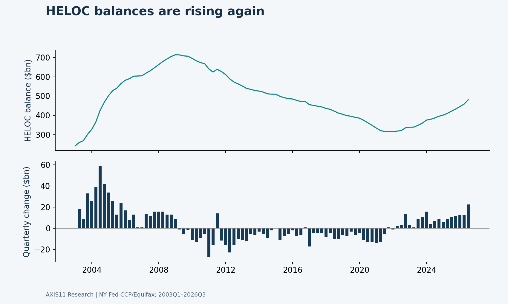
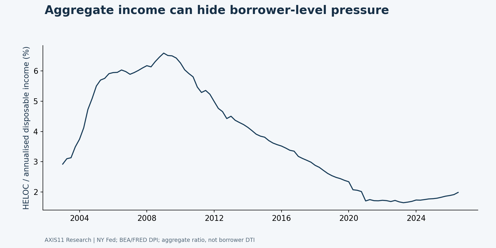
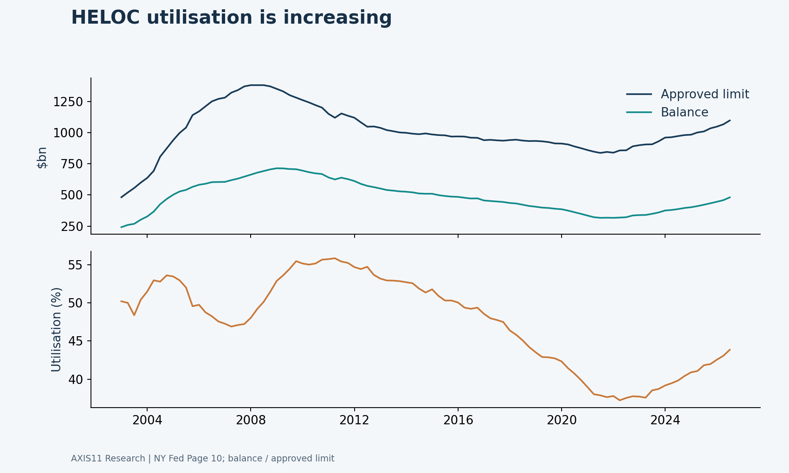
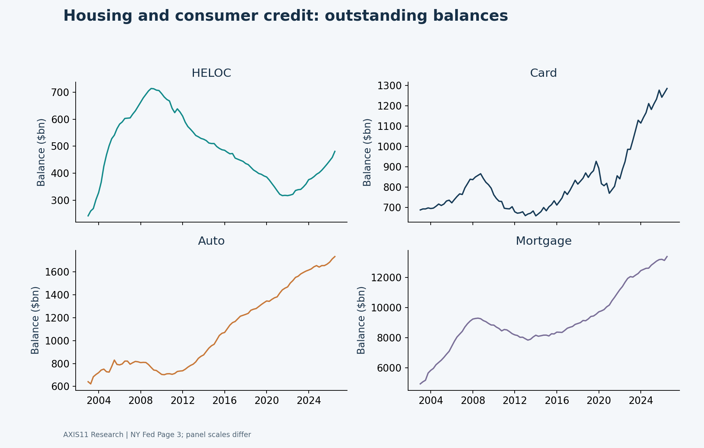
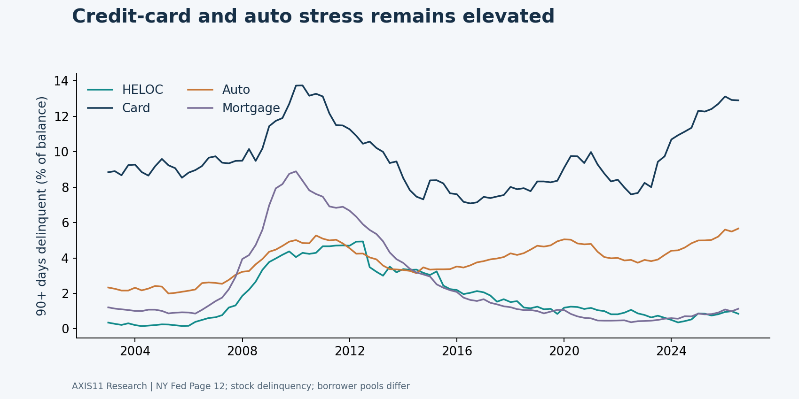
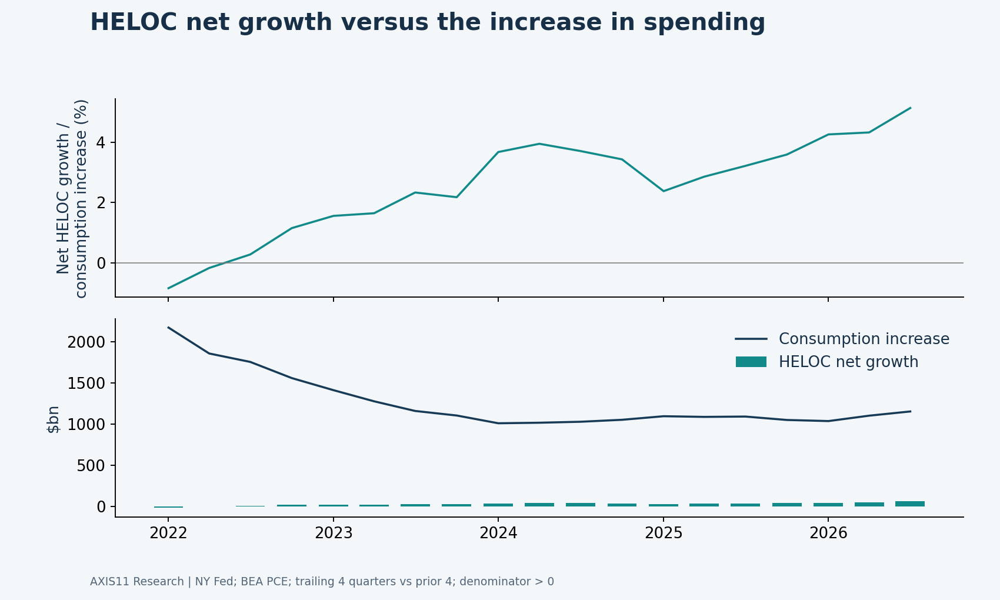
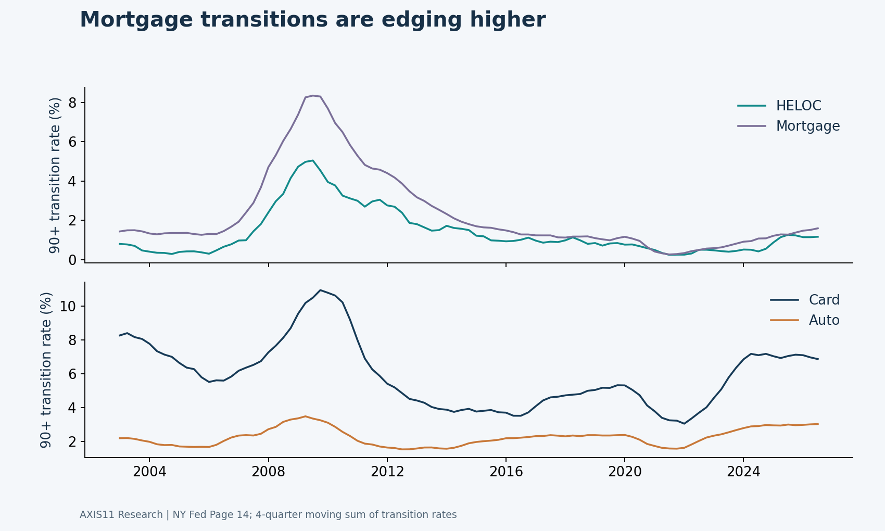

*More borrowing against homes, greater use of credit lines, and an uneven picture of repayment stress*

The WSJ’s [These Charts Show How More People Are Pulling Cash Out of Their Homes](https://www.wsj.com/economy/housing/these-charts-show-how-more-people-are-pulling-cash-out-of-their-homes-66584b69) describes a renewed rise in US borrowing against housing wealth. The question is **what is driving that borrowing and what it means for household credit risk**. This note analyses home equity lines of credit (HELOCs) alongside credit card, auto loan and mortgage balances and delinquencies.

A HELOC lets a homeowner draw and repay money within an approved credit limit, secured against the home. It can be particularly attractive to borrowers with low-rate mortgages. Rather than refinancing the entire mortgage at today’s higher rate, they can retain the existing loan and borrow only the additional amount through a HELOC. The New York Fed identifies this [mortgage lock-in effect](https://libertystreeteconomics.newyorkfed.org/2024/08/mortgage-lock-in-spurs-recent-heloc-demand/) as a driver of recent demand.

The distinction is between using credit to smooth spending and relying on it to sustain spending that income no longer covers. HELOC growth alone cannot resolve that question. Rising balances across several credit products and their different repayment trends provide a fuller picture.

## 1. A low aggregate ratio can conceal a concentrated burden

HELOC balances reached **$481bn in 2026Q3**, about 52% above the $317bn recorded in 2022Q1. Balances have risen for 18 consecutive quarters. The latest quarterly increase—about $23bn in the official release—was the largest since 2005.

*Figure 1. HELOC balances and the quarterly change, in billions of dollars. Source: NY Fed Consumer Credit Panel/Equifax, AXIS11 calculations.*

HELOC balances are approximately **2.0% of annualised US disposable income**, compared with roughly 6.1% in late 2007. Relative to the income of all households, the outstanding balance is much smaller than before the financial crisis.

*Figure 2. Quarter-end HELOC balance ÷ that quarter's annualised nominal disposable income. Source: NY Fed, BEA/FRED DPI, AXIS11 calculations.*

That aggregate comparison can obscure who owes the debt. Its denominator includes income earned by households with no HELOC. If borrowing grows among households with less disposable income, their exposure can increase without making much difference to the national ratio.

The St. Louis Fed’s [analysis](https://www.stlouisfed.org/on-the-economy/2026/jun/tracking-shift-mortgage-refinancings-helocs) shows HELOC use spreading in lower-income areas. Among housing-debt holders in the lowest-income decile of ZIP codes, the share using a HELOC rose **from 5.53% to 6.38%** between 2022Q1 and 2026Q1. The real balance per user increased **21%**. The share of users in high-income areas did not increase over the recent expansion.

This is evidence of wider use in lower-income areas. It helps explain why a modest aggregate balance deserves closer attention: the risk depends on the resources available to the borrowers carrying it.

## 2. Borrowers are drawing more of their approved credit

Comparing balances with approved limits shows how actively HELOCs are being used. The collateral component of an individual limit can be illustrated as follows.

**Collateral-based HELOC limit ≈ max(0, appraised value × permitted combined loan-to-value − existing mortgage and other secured balances)**

For a home valued at $800,000, an 80% permitted combined loan-to-value ratio and $300,000 of existing secured debt imply `800,000 × 80% − 300,000 = $340,000` of collateral-based capacity. This is an illustration; approval also depends on income, credit score and lending standards. The aggregate limit sums the credit actually approved.

In 2026Q3, approved limits totalled about **$1.097trn**, against **$481bn** drawn. Utilisation was approximately **43.8%**, up about 6.1 percentage points from roughly 37.8% in 2022Q1. Both approved limits and drawn balances have expanded, with balances rising faster.

*Figure 3. Utilisation = HELOC balance ÷ total approved limit. Source: NY Fed source workbook, Page 10, AXIS11 calculations.*

**Utilisation measures use of approved housing credit more directly than the aggregate income ratio.** Its rise shows borrowers drawing more heavily on the lines they have arranged.

## 3. Borrowing is rising across consumer credit

A HELOC used to repay a credit card changes the composition of debt. A HELOC used for living costs or additional purchases adds financing for consumption and a future repayment obligation. Balances and delinquencies across other products help place the expansion in context.

*Figure 4. HELOC, credit card, auto loan and mortgage balances, in billions of dollars. Panel scales differ. Source: NY Fed, Page 3.*

| Product | 2026Q3 balance, $bn | Increase over the year | 90+ days delinquent | A year earlier |
|---|---:|---:|---:|---:|
| HELOC | 481 | 59 | 0.85% | 0.75% |
| Credit card | 1,285 | 52 | 12.90% | 12.41% |
| Auto loan | 1,734 | 79 | 5.66% | 5.02% |
| Mortgage | 13,374 | 302 | 1.13% | 0.83% |

*Source: NY Fed, Pages 3 and 12, AXIS11 calculations. Increases are against the same quarter a year earlier. Mortgages and HELOCs are separate product categories.*

Credit card and auto balances have increased alongside HELOCs. The expansion in household borrowing extends across several products.

*Figure 5. Share of each product's balance that is 90 or more days delinquent. Source: NY Fed, Page 12.*

The share of card balances at least 90 days delinquent rose from 12.41% to 12.90% over the year; the auto share increased from 5.02% to 5.66%. HELOC delinquency remains low, but that relative stability sits alongside greater repayment stress elsewhere.

## 4. Net HELOC borrowing is growing relative to additional spending

**Comparing net HELOC growth with the increase in consumption shows the scale of additional borrowing against homes relative to additional spending.** A rising ratio gives reason to examine whether spending is becoming more dependent on housing-secured credit.

The numerator is the increase in HELOC balances over the past four quarters. The denominator is the year-over-year increase in consumer spending over those four quarters.

**Ratio = increase in HELOC balances over the trailing four quarters ÷ year-over-year increase in consumer spending over those four quarters**

*Figure 6. Above: net HELOC growth ÷ the increase in spending. Below: the two amounts, in billions of dollars. Source: NY Fed, BEA/FRED PCE, AXIS11 calculations.*

| As of | HELOC net growth, past year | Annual increase in spending | Ratio |
|---|---:|---:|---:|
| 2025Q3 | $35bn | about $1.089trn | 3.2% |
| 2026Q1 | $44bn | about $1.034trn | 4.3% |
| 2026Q2 | $47.5bn | about $1.100trn | 4.3% |
| 2026Q3 | $59bn | about $1.151trn | 5.1% |

The ratio rose from 3.2% in 2025Q3 to 5.1% in 2026Q3. Together with higher utilisation, it shows housing-secured borrowing taking a larger role in the household credit picture.

This is a comparison of scale: **5.1% is not the share of additional consumption financed by HELOCs**. Establishing how borrowers used the funds requires borrower-level data.

## 5. New delinquency is rising in mortgages and auto loans

**Low HELOC delinquency is only one part of the household credit picture.** Serious delinquency shares have risen on cards and auto loans, while the mortgage share increased from 0.83% to 1.13% over the year.

The stock of delinquent balances and the flow into delinquency answer different questions. The latter helps show whether repayment pressure is still building.

*Figure 7. Transition rate into 90+ day delinquency, as a four-quarter moving sum on the NY Fed's basis. Source: NY Fed, Page 14.*

| Product | 2025Q3 | 2026Q2 | 2026Q3 |
|---|---:|---:|---:|
| HELOC | 1.27% | 1.15% | 1.17% |
| Credit card | 7.05% | 6.97% | 6.87% |
| Auto loan | 2.99% | 3.00% | 3.02% |
| Mortgage | 1.28% | 1.52% | 1.60% |

The card transition rate is easing, despite the higher stock of seriously delinquent balances. Auto and mortgage transition rates are rising. Mortgages show increases in both measures, although the New York Fed still considers the transition rate low by historical standards.

**Borrowing is expanding, but these measures do not yet establish a broad household credit crisis.** The pressure to watch is the high delinquency burden on cards and auto loans, together with the upward trend in mortgage delinquency.

The recent market correction could add pressure through lower asset values and weaker spending confidence. A slowdown in income or employment would further test households relying on additional borrowing. The credit data end in September, so they do not yet capture any subsequent effect.

The key question is whether **higher HELOC utilisation is accompanied by further deterioration in card, auto and mortgage repayment**. That would make the increase in borrowing more concerning than its small ratio to aggregate income suggests.

## Data and method

- The analysis covers 2003Q1 to 2026Q3. HELOCs exclude cash-out refinancing and closed-end second liens.
- Balances, limits, delinquency and transition rates come from the New York Fed's Household Debt and Credit report and its source workbook (Pages 3, 10, 12 and 14); disposable income and consumer spending come from BEA/FRED. As of 18 November 2026.
- The ratio to income, the utilisation rate and net growth against the increase in spending are all calculated from aggregate data. None is a debt-to-income ratio or a repayment burden at the level of a borrowing household.
- In the St. Louis Fed material, income groups are defined by ZIP code, the population is holders of housing debt aged 20 to 64, and balances per person are in real terms.
- The limit formula above simplifies the structure of adding a new HELOC on top of existing secured debt. Calculation definitions, data units and the verification results are kept in a separate working file.

## Sources

1. [WSJ — These Charts Show How More People Are Pulling Cash Out of Their Homes](https://www.wsj.com/economy/housing/these-charts-show-how-more-people-are-pulling-cash-out-of-their-homes-66584b69) · the starting point for this note; the calculations use the official sources below.
2. NY Fed — [2026Q3 report](https://www.newyorkfed.org/medialibrary/interactives/householdcredit/data/pdf/hhdc_2026q3.pdf), [source workbook](https://www.newyorkfed.org/medialibrary/interactives/householdcredit/data/xls/hhd_c_report_2026q3.xlsx), [press release](https://www.newyorkfed.org/newsevents/news/research/2026/20261110)
3. NY Fed — [Mortgage Lock-In Spurs Recent HELOC Demand](https://libertystreeteconomics.newyorkfed.org/2024/08/mortgage-lock-in-spurs-recent-heloc-demand/), 6 August 2024
4. BEA/FRED — [DPI](https://fred.stlouisfed.org/series/DPI), [PCE](https://fred.stlouisfed.org/series/PCE)
5. St. Louis Fed — [Tracking the Shift from Mortgage Refinancings to HELOCs](https://www.stlouisfed.org/on-the-economy/2026/jun/tracking-shift-mortgage-refinancings-helocs), 2 June 2026
6. [Chase — what is a HELOC](https://www.chase.com/personal/mortgage/education/financing-a-home/what-is-a-heloc), [Fannie Mae — HCLTV ratios](https://selling-guide.fanniemae.com/sel/b2-1.2-03/home-equity-combined-loan-value-hcltv-ratios)
