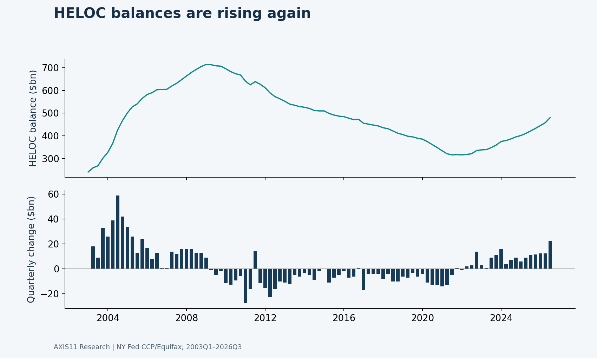
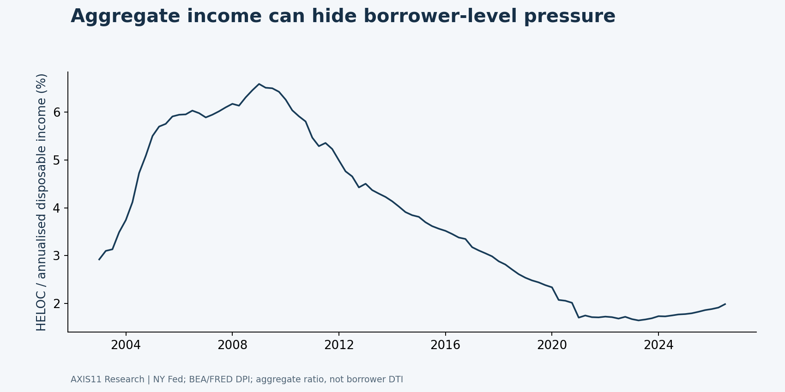
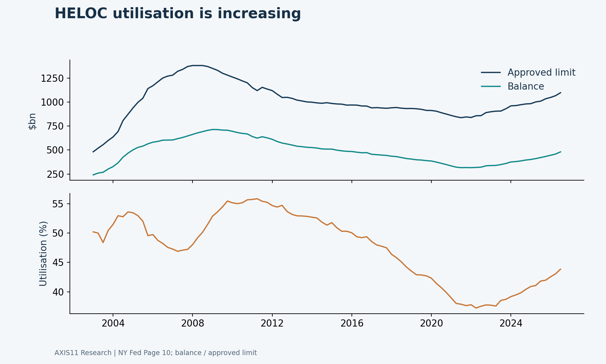
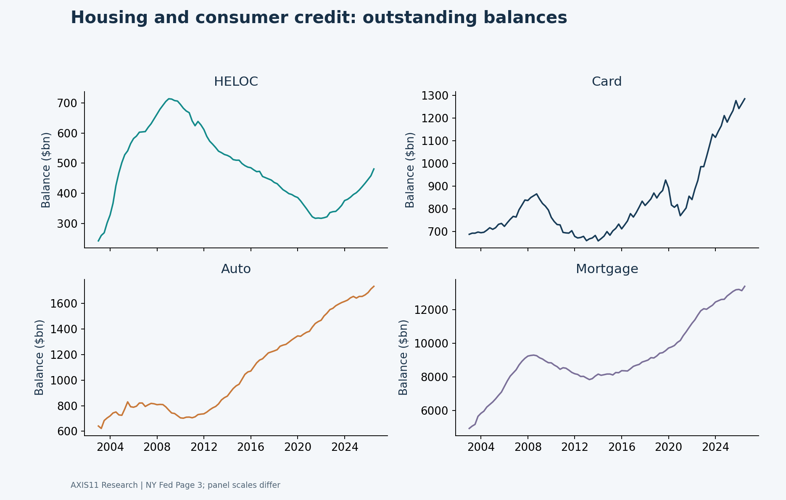
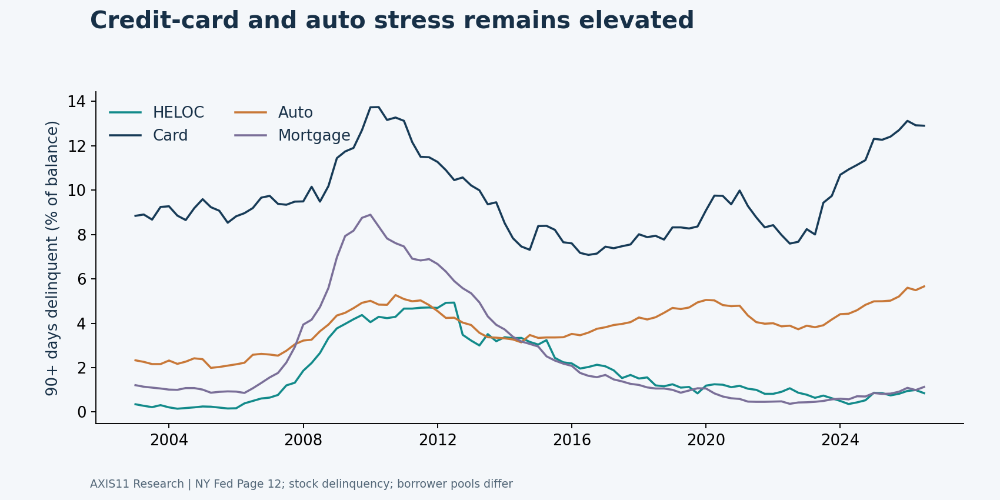
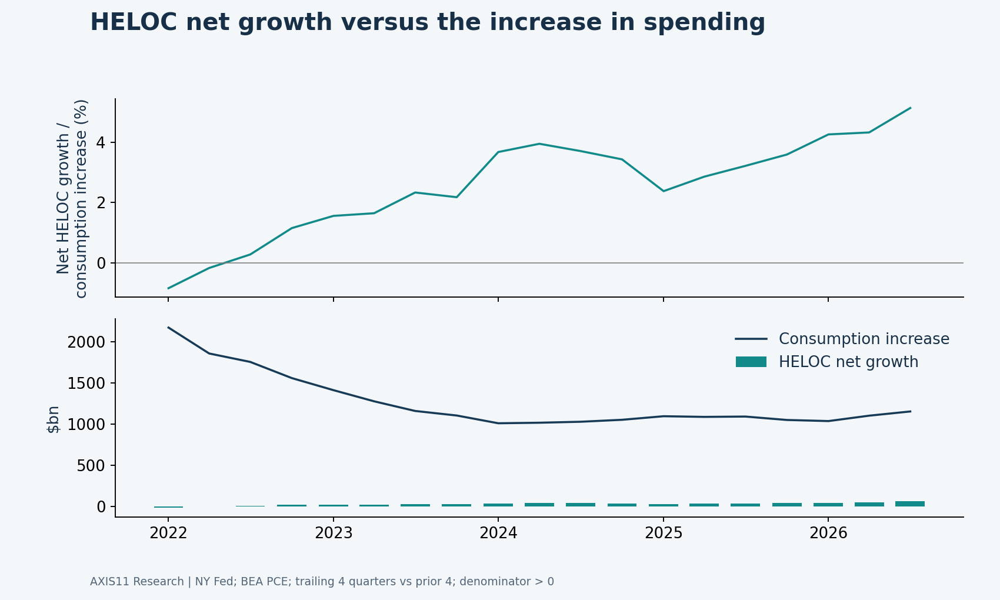
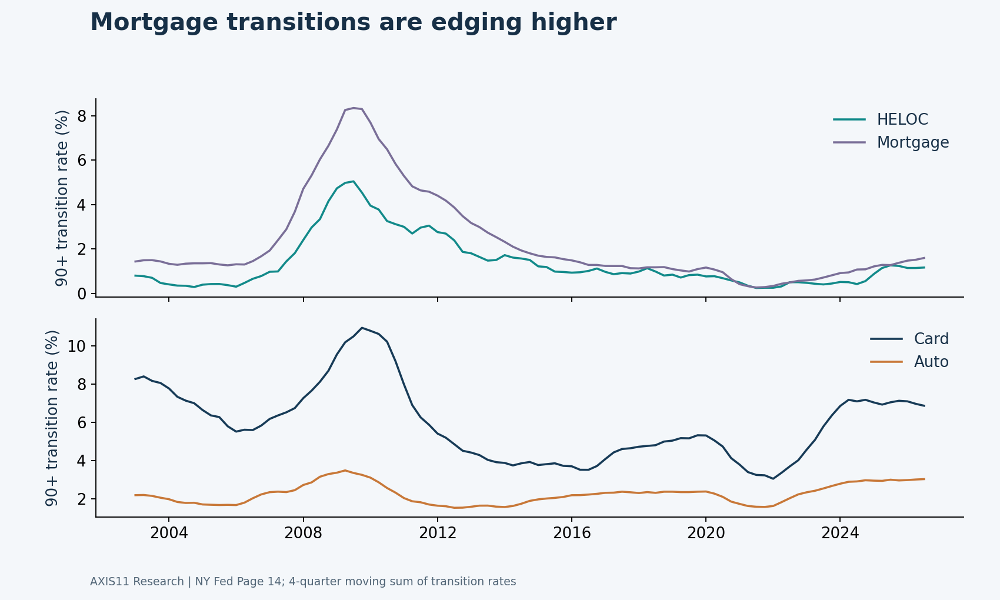

*한도 사용률과 연체 흐름으로 본 미국 가계 신용의 현재 위치*

WSJ의 [These Charts Show How More People Are Pulling Cash Out of Their Homes](https://www.wsj.com/economy/housing/these-charts-show-how-more-people-are-pulling-cash-out-of-their-homes-66584b69)는 미국 가계가 다시 주택을 담보로 현금을 인출하는 흐름을 소개했다. 이 기사를 읽고 확인하고 싶었던 것은 차입 증가 자체보다 **그 배경에 어떤 위험이 있으며, 가계의 신용위험을 높이는 요인인지**였다. 이를 살펴보기 위해 주택담보 신용한도인 HELOC와 함께 신용카드·자동차 대출·모기지의 잔액과 연체 자료를 분석해 보았다.

HELOC(Home Equity Line of Credit)는 주택을 담보로 승인된 한도 안에서 인출하고 상환하는 대출이다. 미국에는 30년 고정금리처럼 만기가 긴 모기지가 널리 활용된다. 과거 저금리에 받은 고정금리 모기지를 유지하면서 HELOC를 추가하면 기존 대출 이자는 낮게 유지하고, 필요한 추가 금액만 새로운 금리로 빌릴 수 있다. 기존 모기지 전체를 높은 금리로 바꿀 필요가 줄어드는 것이다. 뉴욕 연준도 이 [잠김 효과](https://libertystreeteconomics.newyorkfed.org/2024/08/mortgage-lock-in-spurs-recent-heloc-demand/)를 최근 HELOC 수요의 배경으로 지목한다.

핵심 질문은 이 차입이 소비를 유연하게 조정하는 수단인지, 아니면 소득만으로 감당하기 어려운 지출을 부채로 유지하는 신호인지다. 현재 가계는 신용 사용을 늘리고 있으며 일부 상품에서 상환 부담도 커지고 있다. HELOC뿐 아니라 다른 소비자 신용의 연체 흐름을 함께 확인해야 하는 이유다.

## 1 전체 소득 대비 비율은 실제 차입자의 부담을 가릴 수 있다

2026년 3분기 HELOC 잔액은 4,810억 달러다. 2022년 1분기의 3,170억 달러보다 약 52% 늘었고, 18분기 연속 증가했다. 분기 증가액은 공식 발표 기준 약 230억 달러로 2005년 이후 가장 컸다.

*그림 1. HELOC 잔액과 분기 잔액 변화. 단위: 십억 달러. 출처: NY Fed Consumer Credit Panel/Equifax, AXIS11 계산.*

HELOC 잔액을 미국 전체 연율 가처분소득으로 나누면 현재 약 2.0%다. 2007년 말의 약 6.1%보다 낮다. 경제 전체의 소득 규모와 비교하면 과거보다 작은 신용 사이클이다.

*그림 2. 분기말 HELOC 잔액 ÷ 해당 분기 연율 명목 가처분소득. 출처: NY Fed·BEA/FRED DPI, AXIS11 계산.*

그러나 이 비율이 낮다고 실제 차입자의 부담까지 낮다고 판단할 수는 없다. 전체 가계소득에는 HELOC를 사용하지 않는 고소득 가계의 소득도 포함된다. 추가 차입 수요가 소득 여력이 작은 가계에서 더 빠르게 늘어난다면 총량 비율은 부담의 집중을 가릴 수 있다.

세인트루이스 연준 [연구](https://www.stlouisfed.org/on-the-economy/2026/jun/tracking-shift-mortgage-refinancings-helocs)에서 소득 하위 10% 우편번호 지역은 2022년 1분기~2026년 1분기 주택부채 보유자 중 HELOC 이용자 비중이 **5.53%에서 6.38%로 증가**했다. 이용자당 실질 잔액도 **21% 증가**했다. 고소득 지역에서는 최근 확대 국면에 이용자 비중 증가가 관찰되지 않았다.

이는 저소득 지역에서 이용이 확대됐다는 근거다. 전체 소득 대비 부채가 작아 보여도 소득 여력이 작은 차입자에게 부담이 집중될 수 있다. 신용위험을 평가하려면 평균 비율보다 실제 차입자의 소득과 상환능력에 주목해야 한다.

## 2 HELOC 총한도 대비 사용률이 올라가고 있다

승인된 신용이 실제로 얼마나 사용되는지 보려면 HELOC 총한도 대비 잔액을 확인해야 한다. 개별 대출의 담보 기준 한도는 간단히 다음처럼 이해할 수 있다.

**담보 기준 HELOC 한도 ≈ max(0, 주택 평가액 × 허용 총담보비율 − 기존 모기지 및 다른 담보대출 잔액)**

예를 들어 주택 평가액이 80만 달러, 허용 총담보비율이 80%, 기존 담보대출이 30만 달러라면 담보 기준 한도는 `80만 × 80% − 30만 = 34만 달러`다. 이는 설명용 가정이며, 실제 승인액은 소득·신용도·금융기관 기준에 따라 달라진다. 미국 전체 HELOC 총한도는 개별적으로 승인된 한도를 합한 것이다.

2026년 3분기 총한도는 약 **1.097조 달러**, 사용 잔액은 **4,810억 달러**로 사용률은 약 **43.8%**다. 2022년 1분기의 약 37.8%보다 약 6.1%포인트 높다. 즉, 최근에는 대출 한도와 실제 사용이 함께 확대되고 있다.

*그림 3. 사용률 = HELOC 잔액 ÷ 총한도. 출처: NY Fed 원본 엑셀 Page 10, AXIS11 계산.*

**총한도 대비 사용률은 전체 소득 대비 HELOC보다 승인된 신용이 실제로 얼마나 사용되는지 더 직접적으로 보여준다.** 비이용 가계의 소득이 분모에 포함되지 않기 때문이다. 최근 사용률 상승은 가계가 확보한 주택담보 신용을 이전보다 적극적으로 활용하고 있음을 나타낸다.

## 3 카드·자동차 대출도 늘고 있으며 연체 비중은 높아지고 있다

HELOC로 인출한 돈이 카드 빚을 갚는 데 쓰이면 부채 구성이 바뀐다. 생활비나 추가 구매에 사용하면 소비를 뒷받침하면서 상환 부담도 늘어난다. 다른 신용의 잔액과 연체 흐름을 함께 보면 가계 부담이 어느 부문에 나타나는지 파악할 수 있다.

*그림 4. HELOC·신용카드·자동차 대출·모기지 잔액. 단위: 십억 달러. 각 패널의 세로축 범위는 다르다. 출처: NY Fed Page 3.*

| 상품 | 2026Q3 잔액, 십억 달러 | 최근 1년 증가액 | 90일 이상 연체 비중 | 1년 전 연체 비중 |
|---|---:|---:|---:|---:|
| HELOC | 481 | 59 | 0.85% | 0.75% |
| 신용카드 | 1,285 | 52 | 12.90% | 12.41% |
| 자동차 대출 | 1,734 | 79 | 5.66% | 5.02% |
| 모기지 | 13,374 | 302 | 1.13% | 0.83% |

*출처: NY Fed Pages 3·12, AXIS11 계산. 증가액은 전년 동분기 대비. 모기지와 HELOC는 별도 상품 분류다.*

HELOC뿐 아니라 카드와 자동차 대출도 증가했다. 가계는 여러 신용 경로를 통해 소비에 활용할 수 있는 자금을 늘리고 있다.

*그림 5. 각 상품 잔액 중 90일 이상 연체 비중. 출처: NY Fed Page 12.*

카드 연체 비중은 1년 전 12.41%에서 12.90%로, 자동차 대출은 5.02%에서 5.66%로 조금씩 높아졌다. HELOC의 연체 비중은 낮지만, 카드·자동차 대출에서는 상환 부담이 커지고 있다. 가계 신용을 평가할 때는 HELOC의 안정적인 모습과 다른 소비자 신용의 부담을 함께 봐야 한다.

## 4 소비 증가액 대비 HELOC 순증 비율도 높아졌다

**소비 증가액 대비 HELOC 순증 비율은 추가 소비 규모와 비교해 주택담보 순차입이 얼마나 커지고 있는지 보여준다.** 이 비율이 상승하면 소비를 유지하거나 늘리는 과정에서 HELOC에 의존하는 흐름이 강해지고 있을 가능성을 살펴볼 수 있다.

비교 비율은 최근 4분기의 HELOC 잔액 증가액을 같은 최근 4분기 소비지출의 전년 대비 증가액으로 나눠 계산했다.

**비교 비율 = 최근 4분기 HELOC 잔액 증가액 ÷ 최근 4분기 소비지출의 전년 대비 증가액**

*그림 6. 위: HELOC 순증 ÷ 소비 증가액. 아래: 두 금액, 십억 달러. 출처: NY Fed·BEA/FRED PCE, AXIS11 계산.*

| 기준 시점 | HELOC 최근 1년 순증 | 연간 소비지출 증가액 | 비교 비율 |
|---|---:|---:|---:|
| 2025Q3 | 350억 달러 | 약 1.089조 달러 | 3.2% |
| 2026Q1 | 440억 달러 | 약 1.034조 달러 | 4.3% |
| 2026Q2 | 475억 달러 | 약 1.100조 달러 | 4.3% |
| 2026Q3 | 590억 달러 | 약 1.151조 달러 | 5.1% |

최근 HELOC 순차입은 소비 증가액보다 빠르게 커지고 있다. 총한도 사용률 상승과 함께 보면 **주택담보 신용에 대한 의존이 확대되는 신호**로 읽을 수 있다.

이 지표는 차입과 소비의 규모를 비교한 것으로, 5.1%가 실제 소비 증가의 자금조달 기여율을 뜻하지는 않는다. 자금 사용처와 이용 가구 수는 별도의 차입자 자료가 필요하다.

## 5 HELOC만 보지 말고 모기지와 다른 소비자 신용의 연체를 함께 봐야 한다

**HELOC 연체 비중이 낮다는 이유만으로 소비자 신용 전반에 문제가 없다고 판단할 수는 없다.** 카드·자동차 대출의 연체 비중이 높아지고 있으며, 모기지도 1년 전 0.83%에서 1.13%로 상승했다.

기존 잔액에 쌓인 연체와 함께 심각한 연체로 새롭게 이동하는 흐름을 확인할 필요가 있다.

*그림 7. 90일 이상 연체로의 전이율. NY Fed 기준 4분기 이동합. 출처: NY Fed Page 14.*

| 상품 | 2025Q3 | 2026Q2 | 2026Q3 |
|---|---:|---:|---:|
| HELOC | 1.27% | 1.15% | 1.17% |
| 신용카드 | 7.05% | 6.97% | 6.87% |
| 자동차 대출 | 2.99% | 3.00% | 3.02% |
| 모기지 | 1.28% | 1.52% | 1.60% |

카드의 심각한 연체 전이율은 낮아지는 반면 자동차 대출과 모기지는 상승하고 있다. 특히 모기지는 잔액 중 연체 비중과 신규 연체 흐름이 함께 높아지고 있다. 뉴욕 연준은 모기지 연체 전이율이 상승했지만 역사적으로는 아직 낮은 수준이라고 평가했다.

**가계는 소비에 활용할 수 있는 신용을 늘리고 있지만, 아직 광범위한 가계 신용위기로 번질 정도의 문제는 보이지 않는다. 다만 카드·자동차 대출의 부담과 모기지 연체 상승은 계속 관찰해야 한다.**

최근 시장 조정은 자산을 보유한 가계의 평가자산과 소비심리에 어느 정도 부담을 줄 것으로 예상한다. 소득이나 고용까지 약해지면 추가 차입으로 소비를 유지해 온 가계의 상환 부담이 커질 수 있다. 현재 연체 자료는 9월 말까지이므로 이후 시장 조정의 영향은 앞으로 발표될 자료에서 확인해야 한다.

앞으로는 **HELOC 사용률과 카드·자동차·모기지 연체가 함께 상승하는지**를 중심으로 판단을 업데이트할 필요가 있다.

## 데이터와 방법

- 분석 기간은 2003년 1분기~2026년 3분기다. HELOC는 cash-out 재융자와 폐쇄형 후순위 대출을 포함하지 않는다.
- 잔액·한도·연체·전이율은 뉴욕 연준 Household Debt and Credit 보고서와 원본 엑셀(Pages 3·10·12·14)에서, 가처분소득과 소비지출은 BEA/FRED에서 가져왔다. 기준일은 2026년 11월 18일이다.
- 소득 대비 비율과 사용률, 소비 증가액 대비 순증은 모두 총량 자료로 계산한 것이며 차입 가구 단위의 DTI나 상환부담이 아니다.
- 세인트루이스 연준 자료의 소득 구분은 우편번호 지역 기준이고, 대상은 20~64세 주택부채 보유자이며, 1인당 잔액은 실질 기준이다.
- 본문의 한도 산식은 기존 담보대출에 신규 HELOC를 추가하는 구조를 단순화한 설명이다. 계산 정의·데이터 단위·검증 결과는 별도 상세분석 파일에 정리했다.

## 참고자료

1. [WSJ — These Charts Show How More People Are Pulling Cash Out of Their Homes](https://www.wsj.com/economy/housing/these-charts-show-how-more-people-are-pulling-cash-out-of-their-homes-66584b69) · 이 노트의 출발점이며, 계산은 아래 공식 자료를 사용했다.
2. NY Fed — [2026Q3 보고서](https://www.newyorkfed.org/medialibrary/interactives/householdcredit/data/pdf/hhdc_2026q3.pdf), [원본 엑셀](https://www.newyorkfed.org/medialibrary/interactives/householdcredit/data/xls/hhd_c_report_2026q3.xlsx), [공식 발표](https://www.newyorkfed.org/newsevents/news/research/2026/20261110)
3. NY Fed — [Mortgage Lock-In Spurs Recent HELOC Demand](https://libertystreeteconomics.newyorkfed.org/2024/08/mortgage-lock-in-spurs-recent-heloc-demand/), 2024년 8월 6일
4. BEA/FRED — [DPI](https://fred.stlouisfed.org/series/DPI), [PCE](https://fred.stlouisfed.org/series/PCE)
5. St. Louis Fed — [Tracking the Shift from Mortgage Refinancings to HELOCs](https://www.stlouisfed.org/on-the-economy/2026/jun/tracking-shift-mortgage-refinancings-helocs), 2026년 6월 2일
6. [Chase — HELOC 설명](https://www.chase.com/personal/mortgage/education/financing-a-home/what-is-a-heloc), [Fannie Mae — HCLTV 산식](https://selling-guide.fanniemae.com/sel/b2-1.2-03/home-equity-combined-loan-value-hcltv-ratios)
