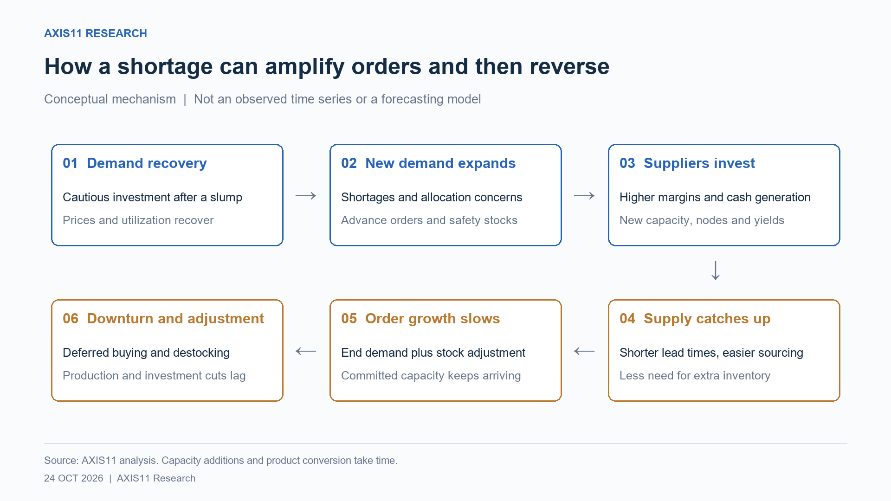
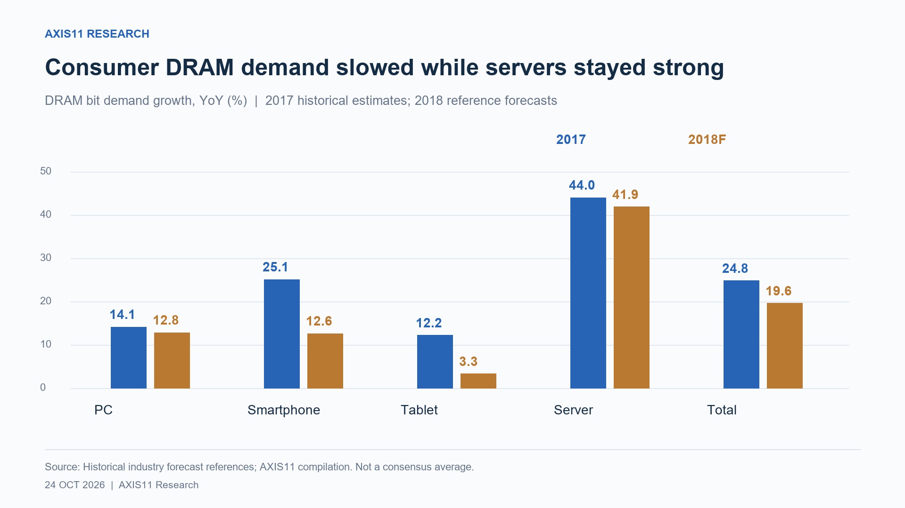
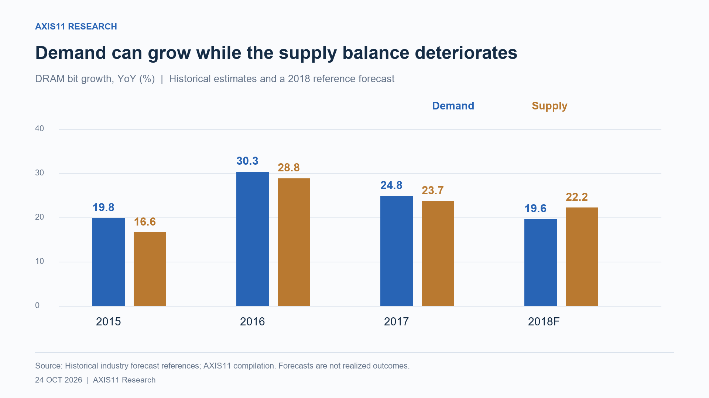
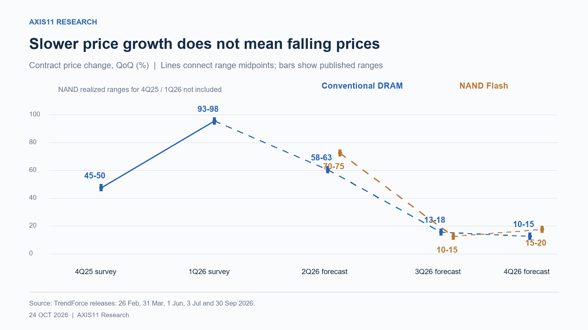
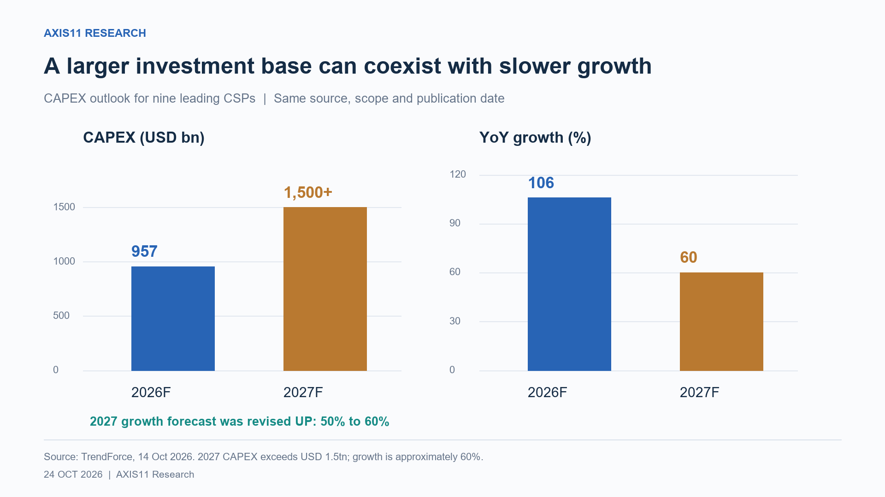
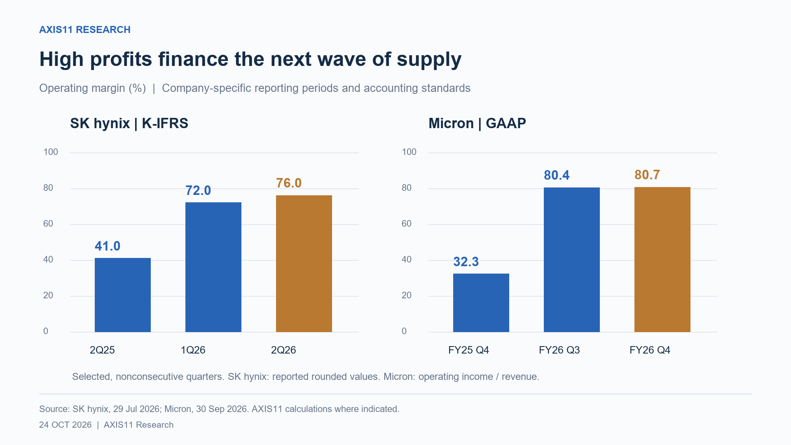
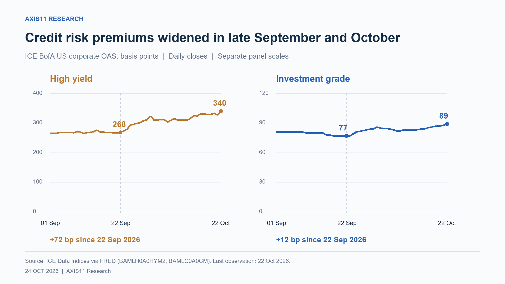
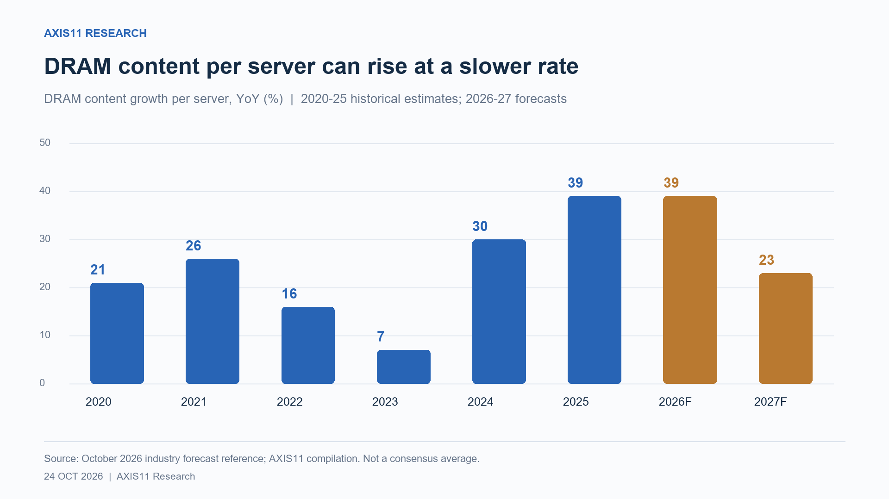

*Why strong demand and record profits may not be enough to sustain memory stocks*

Memory prices are rising. Earnings are improving. Yet share prices are falling.

One explanation is that investors are looking ahead to slower demand growth just as output from earlier investment and process improvements arrives. But that reading needs to account for the strength of AI. Infrastructure remains supply-constrained, and cloud providers’ capex forecasts are still being revised up. Current demand has not collapsed.

Today’s product price increases reveal a shortage. They tell us less about how long it will last. If share prices already assume that exceptional profits will continue, better current earnings may not be enough to sustain them.

The 2018 memory cycle illustrates how a shortage can begin to unwind while its strongest source of demand remains healthy. This note uses that experience to examine the conditions forming during the current boom. It does not identify the peak, estimate a statistical lead between supply-demand indicators and share prices, or attribute the recent correction to a single cause. **The question is how the next phase of the cycle takes shape before the present one has ended.**

## 1. How a shortage creates the conditions for its reversal

A cycle often begins with the restraint left by the previous downturn. In a concentrated industry such as memory, adjustment comes mainly through production cuts, lower investment and delayed process migration, rather than suppliers exiting altogether. Balance sheets may also be weaker.

When demand recovers, suppliers are initially cautious. The downturn is recent, and the durability of new demand is uncertain. Utilisation, prices and profits can therefore recover before companies commit to substantial new capacity.

New applications can turn that recovery into a shortage. With little history to guide forecasts, suppliers and analysts may underestimate the demand. Customers then respond by ordering early, building safety stocks and accepting long-term contracts or prepayments to secure supply.

Orders now reflect both consumption and inventory building. Advance purchases are not necessarily excessive, but orders can increase by 20 while final consumption rises by only 10. If suppliers treat the full increase as recurring demand, they invest against a higher baseline. **The response to a shortage can make underlying demand look stronger than it is.**

Supply responds with a lag. Higher profits generate cash for investment. Better yields and process migration raise the bits produced per wafer, while capacity approved earlier begins operating. A new capex cut cannot immediately stop those additions to output.

Meanwhile, customers may need less inventory even if consumption continues to grow. Shorter lead times and easier sourcing allow the same sales to be supported with smaller stocks. Expected price declines also reduce the incentive to buy early. If final demand slows while customers destock, suppliers’ orders weaken faster than consumption.

| Phase | Final customer | Orders and inventory | Supplier response |
|---|---|---|---|
| Early recovery | Consumption recovers | Buying as needed | Conservative investment, utilisation recovers |
| Shortage | New uses and customers | Advance purchases, safety stock | Price increases, expanded investment |
| Balance eases | Growth can continue | Slower inventory building | Output from earlier investment arrives |
| Downturn | Growth slows or falls | Deferred buying, destocking | Production and investment cuts, with a lag |

The turning point can arrive before demand falls outright: suppliers have prepared for one growth rate, while customers need another. A larger base does not mechanically force growth to slow; a sufficiently strong new market can sustain or accelerate it. The issue is whether incremental demand keeps pace with the supply being prepared.

## 2. In 2018, server demand stayed strong as the balance weakened

Cloud computing was a central source of demand in the previous boom. Enterprise migration to cloud services, SaaS and internet growth increased both server volumes and memory and storage per server. Cloud was not the cycle’s only driver, but contemporaneous forecasts show the importance of server DRAM.

Between the start of 2018 and June, forecast server DRAM demand growth increased from roughly 38% to 42%. Both server shipments and memory content per server were revised up. The first signs of weakness appeared in PCs, smartphones and other applications.[^1]

| 2018 forecast item | Start of year | June revision | Change |
|---|---:|---:|---:|
| PC shipment growth | −0.6% | −2.5% | −1.9pp |
| Smartphone shipment growth | +2.2% | −3.4% | −5.6pp |
| Server shipment growth | +7.0% | +8.5% | +1.5pp |
| DRAM content per server growth | +28.5% | +30.9% | +2.4pp |
| Server DRAM demand growth | +37.5% | +41.9% | +4.4pp |
| Total DRAM demand growth | +19.1% | +19.6% | +0.5pp |

Source: contemporaneous industry forecasts compiled by AXIS11 on a consistent basis for the two dates. These are forecasts made at the time, rather than realised outcomes or a consensus average across research houses.

The table shows why strong server demand was insufficient to settle the outlook. Weakness elsewhere could still weigh on the overall market, and an upward revision to demand did not necessarily improve the balance if supply was being revised up faster.

The June forecast put 2018 DRAM demand growth at 19.6%, below the contemporaneous estimate of 24.8% for 2017. Supply was forecast to grow 22.2%. Its upward revision from the start of the year—1.5pp—also exceeded the 0.5pp increase in forecast demand growth. **Demand was growing, but supply was expected to grow faster.**[^1]

| Metric | 2017 historical estimate at the time | 2018 forecast at the time |
|---|---:|---:|
| DRAM demand growth | 24.8% | 19.6% |
| DRAM supply growth | 23.7% | 22.2% |
| Supply growth − demand growth | −1.1pp | +2.6pp |
| Estimated supply surplus ratio | −0.7% | +1.4% |

Source: contemporaneous industry forecasts, restated by AXIS11. The last row is supply/demand − 1, a different measure from the difference in growth rates. This is not a table of realised outcomes.

These figures describe the balance expected at the time. The 2.6pp gap is the difference between two growth rates; the 1.4% is an estimated supply surplus ratio. Neither measures a realised surplus. Their significance is the forecast shift from shortage towards slack.

Industry concentration does not eliminate this risk. Each supplier has an incentive to defend or increase its share, even while recognising the danger of industry-wide overcapacity. Individually rational expansion can still produce an aggregate surplus.

Suppose demand is 100 and company A supplies 30. If demand is expected to reach 120, A needs output of 36 to preserve its 30% share. Balance holds if all suppliers expand proportionately and demand meets the forecast. It breaks if suppliers collectively prepare more output to gain share, or demand falls short.

| Illustrative assumption | Next-period demand | Supply prepared | Result |
|---|---:|---:|---|
| All hold share, forecast realised | 120 | 120 | Balance maintained |
| Suppliers compete for share | 120 | 125 | Surplus of 5 |
| Demand grows less than expected | 115 | 120 | Surplus of 5 |

This is an AXIS11 arithmetic illustration, not market data. A prolonged shortage can raise both demand forecasts and suppliers’ ambitions. If the resulting capacity arrives together, supply can exceed demand even as consumption grows.

Product mix also adjusts. Suppliers seek higher-margin server business, eventually bringing more output into the strongest market. Moving capacity between mobile, PC and server DRAM requires process changes, equipment and customer qualification, so weak consumer demand does not instantly release equivalent server supply. It does, however, put pressure on the use of the industry’s installed capacity.

By October 2018, TrendForce reported rising bit output from node migration and yield improvements, particularly in server DRAM, and forecast a quarterly DRAM price decline of more than 5% in 4Q18. The June demand revisions and October supply assessment fit the sequence described above. They do not quantify how much consumer capacity was redirected to servers.[^2]

## 3. Record profits did not protect the shares

SK hynix reported record 3Q18 revenue of KRW 11.42trn and operating profit of KRW 6.47trn. On 25 October, the day of the release, its shares nevertheless closed 3% lower at KRW 64,700. Investors did not need to wait for reported earnings to deteriorate before marking down the stock.[^3][^4]

| Date | What was observable at the time | What it meant |
|---|---|---|
| June 2018 | Server demand revised up, PC and smartphone shipments revised down | Divergence between strong and weak areas of growth |
| 9 October 2018 | Supply growth from node and yield gains; weaker 4Q prices expected | Supply's delayed response becomes the issue |
| 25 October 2018 | SK hynix record 3Q results; shares −3% on the day | Record profit and a falling share price together |

Equity valuation depends on the earnings ahead as well as those just reported. If the shortage supporting exceptional margins is expected to ease, investors can reduce both future profit estimates and the multiple they are willing to pay. Current earnings can continue to improve during that repricing.

The episode does not establish a fixed lead time from demand growth to share prices. Trade tensions and other demand concerns were also present. It does show why **strong server demand and record profits were insufficient reasons to dismiss weakness elsewhere or the supply response.**

## 4. Today, demand pressure is appearing outside AI first

AI infrastructure is the main source of new demand in this cycle. AI itself predates 2023, but the commercialisation of generative AI around that time accelerated simultaneous investment in compute, networking and memory for training and inference. The scale and intensity differ from the earlier cloud buildout.

The shortage is visible in memory prices. TrendForce’s subsequent survey put the 1Q26 increase in conventional DRAM contract prices at 93–98% quarter on quarter. Its forecasts for the following quarters were +58–63%, +13–18% and +10–15%. These are successively smaller increases, rather than price declines.[^5]

Customers’ ability to absorb those increases varies. Higher memory revenue is a higher input cost for the buyer. An AI provider expanding rapidly may prioritise securing supply; a consumer PC or smartphone maker may have to raise retail prices, reduce specifications or accept lower margins.

TrendForce illustrated the pressure in March 2026. Starting with a USD 900 notebook, fully passing through higher memory and CPU costs while preserving existing margins would raise the retail price by about 40%. This was a cost-pass-through scenario, rather than an observed 40% increase across notebook prices.[^6]

In September, TrendForce forecast a 9.4% decline in 2026 notebook shipments. It also noted that lower-cost inventory and advance purchases were cushioning the immediate effect of component inflation. As those inventories are used, higher costs feed into new products, creating a lag between component-price increases and their effect on final demand.[^7]

| Market | Observed pressure | How demand responds |
|---|---|---|
| Consumer PCs | Higher memory and CPU costs | Deferred replacement, spec changes, price increases |
| Smartphones | Memory prices against consumer purchasing power | Adjusted production plans, content and mix changes |
| AI and enterprise servers | Component shortage and high system prices | Long-term contracts, prepayments, buying to secure supply |

Compiled from TrendForce's published March, July and September analyses. It does not imply that every customer responds the same way.[^6][^7][^8]

The warning is therefore not a collapse in AI demand. It is the pressure on customers less able to absorb high prices while AI buyers draw supply towards their own applications. This is the relevant parallel with 2018: watch the weaker end markets even while the strongest one continues to expand.

## 5. A larger capex base raises the bar for further growth

US hyperscaler capex consensus compiled in August stood at USD 794bn. This covers total capex at those companies, not AI alone; the same source separately estimated global AI-related investment at about USD 1trn.[^9] On 14 October, TrendForce forecast capex of USD 957bn in 2026 and more than USD 1.5trn in 2027 for nine leading global cloud service providers (CSPs), representing growth of 106% and about 60%. These estimates have different coverage. In TrendForce’s series, spending growth slows in 2027 even as the forecast growth rate is revised up from 50% to 60%. **Deceleration and an upward revision can occur together.**[^10]

This is still a forecast of substantial additional investment. From USD 957bn, even 10% growth requires another USD 95.7bn. Sustaining the percentage increases achieved on a smaller base requires progressively more absolute spending. The scale raises the burden of delivering further growth; it does not by itself establish that demand will weaken.

Capex growth is also not the same as memory bit-demand growth. TrendForce attributed part of the upward spending revision to higher server and component prices and to prepayments. Some additional dollars therefore buy more expensive equipment rather than more units. Conversely, systems with greater memory intensity can drive bit demand faster than shipments.[^10]

The correction in AI-related shares need not imply collapsing demand. Investors may instead be reassessing how much growth and profitability are already priced in, and how much scope remains for further upgrades. That is a plausible interpretation, rather than a demonstrated attribution of the correction.

## 6. Today’s profits finance tomorrow’s supply

Memory suppliers are earning unusually high margins. SK hynix reported a 76% operating margin in 2Q26. Micron’s reported revenue and operating income imply a GAAP operating margin of about 80.7% in its fiscal 4Q26. The chart retains each company’s reporting period and accounting basis rather than treating them as directly interchangeable.[^11][^12]

Those profits provide the cash to address the shortage through capacity, packaging and process investment. SK hynix’s July release discussed the M15X ramp and additional output from the Yongin clean room from 2027 onwards.[^11]

High margins do not establish over-investment. HBM and conventional DRAM require different resources per bit and have different yields; packaging and customer qualification add constraints. Well-paced investment can coexist with a prolonged shortage. The key question is **whether demand will still justify the planned output when it reaches the market.**

In 2018, output from earlier node migration and yield gains was increasing even as suppliers sought to restrain investment. The same lag matters now. Actual ramp dates, yields and bit output reveal more about incoming supply than capex announcements alone.

### CXMT adds a different source of supply risk

CXMT (ChangXin Memory) adds a significant Chinese supply variable. Estimates differ: reporting on Counterpoint and TrendForce forecasts puts capacity at roughly 320,000 wafers per month in 2026 and 420,000 in 2027, an increase of more than 30%. Citrini Research estimates about 350,000 by end-2026, compared with roughly 375,000 for Micron, 720,000 for Samsung and 590,000 for SK hynix. The estimates use different sources and should not be combined into one precise capacity series. They nevertheless point to a supplier too large to ignore.[^17][^18]

Its investment incentives may also differ. Incumbents balance expansion against expected prices and returns, while China’s semiconductor self-sufficiency goals introduce a strategic objective. Citrini describes state-backed financing and government-directed technology transfer, including pressure for CXMT to share DRAM technology with other Chinese firms. Such support could sustain investment through weaker profitability, making price discipline a less reliable constraint on supply.[^17]

There are important limits. Lithography constrains expansion, domestic Chinese demand may absorb much of the output, and government priorities may favour domestic supply over exports. Production is also focused on conventional PC and consumer DRAM rather than HBM. CXMT is therefore unlikely to resolve the AI memory shortage directly.[^17][^18]

Expansion in conventional DRAM could still affect the wider balance. It may displace incumbent output or encourage incumbents to redirect resources towards server DRAM and HBM, subject to conversion and qualification constraints. These are possible transmission paths, not equivalent or immediate outcomes. **CXMT makes the supply response harder to infer solely from the investment discipline of the established suppliers.**

## 7. Financing can slow orders even while demand holds

Financing conditions affect buyers unevenly. Cash-rich hyperscalers and debt-funded data-centre operators can pursue similar projects at very different costs. Smaller neocloud operators are more exposed to borrowing terms, while consumer-device makers face inventory-financing costs alongside pressure on their customers’ purchasing power.

The Federal Reserve raised its policy-rate target to 3.75–4.00% on 16 September. This is not an individual company’s borrowing rate, but it provides a different backdrop from near-free funding. Projects that pay for equipment well before collecting revenue carry a greater financing burden.[^13]

For illustration, a 1pp increase in the interest rate on an average borrowing balance of USD 1bn adds USD 10m in annual interest. This is arithmetic, not a company estimate. Rising memory prices can also increase the inventory balance that needs financing, compounding the cost.

Investment can continue growing while project scrutiny tightens. Buyers may demand clearer evidence of utilisation, contracted revenue, compute costs and cash payback before committing funds. This does not establish that large, cash-rich CSPs will cut capex because rates are higher.

Credit spreads add another layer. An option-adjusted spread (OAS) measures compensation above the Treasury curve after allowing for embedded bond options. Wider spreads increase borrowing and refinancing costs even if the underlying Treasury yield is unchanged.

The ICE BofA US high-yield OAS widened by 72bp, from 268bp on 22 September to 340bp on 22 October. Investment-grade OAS rose by 12bp, from 77bp to 89bp. One basis point is 0.01pp. The additional compensation demanded from lower-rated borrowers therefore increased more sharply.[^15][^16]

| OAS index | 22 September 2026 | 22 October 2026 | Change |
|---|---:|---:|---:|
| US high yield corporates | 268bp | 340bp | +72bp |
| US investment grade corporates | 77bp | 89bp | +12bp |

Source: ICE Data Indices via FRED, comparing the same dates for each index. The OAS is neither a total corporate bond yield nor any individual company's borrowing rate.

Demand for AI capacity may remain strong while the pace of financing and deployment slows. Debt-funded operators must absorb equipment costs, refinancing terms and lender conditions. A higher project hurdle rate can delay contracts or capital deployment, reaching suppliers through the timing of orders.

The high-yield index covers the broader US speculative-grade market, not neoclouds specifically. Its widening does not establish distress in AI projects or a financial crisis. That requires company-level evidence on cash, maturities, collateral and customer contracts.

For the memory cycle, the combination matters: higher prices raise the cash required to buy components, while wider spreads raise the cost of financing them. Suppliers can use boom profits to expand just as some customers become more cautious. Underlying usage and financed orders need not move at the same pace.

## 8. Watch shipments, memory content and incoming supply together

Early in a rapidly growing market, securing infrastructure can take priority over efficiency. Missing demand or falling behind a competitor may be more costly than carrying spare capacity. As the installed base expands, utilisation and output per dollar invested become more important. Efficiency gains can also lower prices and stimulate additional usage, so their net effect on demand is not predetermined.

An October industry forecast puts growth in average DRAM content per server at 39% in 2026 and 23% in 2027. Content is still rising rapidly; the forecast is for a slower rate of increase.[^14]

Server memory demand is approximately unit shipments multiplied by memory per unit. If content rises 23% and shipments rise 10%, demand on that same basis grows about 35.3%. A slower content-growth rate alone does not establish weaker total demand.

The AI-server outlook provides an important counterpoint. TrendForce’s October forecast puts shipment growth at 32.2% in 2026 and about 36% in 2027—an acceleration. Those AI-server shipment figures cannot simply be multiplied by average content growth across all servers. They do show why it would be wrong to claim that every demand indicator is slowing.[^10]

| Question to separate | Indicator to watch | What to be careful of |
|---|---|---|
| Are more systems actually being installed | Server shipments and installations by type | Distinguish higher spending from higher volume |
| Does each unit need more memory | DRAM and HBM content within the same type | Do not mix all-server and AI-server averages |
| Do the installed resources generate revenue | Utilisation, contracts, usage, payback | Efficiency gains can also stimulate new demand |
| What is weakening outside the strong market | PC and smartphone shipments, specs, inventory | Do not judge the whole balance from the strongest application |
| How far is supply following | Actual start-ups, yields, bit output | Do not convert capex straight into output |

These indicators do not identify the exact peak in shipments or selling prices, and a product-price scenario cannot be translated mechanically into a share-price target. Stocks can anticipate deterioration, or recover when conditions turn out less weak than expected.

The useful signal is the changing balance between customers and suppliers. AI capex forecasts are still rising and shortages persist. Consumer customers face cost pressure, while debt-funded buyers face tighter financing. Suppliers’ profits fund new output, and CXMT adds supply governed partly by strategic priorities. The 2018 lesson is that the balance can begin shifting outside the strongest application before that application itself weakens.

**A cycle can turn before demand stops growing.** Watch whether additional consumption absorbs incoming bit supply, and whether customers shift from building inventory to reducing it. Share prices can weaken during strong reported results because investors are already reassessing the conditions that will produce the next set of earnings.

---

## Sources and basis

This note was compiled by AXIS11 from industry forecasts at several points in time, published market research, company results and macroeconomic indicators. The forecast series in individual tables and charts are reference material for comparing the assumptions of the time; they are neither a consensus averaged across houses nor an independent AXIS11 forecast. Actuals, estimates and forecasts are distinguished in each table and chart.

[^1]: Historical industry forecast references, 2018. AXIS11 compilation, comparing the demand, supply and end-market forecasts of the time on a consistent basis.
[^2]: TrendForce, 9 October 2018, DRAM and NAND Flash Products to See Price Decline. <https://www.trendforce.com/presscenter/news/20181009-10059.html>
[^3]: SK hynix, 25 October 2018, Third Quarter 2018 Results. <https://news.skhynix.com/en/sk-hynix-inc-reports-third-quarter-2018-results/>
[^4]: Korea JoongAng Daily, 25 October 2018, SK Hynix reports record results. <https://www.koreajoongangdaily.com/business/sk-hynix-reports-record-results/11241746>
[^5]: TrendForce, 1 June 2026 survey of 1Q26 and the quarterly forecasts of 31 March, 3 July and 30 September 2026. <https://www.trendforce.com/presscenter/news/20260601-13070.html> · <https://www.trendforce.com/presscenter/news/20260331-12995.html> · <https://www.trendforce.com/presscenter/news/20260703-13134.html> · <https://www.trendforce.com/presscenter/news/20260930-13258.html>
[^6]: TrendForce, 10 March 2026, Notebook cost and price sensitivity. <https://www.trendforce.com/presscenter/news/20260310-12959.html>
[^7]: TrendForce, 4 September 2026, Notebook shipments and component costs. <https://www.trendforce.com/presscenter/news/20260904-13217.html>
[^8]: TrendForce, 3 July 2026, Consumer demand and memory prices. <https://www.trendforce.com/presscenter/news/20260703-13134.html>
[^9]: Public capex research, 7 August 2026; estimate range and method checked. <https://www.goldmansachs.com/insights/articles/global-investment-is-forecast-to-exceed-1-trillion-in-2026>
[^10]: TrendForce, 14 October 2026, CSP CAPEX and AI server outlook. <https://www.trendforce.com/presscenter/news/20261014-13269.html>
[^11]: SK hynix, 29 July 2026, 2Q26 Financial Results. <https://news.skhynix.com/en/q2-2026-business-results/>
[^12]: Micron, 30 September 2026, Fiscal Fourth-Quarter and Full-Year 2026 Results. <https://investors.micron.com/news/press-release/2026/Micron-Technology-Inc--Reports-Record-Fiscal-Fourth-Quarter-and-Full-Year-2026-Results/default.aspx>
[^13]: Federal Reserve, 16 September 2026, FOMC statement. <https://www.federalreserve.gov/newsevents/pressreleases/monetary20260916a.htm>
[^14]: Industry forecast reference, October 2026. AXIS11 compilation. An average DRAM content forecast across all servers, not an AI-server-only forecast and not an average across houses.
[^15]: ICE Data Indices, US High Yield Index Option-Adjusted Spread, FRED BAMLH0A0HYM2. Observation 22 October 2026, retrieved 24 October 2026. <https://fred.stlouisfed.org/series/BAMLH0A0HYM2>
[^16]: ICE Data Indices, US Corporate Index Option-Adjusted Spread, FRED BAMLC0A0CM. Observation 22 October 2026, retrieved 24 October 2026. <https://fred.stlouisfed.org/series/BAMLC0A0CM>
[^17]: Tom's Hardware, 15 July 2026, CXMT close to matching Micron's memory capacity in 2026. Citing Citrini Research's bottom-up estimates of end-2026 capacity, state-backed financing, technology transfer and lithography constraints. <https://www.tomshardware.com/pc-components/dram/cxmt-close-to-matching-microns-memory-capacity-in-2026-research-claims-would-put-china-on-track-to-become-worlds-second-largest-dram-producer>
[^18]: Digital Today, October 2026, China's CXMT to double DRAM output, but easing memory shortage seen unlikely. Reporting Counterpoint and TrendForce forecasts. <https://www.digitaltoday.co.kr/en/view/116690/china-cxmt-to-double-dram-output-but-easing-memory-shortage-seen-unlikely>
